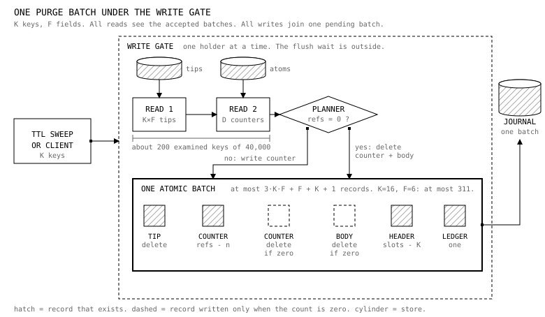

# Counter lifecycle

**Written 2026-10-19 · Status: step S1 is built in this repository (see `docs/lastdb-atom-counter.md`). Steps S2 to S8 are proposed. Sections 13 and 14 were estimates; the S1 numbers are in the pull request that added this file and in section 13.1.**

> Design decisions of 2026-10-19:
> (1) The counter alone decides whether an atom and a molecule can be purged.
> (2) The next primary starts as a fresh database. No migration. No support for a home that an older build made.
> (3) An atom stays at or below 256 KiB.
> (4) The default TTL sweep verb is `purge` (hard erase). It must be fast. It must not stall writers.
> (5) The database keeps every conflicting write (recorder M1, lastdb#179). A kept loser stays protected until the retention janitor (step S4 of the multi-device conflicts design) releases it.

Base of every fact: `EdgeVector/lastdb` `origin/main` at `fadd60ab` (after PRs #212 to #221). Paths without a prefix are under `fold_db/crates/core/src`. Runs used a `dev-release` build of that commit on fresh synthetic homes in `$TMPDIR`, `EXEMEM_ENV=dev`. No primary data was touched.

Words: schema, field, record, hash, range, key, molecule, atom, tip, file, memory, disk, flush, counter, reference count, grace window.
"Record" means one stored key and value unless the text says "record of a key".

---

## 0. Summary

1. **One counter per atom.** It lives in the source-of-truth collection `atoms`, in the same hash group as the atom body. Nothing else counts atom references.
2. **One planner.** One function computes every counter change from three inputs: the old tips, the new tips, and the changed conflict records. It runs inside the native write gate. It reads the old state from the store, never from memory.
3. **One batch.** The tip change, the counter change, the body write or delete, the molecule counters and the ledger record land in one native batch. A crash cannot split them.
4. **Delete on zero.** A batch that lowers a count to exactly zero deletes the atom body and the counter record in the same batch. No candidate queue. No grace window. No audit. No reaper.
5. **Purge is point reads plus one batch.** It reads the tips of its keys, reads the counters of their atoms, and writes one batch. No whole-schema read. No schema barrier. The cost does not follow the size of the schema.
6. **Molecule counters** (`slots`, `bindings`, `records`) live in the molecule header. A molecule family may go only when all three are zero.
7. **Blob counters** count atoms. A blob has one extra rule: a dwell after its count reaches zero, because an upload comes before the atom that names it.
8. **A verifier reports. It never deletes.**
9. **A format fence** (a new required-feature bit) makes each build refuse a home that has another counter model.

What the design removes: reverse edge records, the live count with its `exact` flag, candidate and queue records, pending holds, the audit probe, the reaper, the delete pass, the manual orphan walker, the peer-apply interlock, the manifests and completion markers, the whole-schema purge proof, the schema purge barrier. About 11,000 lines in the modules of section 15.

---

## 1. Current state

### 1.1 What the storage layer gives

| # | Fact | Evidence |
|---|---|---|
| S1 | One native request owns one pending batch. Every `batch_put`, `batch_mutate` and `batch_delete` inside the request joins it. The request publishes the batch as one journal batch. | `storage/disk_pack/kv.rs:39-52`, `transaction.rs:120-175`, `transaction/request.rs:51-99` |
| S2 | A journal batch is BEGIN, the ordered operations, COMMIT. Recovery returns a batch only after every operation and the COMMIT verify. | `docs/lastdb-disk-journal.md:10`, `:63` |
| S3 | Each operation names its collection. One batch spans collections and hash groups. | `transaction.rs:18-23`, `kv.rs` `write_target` |
| S4 | A write outside a request scope is its own batch. | `kv.rs:39-52`, `request.rs:63` |
| S5 | One exclusive gate (`write_gate`) covers prepare, stage and accept. A request holds it from scope entry to accept. The flush wait comes after the gate is free. | `queue.rs:32-46`, `request.rs:63-100` |
| S6 | Inside the gate a read sees the committed root, the earlier accepted batches and the pending batch. A read with no write owner sees only the committed root. | `read.rs:72-83`, `read/overlay.rs:1-37`, `read/raw.rs:78-90` |
| S7 | `flush()` inside a scope returns at once. A "flush as barrier" call in a scope does nothing. | `write.rs:236-239` |
| S8 | A batch holds at most 4,096 operations (older homes) or 16,384 (fresh home, feature bit 0x20), and 128 MiB. | `docs/lastdb-disk-complete-mutation-admission.md:37-45`, `transaction.rs:130-160` |
| S9 | An ordinary read call has a budget of 10,000 examined keys. A write-preparation call has 40,000. Pages (4,096), blocks (16,384) and bytes (256 MiB) are the same. The budget is one total for the whole call. An error does not reset it. | `disk_pack/mod.rs:92-97`, vendor `laststore/src/disk_pack/call.rs:26-40` and `:121-134`, `home.rs:262-272`, `read/raw.rs:46-52` |
| S10 | A memory ack returns before the flush (at most 500 ms later). A crash can lose a whole acked batch. It never keeps a part of one. | `docs/lastdb-rehydrate.md:94` |

Run proofs (appendix A):

- One durable request that created one key wrote the tip record (collection `tips`, operation 20), the count record (collection `atom_ref_edges_v2`, operation 13) and the edge record (operation 10) in **physical batch 27**. The author-clock write was batch 26. So the count is atomic with the tip across two collections.
- Four `SIGKILL` rounds under write load (240 to 360 acked mutations each, 1,440 tip records, 422 to 512 distinct atoms): after each restart, for every atom the number of edge records equalled the number of tips that name it, and a count record existed. 0 mismatches. I could not read the count value (it is encrypted), so the run proves presence and edge agreement, not the value.

**Answer to "is the count atomic with the tip?"** Yes, inside one request scope. Section 1.3 lists every path where it is not.

### 1.2 Where a count changes today

The count is `AtomLiveRefCount { live_refs, exact }` at key `aref:v2:e:<atom token>` + `\0!live-count` (`db_operations/atom_store/atom_ref_edges.rs:105`). It counts **Tip edges only**, weighted by one plus the database-catalog count of the tip's molecule (`atom_ref_edges/transitions.rs:176-258`). A TipVersion edge and a MutationHistory edge are edges only. They are not counted.

| Site | Trigger | Change | Evidence |
|---|---|---|---|
| `batch_put_items_with_atom_ref_v2` | every tip write: native job, protein sibling fold, generation activation | edge puts, then count puts, then source records, then edge deletes. The count changes only when an edge existence flips. | `transitions.rs:17-86`, `:207-258` |
| `apply_live_ref_delta` | same | absent count with an edge or a negative delta: write `{0, exact:false}` and **cancel** the candidate. Underflow does the same. | `transitions.rs:261-358` |
| `remove_molecules_keys_with_extra_and_trailing_batch` | client delete, purge, TTL purge, protein key move, dangling-tip repair | minus weight per removed tip, read from the durable tip. Header and `mgd` marker are a second batch. | `molecules/delete.rs:132-220`, `:186`, `:194` |
| `missing_atom_ref_count_items` | atom birth, and settle after the tip phase | `{0, exact}` plus a candidate pair | `atom_ref_edges/counts_pending.rs:53-109`, `atoms/write.rs:126-155` |
| `rearm_atom_gc_candidate_mutations` | body write over an old zero-count atom | new epoch, no audit | `atom_ref_gc/rearm.rs:80-145`, `atoms/write.rs:179-181` |
| `commit_catalog_atom_ref_plan` | add or remove a schema in a database catalog | plus or minus one per tip of every field molecule, from a snapshot taken at prepare | `atom_ref_edges/catalog_refs.rs:52-291` |
| reaper, delete pass | grace and audit passed | delete count record, candidate records, body | `atom_ref_gc/body.rs:13-62`, `gc_atoms_delete_steps.rs` |

Rebuild paths. The header of `atom_ref_edges.rs:1-7` says `mk:` tips and `tv:` rows are authoritative, `aref:` is a "rebuildable shadow", and "a two-pass rebuild" exists. The code does not match. `reindex.rs` holds one point-read of a manifest. The only writer of a manifest is `push_manifest_item_with_version` (`atom_ref_edges.rs:369`), and its only caller is the history upgrade `reindex_v1_upgrade.rs:55`, which acts only when a v1 manifest already exists. Nothing writes a v1 manifest. `v1_drain.rs:7` is a one-record probe. So **today the count is a derived shadow with no rebuild, and a new molecule never gets a manifest.**

### 1.3 Is the count written in the same batch as the tip? Path by path

| Path | Same batch? | Why, and what follows |
|---|---|---|
| Create, update, rewrite (one request) | **Yes** | One scope: bodies, tips, counts, edges, sibling tips, schema record in one batch (`write/native.rs:62-109`, `persist/deferred_job.rs:9-33`). The author-clock record is an earlier batch (`native.rs:57-60`). It is not a reference. |
| Client delete (native) | **Yes** | The lane job runs the whole attempt in one scope (`persist/purge_job.rs:41-46`, `protein_delete.rs:10-70`). Tips, counts and trailing edges are one `batch_mutate`; the header put joins the same pending batch (`delete.rs:186`, `:194`). The body stays. |
| Client purge, TTL purge | **Yes for tips and counts. No cleanup of the count record.** | Same scope. The body delete removes the body, locator and schema marker, but not the count record, the candidate records or the blob edges (`purge/guarded_steps.rs:269-300`). Run: after a purge the body answered 404 and the count record and a candidate record stayed (appendix A.4). |
| Mixed create and delete in one request | **No: two batches** | The request splits into erasures (lane scope) and the rest (request scope) (`write/batch_inner.rs:31-67`). Each batch is consistent. The pair is not one atomic change. `docs/lastdb-canonical-model.md:125-126` says so. |
| Protein sibling write | **Yes** | Sibling tips are staged in the same job (`deferred_job.rs:91-123`). |
| Replay of a peer Put or Delete (MutationIntent) | **Yes** | Same code as a request (`write/replay.rs:75-83`). Cloud sync is off in this build, so no run. |
| Replay of a Put that loses to a Delete barrier | **No: two batches** | Bodies and zero-count birth records first, history record and edge second (`replay.rs:214`, `:218`). |
| Conflict recorder (M1) | **Yes in a request scope** | Edges and rows are one batch and join the tip batch (`conflict_record/write.rs:46-90`). The recorder writes **MutationHistory edges, which the count does not include.** |
| Raw legacy `mk:` replay | **No** | Writes the tip with no edge and no count (`sync/engine/replay/records.rs:166-201`). Not reachable while cloud sync is off. |
| Database-catalog add or remove | **No** | Pending holds, then the catalog record, then the count batch, with a recovery registry (`catalog_refs.rs:132-291`). Two durability domains. |
| Reaper and delete pass | **No** | The decision is made outside the gate, then a separate batch deletes (`atom_ref_gc/reap.rs:92-212`, `body.rs:13-62`). See 1.4. |
| Admin repair outside a scope (dangling tips) | **No** | `batch_mutate` for rows and counts, then a header put (`delete.rs:186`, `:194`). |
| Schema store (molecule edges) | **No** | Four separate steps (`db_operations/schema_operations.rs:68-86`). |
| Physical restore of a native backup | **Yes** | The restore is the complete root (appendix A.6). |
| Restore of the legacy chunk backup | not available | The legacy list excludes `atom_ref_edges*` and no rebuild exists (`storage/laststore/backup_manifest/exclusions.rs:60-70`). The native build refuses a cloud restore. |

### 1.4 What each gate protects, and what stays necessary if the count is exact and atomic

| Gate | What it protects | Needed if the count is exact and atomic with the tip? |
|---|---|---|
| Grace window (24 h, `atom_ref_gc.rs:48`) | Order gaps. The old code wrote the body batch, then the tip batch, with a zero count in between. It also hides a false zero for a while. | **No.** One batch has no gap. A false zero is not hidden by waiting. |
| Audit (probe lap, `admin_db/gc_atoms_probe.rs:18`) | A second proof that no tip names the atom, because the count and the tip were separate writes with no durable order. It walks every tip, tv, history, conflict and atom record with a physical scan. | **No.** The batch is atomic. The audit is the one full scan in the system. A verifier that only reports replaces it (section 7). |
| Pending hold / "fold marker" (`aref:pending:v1:`) | The window of a catalog add between its holds and its count batch. Its only writer is the catalog add (`catalog_refs.rs:141-147`). After #221 no protein fold writes one (`persist/sibling.rs`, `deferred_job.rs:113`). | **No.** Catalog binding becomes one counter change (section 12). |
| Packing lock, backup cut hold (`fold_db/sync/status.rs:204-234`) | The legacy chunk backup and its packing. It returns false with no sync engine. | **No for native.** A native backup holds a complete root with a durable reference (`disk_pack/backup.rs:11-43`). It does not depend on atom deletes. |
| Peer-apply interlock (`atom_store/peer_apply.rs`) | A conflict loser that no record names. | **No.** A fresh node has the recorder from its first write (decision 10). Recorder rows hold counted references. |
| Re-arm, birth rows, `settle_atom_births` | The body-then-tip order gap. | **No.** |
| Atom stripe locks (`locks.rs:202-235`) | In-process order for read-modify-write of a count. | **No.** The gate orders everything. They also cause a lock-order risk (below). |

**Two hazards in the old gates (read, not run).**

1. *Stale decision.* The reaper reads the count outside the write gate. An ordinary read sees only the committed root (S6). A write that the node acked and has not yet flushed (up to 500 ms) is not visible. The reaper can read zero, then delete the body in its own batch after the write batch. `atom_ref_gc/reap.rs:92-212` reads; `body.rs:49-62` deletes. The re-arm and the audit narrow the window. They do not close it by construction.
2. *Lock-order inversion.* A request holds the gate and then takes the atom stripe locks (`atoms/write.rs:172`). The reaper holds the stripe locks (`reap.rs:101-106`) and then enters the gate through `batch_mutate`. If both meet on one stripe, each waits for the other. I did not reproduce this. The reaper needs a 24-hour-old audited candidate.

### 1.5 The purge paths today, and why they are slow

| Path | Reads and writes that decide a body | Evidence |
|---|---|---|
| Client delete (`delete`) | Tips only. The count falls by the weight. The body stays for the reaper. Writes a delete barrier record per field per key. | `purge/converge.rs`, `persist/protein_delete.rs` |
| Client purge (wire `purge`) | The CLI maps `purge` to `delete --must-exist` (`bin/lastdb/mutate_cmds.rs:8-20`), but the batch route passes `purge` to the hard-erasure path (run: it took the purge path and failed). | appendix A.3 |
| TTL purge | Same path with the Skip policy and a tip write-time cutoff. | `lastdb_node/src/ops/ttl_sweep/send.rs:65-94` |
| Hard-erasure lane job | Same code as above. | `persist/purge_job.rs:8-60` |

Why a purge is slow:

1. A purge needs a "cutover" proof. `atom_ref_cutover_ready` needs a manifest for every molecule (`purge/helpers.rs:225-262`). No code writes a manifest for a new molecule. So it returns false at `helpers.rs:244`.
2. So every purge takes the **guarded complement** path (`write/hard_erasure.rs:227-248`, `hard_erasure_process.rs:234-302`). Planning, on the request thread: `plan_guarded_complement_retained` loads every `mk:` record of every field and walks the chain of every retained key (`purge/bulk.rs:405-434`). In the gate: `purge_records_bulk` loads every record of every field again, collects every live atom of the schema (`guarded_steps.rs:61-85`), and holds the schema purge barrier (`hard_erasure_process.rs:246`).
3. The cost is O(fields × rows). The new native read budget (S9) turned a slow purge into a failing purge.
4. After the proof, each candidate atom costs one awaited range read (`guarded_steps.rs:194-225`). That is a serial await per atom.

Measured (appendix A.1 to A.3):

| Run | Result |
|---|---|
| TTL sweep, 6 fields, 2,400 rows (2,100 expired), default knobs, two writers | The first pass failed after 15.5 s with `read resource limit exceeded`. 0 keys erased. 2,084 keys left. |
| Same, 1,000 rows (900 expired), 480 s | 288 keys erased in 18 batches. Batch time 4.1 to 21.6 s, median 4.8 s. Of that, the whole-schema load (`materialize_ms`) was a median of 4.1 s (86 percent). The schema purge barrier was held 0.72 to 1.07 s per batch (median 0.83 s). |
| Writers during that run | To the swept schema: p50 391 ms, p95 1,245 ms, longest 15.3 s. To the **other** schema: p50 376 ms, p95 1,320 ms, longest 5.1 s. |
| Client batch of 16 keys, 6 fields, no other load, durable | update 0.40 to 0.61 s. delete 0.41 to 0.93 s. **purge: failed** with HTTP 503 `read_resource_limit` after 5.7 to 9.2 s (1,000 rows) and 14.8 to 20.3 s (2,400 rows). |
| Trace of one client purge that worked (1,000 rows) | 27,746 of the 40,000 examined keys and 93 MB of the 256 MiB byte budget. |

**Where the 40,000 examined-key budget comes from, and what else it limits.**

- It comes from `ReadCall::from_write_preparation`, `vendor/laststore/src/disk_pack/call.rs:121-134` (`keys: 40_000`). `PackRuntime::capture` selects it for every request scope with a write owner (`read.rs:72-73`). `raw.rs:46-52` also lets one batch read name up to 40,000 keys in a write scope and 10,000 outside.
- It limits **every** write request: create, update, delete and purge. All reads of the request share it: idempotency, conditions, tips, counts, edge probes, candidate reads, atom reads. It does not reset after an error.
- Outside a write scope an ordinary read has 10,000 (`disk_pack/mod.rs:92-97`). The purge planning walk runs there.
- A range read counts every examined entry, tombstones included (`call.rs:20`). I could not observe this in a receipt (section 19).
- The same call has a byte budget of 256 MiB and a page budget of 4,096.
- **The new purge must not depend on any whole-schema read, or on any read whose cost follows the size of the schema.** Its reads are bounded by the keys of the batch.

### 1.6 The molecule lifecycle today

| Stage | What happens | Evidence |
|---|---|---|
| Identity | A field gets a deterministic molecule uuid. No record is written. | `schema/types/declarative_schemas/runtime.rs:113-123` |
| Schema install | `store_schema` writes the `mref:v1:e:` schema-field edges, the schema record, a meter, then deletes stale edges. Four steps. | `db_operations/schema_operations.rs:68-86` |
| First write | The write creates the `mk:` tip records and the `mh:` header `{version, updated_at}`. No manifest. | `molecules/store/items.rs:201-236`, `molecules/load.rs:42` |
| Protein member | Three separate puts: member edge, `protein:` record, `molprot:` record. | `protein/ops.rs:103-123` |
| Slot removal | One function removes slots (section 1.2). It leaves an `mgd:v1` marker that nothing removes. | `molecules/delete.rs:132-319` |
| Whole molecule removal | **No code removes a molecule.** Schema drop writes a receipt and deletes the catalog records, but no tip and no count. The reaper execute step is refused. | `schema_store/write.rs:130-170`, `dropped_schema_reap.rs:214-219` |
| Counts | `MoleculeRefEdge` records (schema-field, protein-member, database-catalog-field) are set members, not counters. The only molecule counter is `MoleculeCatalogRefCount` at `mref:v1:c:database-catalog:<token>`, the number of database catalogs that name the molecule (`atom_ref_edges.rs:135`). No counter counts slots. | `molecule_ref_edges.rs:22-89`, `catalog_refs.rs:397-462` |
| Catalog add or remove | Loads the whole molecule (`load_molecule_per_key`) and changes the count of every atom. O(atoms in the molecule). | `catalog_refs.rs:132-149` |
| Protein membership | Never removed. A protein-bound molecule can never be reaped. | read of `protein/ops.rs`, `dropped_schema_reap/walk.rs:306-310` |

### 1.7 Every way an atom gets a reference

| Reference | Counted today | Edge today | Counted in the new design |
|---|---|---|---|
| Tip record of a molecule | Yes (weighted) | Tip | Yes, plus one per tip |
| Protein sibling tip | Yes | Tip | Yes, one per sibling tip |
| Conflict record (history, conflict) | **No** | MutationHistory (v2 or v1) | Yes, one per distinct atom per record |
| Suppressed Put record | No | MutationHistory | Yes |
| `tv:` chain | No | TipVersion | **Gone.** Current writes make none. |
| Pending hold (catalog add) | No (hold only) | none | **Gone** |
| Atom to blob | blob edge `bref:v1` | atom to blob | Blob counter counts atoms |
| Database catalog | weight | `mref` | **Molecule `bindings`**, not atom weight |
| Delete barrier (`displaced_atom_uuid`) | No | none | No. It holds a stamp, not a body. |
| Retired intent | No | none | Cloud only. Out of scope. |
| Generation base, `mgd` marker | No | mirrored | Out of scope. See 16. |
| `keep_small` meters | No | none | No. A gauge, not a reference. |

`as_of` queries are refused (`schema/logical_rules.rs:43`). No history exists to reference. Writes make no `tv:` or history record (`docs/lastdb-rehydrate.md`).

### 1.8 Defects found while reading

| # | Defect | How I know |
|---|---|---|
| D1 | A purge leaves the count record and a candidate record for each erased atom. | **Run** (A.4). I did not wait 24 hours to see whether the reaper removes them. The audit walks bodies, and the body is gone. |
| D2 | A client delete leaves the body. Disk returns only after the reaper. | **Run** (A.4): after `delete`, the atom still answered 200. |
| D3 | `cloud_purge_peer` commits a catalog **removal** with the add function. Counts go up. | Read: `sync/cloud_purge_peer/scope/hygiene.rs:47-48`, `catalog_refs.rs:189-194`. |
| D4 | An "unknown" count cancels its candidate. The atom then leaks with no way back. | Read: `transitions.rs:334-358` calls the candidate planner with `after = u64::MAX`, which deletes the candidate. |
| D5 | The count does not include conflict records. Their atoms stand on an edge and the audit. | Read: `transitions.rs:41`, `:188`, `:216`. |
| D6 | The replay path for a Put lost to a Delete writes the atom and the history in two batches. | Read: `replay.rs:214`, `:218`. |
| D7 | The stale-decision and lock-order hazards of 1.4. | Read. Not run. |
| D8 | `mgd:v1` markers, one per removed slot, are never removed. | Read: `molecules/delete.rs:308-319`, `docs/lastdb-ttl-sweep.md`. |
| D9 | The old header and `docs/lastdb-atom-refcount-grace-window-gc.md` describe a rebuild and a fold marker that do not run. | Read (1.2, 1.4). |
| D10 | The client `purge` verb fails at 1,000 rows. The hint says "request fewer records or fields", which is wrong. | **Run** (A.3). |

A helper read also reported over-counts from an edge deactivation that uses the in-memory tip, and a catalog count that moves without a tip edge. I read the catalog code and agree it takes a snapshot at prepare. I did not check the first claim myself.

---

## 2. The rule

> **The counter is the only authority.** An atom body, a blob, or a molecule may leave the store only when its counter is exactly zero, read inside the same write-gate hold as the batch that removes it.
> No other structure may authorize a delete. No other structure may block one.

Consequences:

- No reverse edge. No audit. No candidate queue. No grace window. No reaper.
- A decision outside the gate is not a decision.
- A decision from memory is not a decision. A decision from a read that did not see the accepted batches is not a decision.
- Where the counter says "not zero", the object stays. Where the counter is absent or lower than a removal needs, the object stays and the case is reported (section 7).

---

## 3. The invariant

For every scope `S` (personal, an org database prefix, a share prefix) and every atom `A`:

- **I1 (exact).** `refs(S, A)` equals the number of tip records in `S` that name `A`, plus the number of conflict records in `S` that name `A` (one per distinct atom per record).
- **I2 (body).** The atom body record exists if and only if the counter record exists. A counter record never holds zero. The batch that makes it zero deletes it.
- **I3 (justified decrement).** A batch lowers `refs(S, A)` by `k` only if the same batch removes `k` references to `A`. The batch reads each of them from the store in the same gate hold.
- **I4 (never low).** The stored count is never lower than the true number of references. I1 gives this at every batch boundary.

Why I1 holds. Every change of a tip record or a conflict record goes through the planner (section 5). The planner reads the old state inside the gate (S6). The batch is atomic (S1, S2). So each batch moves the pair (references, counter) from one equal state to another. A crash keeps a prefix of whole batches (S10). I propose to enforce the "only the planner" rule with a lint on the module boundary: only the planner module may write `mk:` records, conflict record keys, or counter records. This is a source check, not a proof of the live result.

A count too high only leaks. A count too low loses data. Neither can come from a crash. Only a bug in the planner can cause either.

---

## 4. Where the counters live

Four questions decide the layout. The answers:

**Inline or sidecar?** Neither the old sidecar nor a field inside the atom body.

- Today the counters are sidecar collections that the code classes as derived and rebuildable: `aref:v2:*` to `atom_ref_edges_v2`, `mref:v1:*` to `molecule_ref_edges`, `bref:v1:*` to `blob_ref_edges`, other `aref:` to `atom_ref_edges` (`mini_cutover/main_keys.rs:57-63`, `plane_roles.rs:130`). The legacy backup excludes them (`exclusions.rs:60-70`). Capture skips them (`sync/policy.rs:85-113`). A single authority cannot sit there.
- The body is immutable and content-addressed. A change of a count must not rewrite a 256 KiB body.
- **Chosen:** a small **counter record in the source-of-truth collection `atoms`, in the same hash group as the body.** Body key `atom:<uuid>\0b`. Counter key `atom:<uuid>\0c`. Both share the placement prefix `atom:<uuid>\0`, so one hash group holds both. A purge touches one group for each atom instead of two. The fresh database allows the key change (decision 2). Today's body key has no NUL, so it hashes alone.
- Why in `atoms`: body and counter appear and vanish together (I2). One range read shows both. The class is source of truth, so backup, restore and snapshot include it.

**What do backup, restore and replay do with it?**

| Event | Rule | Evidence |
|---|---|---|
| Native local backup | Copies every file of one complete root. Counters travel. | Run A.6: the bundle held the same count and edge records as the source. `vendor/laststore/src/disk_pack/backup/mod.rs:40-60` has no collection filter. |
| Native restore | Builds a new root from the bundle with no source. Counters are inside. | Run A.6: `lastdb-disk-recovery restore` gave the same records. |
| Peer replay | A node derives its own counters by applying each mutation through the planner. The counter record is node-local like the tip. Tips are also on the capture skip list (`sync/policy.rs:85-113`). A counter never goes on the wire. | Rule. Add the counter key family to the skip list. |
| Cloud snapshot (Layer 3, not built) | A root bundle. Counters inside. | Rule for Layer 3. |
| Legacy chunk backup | Not used. Delete the exclusion entries. | |

**Do the edge records still need to exist?** No.

What we lose without them:

| Lost | Effect | What replaces it |
|---|---|---|
| The audit | None. The audit is gone by decision. | The verifier (section 7). |
| A rebuild of the count from edges | None. There is no rebuild today (1.2). | An offline `recount` repair that walks tips and records. It is the one scan we keep, and no gate uses it. |
| Finding the referrers of an atom (`lastdb liveness explain atom`) | Real loss. The command reads v1 edges and shows nothing on a native home (run A.4 note). | It shows the count and the body. A referrer list needs the offline walk. |
| Set semantics (a retry cannot add twice) | Replaced. The planner computes a delta from the old tip it reads in the gate. The same write twice gives delta zero. | State-based deltas. |
| Debugging | Less visible. | Counter value in `lastdb db inventory` and `status`. |

**What happens to the rebuild paths and to `exact`.** `reindex.rs` (a manifest read), `reindex_v1_upgrade.rs` (the history upgrade) and `v1_drain.rs` (a v1 probe) go with the manifests (section 15). They gate nothing in the new design. The `exact` flag goes. A count is exact by I1, so a stored "inexact zero" has no meaning. The one abnormal state is the `suspect` flag on the counter record (section 5, underflow rule). It never authorizes a delete. The one rebuild left is the offline `recount` (section 7), which no gate uses.

What we gain: about 290 bytes for each edge on the old primary (`status_ops_cmds.rs:222`: 936.7 MiB for 3.36 million edges), one write and one read less for each tip change, and no way for an edge and a count to disagree (defects D3, D4 and the list of defects in section 1.8).

**Which objects get a counter?**

| Object | Counter | Where | Counts |
|---|---|---|---|
| Atom | `refs`, `blobs` (list of blob refs), `suspect` flag | `atom:<uuid>\0c` in `atoms` | tip records and conflict records that name the atom |
| Molecule | `slots`, `records`, `bindings` | the `mh:{M}` header, collection `tips`. The write already rewrites the header. | `slots`: live tip records. `records`: live conflict records. `bindings`: schema-field, protein-member and database-catalog bindings. |
| Blob | `refs`, `zero_since` | next to the blob record | atoms whose counter lists the blob |
| Conflict record | none of its own | rows `history`, `conflict`, `mcc`, `hcu` plus a slot directory record | It **holds** one reference per distinct atom it names. |

The counter record format: `AtomCounter { v, refs: u64, blobs: Vec<String>, suspect: bool }`. The `blobs` list lets a delete know the blob refs without a read of the body. The size is at most 100 bytes of value before encryption.

---

## 5. The write rule for each reference type

All rows run inside the gate (S5). "Read" means a batch read by key, with the accepted view (S6).

| Reference type | Read | Write in the same batch |
|---|---|---|
| **Tip write** (create, update, rewrite) | old tip record of each changed slot; counter of each distinct old and new atom; headers | New slot: tip put, `slots+1`. Same atom: nothing. Replaced: `refs(old)-1`, `refs(new)+1`. New atom: counter record with its body (or counter+1 if it exists). Old atom at zero: delete its body and counter, and decrement its blobs. Header bump. |
| **LWW loser** (an incoming write that loses) | the durable tip; the decision is made before the planner | No tip change, no counter change, no body. The recorder (below) may keep the loser. |
| **Delete, purge, TTL** | tip record of each slot; counters of their atoms | Tip delete, `slots-1`, `refs-1` per slot, delete on zero. Purge writes no delete barrier. Delete writes its barrier. Ledger record. |
| **Replay** of a peer Put or Delete | same as a request | same as a request. Applying the same mutation again gives delta zero. |
| **Recorder row** (M1 Replaced or Dropped) | history record key (does it exist?); counters of the named atoms; molecule header | If the record is new: `+1` for each distinct atom it names, `records+1`, the record rows, the slot directory record, the queue record. If it exists: nothing. The loser body is written if absent. |
| **Janitor release** | the record rows (history record gives the atoms); counters | Delete the record rows, `-1` for each distinct atom, `records-1`, delete on zero. |
| **Protein sibling write, delete, key move** | tip of each sibling slot (found inside the gate from the protein list) | The same tip rules for each sibling molecule. One batch with the source. |
| **Blob** | blob counter; atom counter's `blobs` list | New atom with blob refs: `blob.refs+1` each. Atom deleted on zero: `blob.refs-1` each. At zero the blob gets `zero_since`. See 12. |
| **Catalog bind or unbind** | molecule header | `bindings±1` with the binding record. No atom change. |
| **Restore** (native) | none | none. The root is the state. |

The planner is one function:

```
plan(scope, old_tips, new_tips, record_adds, record_removes) ->
    counter puts, counter deletes, body puts, body deletes,
    blob counter puts and deletes, molecule header deltas
```

It aggregates per atom first. Sixteen purged keys that share one `bucket` atom give one delta of minus sixteen. It runs after the LWW decision, the recorder decision and the sibling expansion. It may run once for each job in a request. Each run reads the staged state of the earlier jobs (S6), so the result is exact.

**Underflow rule.** If a delta is larger than the stored count, or the counter is absent while a body exists, the planner does **not** delete the body. It removes the tip as asked. It writes `suspect = true` on the counter. It reports the event in the status. It does not clamp the count to zero and delete.

---

## 6. The purge algorithm



Input: a schema, K keys, a verb (purge or delete), a policy (Refuse or Skip), an optional tip write-time cutoff (TTL, Hash and Single schemas).

**Before the gate (no store lock, metadata only):** resolve the schema, its fields, the molecule of each field, the storage form of each key (`storage_form_keys`, `purge/helpers.rs:68`), the protein member list. Cost: O(F × K). No store read of the schema.

**In the gate, one request scope:**

1. Re-resolve protein peers from the store (as `current_delete_targets` does, `protein_delete.rs:60-90`). A move or write cannot change them before the batch publishes.
2. **Read 1** (one batch read): the tip record of every (field, key, peer slot). Count: K × F plus peers. A key with no tip is "absent": refuse (Refuse) or drop (Skip).
3. TTL guard: compare each tip's `written_at` with the cutoff. A newer tip drops the key from the batch. The tip record is already in memory, so the guard costs no read.
4. **Read 2** (one batch read): the counter record of each distinct atom named. Count: at most K × F.
5. **Read 3:** the molecule headers (F), and, for a molecule whose `records` is above zero, the slot directory of each removed slot (section 10).
6. Run the planner. Stage one batch: delete the tip records, write or delete the counters, delete the bodies of zero-count atoms, write the headers, one ledger record, the retention index change (TTL), and the Search outbox delivery as an after-commit action.
7. Accept the batch. Release the gate. Wait for the flush (the verb is durable) outside the gate.

**Delete** and **overwrite** use the same planner. The only difference of `delete` is the delete barrier records it writes.

**Chunking.** A batch holds at most `ops_limit` operations. The first estimate was `3·K·F + F + K + 1`. It undercounted, because each tip also costs a `mgd` marker, and a delete writes a barrier row. The S1 build measured 3.8 to 4.0 operations per tip for a purge and 4.8 to 5.0 for a delete (every atom unique). The code uses the upper bounds `4·K·F` (purge) and `5·K·F` (delete), plus `F + 8` for each chunk of 64 keys (`fold_db_core/purge/budget.rs`). The reads of the request share the budget of 40,000 examined keys (R13); they cost 9 to 12 for each tip, so the code bounds them at `12·K·F` and `13·K·F`. A request that either bound puts over its limit is refused before it takes the gate, with the number of keys that fits. The sweep sets K from the same bound, and it halves a batch that still hits a size limit. The key is the unit: all fields of one key go in one batch. A purge of more keys than K is several independent batches. Between two batches the state is valid (section 8).

**No lock beyond the gate.** The schema purge barrier, the molecule write locks of `acquire_purge_apply_guards` (`hard_erasure.rs:253-270`), and the atom stripe locks go. The gate orders all writers. The TTL sweep keeps its maintenance admission, which stops a backup cut from starting inside a batch (`ttl_sweep/erase.rs:109-117`).

---

## 7. The delete rule for a body, and what replaces the audit

**Rule.** The batch that takes `refs` to exactly zero deletes, in the same batch: the body record, the counter record, and the blob references (each blob count minus one). Zero is read in the gate. There is no dwell for atoms.

Why no grace window for an atom:

- The grace window covered an order gap (body batch, then tip batch) and a count that might be wrong. The first is gone (S1). The second is handled by the underflow rule and the verifier, not by a wait. A wait does not make a false zero true.
- A reader keeps the root it captured (`read.rs:72`). A body delete in a later batch does not break an open read. A file stays while a call holds it (`docs/lastdb-disk-file-lifetime.md`).
- A backup holds a complete root with a durable reference (`disk_pack/backup.rs:11-43`). It does not depend on a body that a later batch deletes.
- A purge is an erasure. It must not wait 24 hours.
- A peer's replay carries values, not atom ids. It does not need a body that this node deleted.

**What replaces the audit.** Nothing that deletes.

| Check | Who runs it | What it does |
|---|---|---|
| Underflow and absent-counter refusal | The planner, every batch | Keeps the body, marks `suspect`, reports. |
| `lastdb db verify-refs` | An operator or a routine, on request | Reads tip records one hash at a time with a cursor, groups by atom, reads counters. It checks `refs ≥` the tips it saw, that every tip's atom has a body and a counter, and that every counter has a body. **It writes nothing and deletes nothing.** The status shows the last result and the count of `suspect` atoms. A full exact check needs one complete pass. It is off by default. |
| `lastdb db recount` (offline, stopped node) | An operator after a verify failure | Rebuilds every counter from tips and records. It is the only scan. No gate uses it. |

I do not keep a periodic verifier in the node. A routine may call `verify-refs` (decision Q9).

**Alternative I reject (Q1).** Keep a short dwell: a zero count writes a candidate with an epoch, and a reaper deletes after the dwell. It keeps a queue, a reaper and a page of rules. It does not protect against a wrong count, because the reaper has no second proof. I recommend delete on zero.

---

## 8. Crash analysis

Every state after a crash is a prefix of whole batches. I1 holds in each such state, because each batch keeps I1 (section 3).

| Crash point | State on disk | Safe because |
|---|---|---|
| Before accept (in the gate) | no change | nothing was written |
| After a memory ack, before flush | the batch is lost whole | a lost batch is the same as a write that did not happen. The client was told "queued". Existing contract (S10). |
| During the journal append | no complete batch | recovery returns only complete batches (S2) |
| After COMMIT, before `CURRENT` is published | recovery completes the batch | complete batch |
| After batch N of a multi-batch job (TTL pass, mixed request, janitor page, molecule drain) | batches 1..N applied | each batch is valid alone. The keys of one record are in one batch. |
| Between the author-clock batch and the data batch | the clock moved, no data | harmless. The clock only grows. |
| After a blob upload, before the atom | an unreferenced blob | the blob dwell (section 12) |
| After the Search outbox or meter write | outbox or meter ahead | not a reference. Rebuildable. |

**A leak cannot come from a crash. A loss cannot come from a crash.** A leak or a loss comes only from a bug in the planner or a writer that bypasses it.

What can still go wrong, and who sees it: a write path that skips the planner (the lint), an arithmetic error (the underflow rule and the verifier), a corrupt counter record (the verifier, `recount`).

---

## 9. Restore, backup and cloud sync

- **Counters travel with the data in every physical copy.** Run A.6: a native local backup copied 176 files, 2.9 MB, and the bundle had the same count and edge records. `lastdb-disk-recovery restore` built a new root from the bundle with the same records.
- **No rebuild by scan on restore.** The restored root is the state.
- **Peer replay builds its own counters.** The counter is derived by the write rule from the logical mutations, like the tip record. The capture skip list carries the counter key family (`sync/policy.rs:85-113`). A snapshot and a log tail replay give the same counters as live writes, because replay uses the same planner.
- **Cloud sync is off in this build** (`docs/lastdb-rehydrate.md`: startup refuses it). Layer 3 must keep two rules: (1) a cloud snapshot is a root bundle; (2) a log replay goes through the planner. A purge must write its cloud retirement record in the same batch (`retired_intent_retention.rs`). I did not design Layer 3.
- **No more `peer-apply` row, `.peer_derived` marker, `fresh-home` stamp, completion markers, manifests.** The format fence replaces them (section 17, S1).

---

## 10. Multi-device

Decision 5: the database keeps every conflicting write until the retention janitor releases it.

**Recorder rows hold counted references.** M1 writes, for one pair, a history record, a conflict record, an `mcc` entry, an `hcu` event and compact edges for the atoms of the history record (`conflict_record/write.rs:46-147`, `atom_ref_edges.rs:310`). The edges are not counted today (D5). In the new design the recorder goes through the planner:

- New record: `+1` for each distinct atom the history record names (`new_atom_uuid`, `old_atom_uuid`, `conflict_loser_atom`), `records+1` on the molecule header, and the record rows, in the same batch as the tip decision and the body write.
- Repeat of the same decision: the key is a digest of the pair (M1 contract 9.4). The planner reads the history record key first. If it exists, nothing changes.
- The loser body is written in the same batch if absent. The old "body batch, then record batch" order is gone.
- This matches the M1 contract, which keeps both atoms of a Replaced record. Q5 asks whether to keep only the loser.

**Replay of a peer purge or delete.** The peer applies it through the planner: it reads its own tips, removes the slots, decrements counters. A key the peer does not have is dropped under Skip.

**Release by the janitor (S4).** The janitor reads a page of its time queue `aref:cr:v1:q:{expires_at}:{digest}`, reads the history records of the page, and in one batch deletes the record rows, decrements each atom, lowers `records`, and deletes bodies at zero. It never deletes an atom directly. The counter is the only gate. A kept loser leaves only when its last record reference is released.

**Q4 (accepted 2026-10-14): purge and delete of a key end the retention of its losers.** A history record has no key index today. M1 keys records by molecule, time and digest. So a purge by key cannot find the records of that key without reading the molecule's history. Design: S4 writes one **slot directory record** for each conflict record, `crs:{M}:{hash}\0{range}\0{digest}`, in the same batch. The molecule header `records` count says whether any exist. A purge reads the slot directory (one range read under one hash) only for a slot of a molecule with `records > 0`. It then releases those records in the same batch. A molecule with no records pays nothing. Without this index a purge would leave the personal data of the key in a loser atom for the whole window. That would break the erasure promise.

**No more interlock.** A fresh node has the recorder from its first write (decision 10). The `peer-apply` gate and the `stranded_before_recorder` case are not needed.

---

## 11. Protein siblings

- A sibling molecule holds its own tip records for a shared atom. Each is one reference (`protein/ops/tip.rs:45-82`, `persist/sibling.rs:6-18`).
- A write stages the sibling tips in the same job (`deferred_job.rs:113-123`). One batch holds the source tip, the sibling tips and every counter change.
- A delete resolves peers inside the gate (`protein_delete.rs:60-90`). It removes the sibling tips in the same batch.
- A purge today expands only HashRange peers (`write/hard_erasure.rs:24-29`, `erasure.rs:88-160`). A sibling tip of another kind survives. With counters the body stays because the sibling tip holds a reference. No dangling tip. **No loss, but the record is not erased everywhere.** Q7 asks what a purge must do for a Hash sibling.
- The PR 211 review finding "protein sibling bodies" disappears. A sibling tip is a counted reference. Nothing proves "no sibling" any more.

---

## 12. Molecules and blobs

**Molecule counters** (in the `mh:{M}` header):

| Counter | Rises when | Falls when |
|---|---|---|
| `slots` | a tip record for a new key is written | a tip record is removed |
| `records` | a conflict record is written | a conflict record is released |
| `bindings` | a schema field binds the molecule; a protein adds the molecule as a member; a database catalog names it | the reverse event |

**When a molecule may be purged:** `bindings == 0` **and** `slots == 0` **and** `records == 0`. Then one batch deletes the header, the order log records (`mord`, `moc`), the `mgd` markers, and the molecule key wrap. The counter is the only test.

**Catalog bind and unbind** become one counter change and one binding record in one batch. No atom is touched. The weight (1 plus catalog count) goes. The atom counts only tips. A slot in a shared molecule is shared by every database that binds it, so a delete removes it for all. That is the same final effect as today's weight. The prepare registry, the pending holds and the O(molecule) walk go (`catalog_refs.rs`).

**Drain.** A molecule with `bindings == 0` and `slots > 0` is dead but full (a dropped schema). No code removes such a molecule today. To remove it we must enumerate its tips. LastDB has no scan, and `mk:{M}:` spans many hash groups. So a **drain** uses a resumable cursor like `dropped_schema_reap/walk.rs`. Each step is one batch: up to N tip records of one hash group, their atom decrements, `slots-N`. When `slots == 0` and `records == 0` the last batch removes the molecule. The counters give the start test, the progress and the completion proof. This is a background job on a dead molecule only. It is step S7 and optional (Q8).

**Blob counters.** The blob record has `refs` and `zero_since`. An atom with blob refs lists them in its counter record. When the atom is created, each blob gets `refs+1`. When the atom is deleted on zero, each blob gets `refs-1`. At zero the blob gets `zero_since = now` and a record in a small blob queue. A blob is deleted only when `refs == 0` and `zero_since` is older than the blob dwell, read in the gate.
The dwell exists for one reason: an upload comes before the atom that names it (`file_blob_gc.rs` race notes, 600 s guard). A blob with no atom yet is not a bug. Two uploads of the same bytes share one blob. So a blob alone needs a dwell. Q4 asks for the length. Today `gc-file-blobs` scans two planes (`file_blob_gc/sweep.rs`). The queue replaces the scan.

---

## 13. Cost model

K keys, F fields, D distinct atoms (D ≤ K·F), P protein peers (0 here).

| | Today (guarded purge) | New |
|---|---|---|
| Reads by key | tips of the whole schema, twice (planning and gate), each `tv:` probe, the history records of each molecule, one range read per candidate atom, the live head set | K·F tip records, D counter records, F headers |
| Examined keys in the gate | 27,746 for K=16 on 1,000 rows (measured, A.3). More with more rows. Over 40,000 near 2,400 rows. | about 2·K·F plus F. For K=16, F=6: about 200. |
| Bytes charged | 93 MB (measured) | about 60 KB (96 tip records of about 400 B plus 96 counters of about 150 B) |
| Writes (operations) | tip deletes, edge deletes, count puts, candidate puts, body, locator and schema-marker deletes, headers, `mgd` markers, ledger begin and commit, schema store | at most 4·K·F + F + 8 for a purge (5·K·F for a delete). K=16, F=6: at most 398 (measured 364). |
| Batches | several (edges, rows, bodies, schema) | **one** |
| Serial awaits | one per candidate atom | none. Reads are batched. |
| Locks | schema purge barrier, molecule locks, stripe locks, the gate | the gate |
| Cost follows | schema size | batch size |

Time (estimate, written before the S1 build). The same host measured a durable batch of 16 keys by 6 fields: update 0.40 to 0.61 s, client delete 0.41 to 0.93 s (A.3). Those are the nearest relatives of the new purge. I expected 0.4 to 0.8 s.

### 13.1 Measured in step S1

The S1 build ran on fresh synthetic homes (`dev-release`, `EXEMEM_ENV=dev`).

| Measure | Result |
|---|---|
| Operations per tip, purge, 16 keys, every atom unique | 3.8 at 6 fields, 4.0 at 24 fields |
| Operations per tip, delete, same case | 4.8 at 6 fields, 5.0 at 24 fields |
| Operations per tip when the atoms are shared | 2.3 to 2.5 (purge), 3.3 to 3.5 (delete) |
| Purge of 64 keys of a 24-field schema (1,536 tips) | 6,046 operations in one batch, gate hold about 250 ms, 0.8 to 0.9 s from the client |
| TTL sweep, 6 fields, 2,400 rows, 2,100 expired, two writers | all 2,100 erased in 557 s; a batch of 16 keys takes 0.70 s at the median and 3.5 s at most; the gate hold of an erase request is 42 ms at the median and 130 ms at most |

The estimate of section 13 undercounted the operations and the reads (see the chunking rule in section 6). The median batch time is inside the 0.4 to 0.8 s expectation, and the longest batch is above the 2 s target.

---

## 14. Effect on the TTL sweep

| | Today (1,000 rows, measured) | New (expected) |
|---|---|---|
| Batch of 16 keys | median 4.8 s (4.1 to 21.6 s) | 0.4 to 0.8 s. Target: well under 2 s. |
| Fails at | about 2,400 rows | no size limit from the schema. Limit from K·F: one request holds up to 16,384 operations (4,096 on an older home). A purge fits 553 keys of 6 fields or 138 keys of 24 fields (168 and 42 on an older home). A delete fits 511 and 128 (135 and 33). |
| Schema purge barrier | 0.72 to 1.07 s per batch | **none** |
| Gate hold per batch | not measured | reads of about 200 keys plus staging. Expected under 300 ms. Target under 1 s. |
| Writers during the sweep | other schema: longest 5.1 s | one gate hold plus the flush wait, which is outside the gate |

What lock or barrier remains and why:

1. The **native write gate** (S5). It orders all writers on the node. It is needed for the exact read-modify-write of counters. The sweep holds it for the prepare and stage phase of one batch. The flush wait comes after.
2. The sweep's **maintenance admission**. It lets a backup cut wait for a running batch, so a cut never starts inside a batch.

Both stay. The schema purge barrier, the molecule write locks and the atom stripe locks go.

The sweep batch size becomes a function of F (section 6). The default 16 stays for F up to 24 (at most `4·16·24 + 32 = 1,568` operations for a purge; measured 1,534). The duty and rest knobs stay.

---

## 15. Code that goes

The count is lines in the named files and directories on `fadd60ab`. The compiler cascade and a zero-reference scan set the true list at each step (`CLAUDE.md` dead-code rule).

| Group | Files | Lines |
|---|---|---|
| Reverse edges, manifests, rebuild, v1 drain, `exact`, catalog pending plan | `db_operations/atom_store/atom_ref_edges.rs`, `atom_ref_edges/*` | 2,177 |
| Candidate queue, reaper, re-arm | `atom_ref_gc.rs`, `atom_ref_gc/*` | 1,171 |
| Audit probe, delete pass, orphan walker | `admin_db/gc_atoms_probe*.rs`, `gc_atoms_delete*.rs`, `gc_orphans.rs`, `gc_orphans/*` | 2,254 |
| Automatic gc cadence, status, settings | `fold_db_core/sync_coordinator/gc_atoms.rs`, `gc_atoms/*`, `atom_reclaim_janitor.rs` | 2,122 |
| Peer-apply interlock, fresh-home markers | `atom_store/peer_apply.rs`, `fresh_home_edges.rs` | 396 |
| Molecule edges, blob edges | `molecule_ref_edges.rs`, `molecule_ref_edges/*`, `blob_ref_edges.rs` | 730 |
| Tip-version backrefs, chain walk, target chain, whole-schema proof, storage-slot purge | `tip_version_backrefs.rs`, `purge/chain_walk.rs`, `target_chain.rs`, `core_live.rs`, `storage_slot*.rs`, the guarded parts of `bulk.rs`, `guarded*.rs` | about 2,500 |
| Others | `atom_ref_cutover_ready`, `plan_guarded_complement_retained`, `schema_purge_barrier`, atom stripe locks, `LASTDB_GC_ATOMS_*` knobs, `lastdb db gc-atoms`, `gc-file-blobs` scan | not counted |

Total about 11,000 lines. Replaced by: the counter record type, the planner, the molecule header fields, the blob queue, the verifier, `recount`. I expect fewer than 1,500 new lines. This is an estimate. S1 gives the first real number.

---

## 16. Risks

| # | Risk | Mitigation |
|---|---|---|
| R1 | The planner has an arithmetic error. The count goes low. Data is lost. | One planner. The underflow rule refuses a delete. `verify-refs`. A lint for the writer boundary. Run proofs of section 17 that read the raw records. Two independent reviews. |
| R2 | A write path bypasses the planner. | The lint. The reviewer reads every call site of the stores that write `mk:`, conflict and counter keys. |
| R3 | The body key change touches every reader of an atom. | One codec (`atom/atom_key_codec.rs`). The fresh database has no old key. Review lists every reader. |
| R4 | The gate hold grows with the batch. | Chunk by the operation budget (section 6). Measure the hold in S1. |
| R5 | A hot shared atom (one value for 2,400 keys) is rewritten by every batch that touches it. | One small record per batch, after aggregation. The gate already serializes writers. |
| R6 | We lose the referrer list. | Counter in `inventory`. Offline walk. Q3. |
| R7 | The slot directory (Q4) adds a record for each conflict record. | About 100 bytes. Paid only by a conflicted slot. |
| R8 | The blob dwell leaves bytes for a while. | A short dwell. Q4. |
| R9 | A purge does not reach a Hash protein sibling. | Q7. The counter keeps data safe either way. |
| R10 | Old defects stay: `mgd` markers grow, delete barriers grow. | Out of scope. Named here so no reader thinks this design fixes them. |
| R11 | Two builds with two counter models open one home. | The format fence (S1). |
| R12 | A request with many fields exceeds the operation limit. | Refuse before the gate with a clear limit error. Chunk by key for erasure. |
| R13 | The in-gate read budget (40,000) limits K·F. | The estimate of 2 examined keys per tip was wrong. The S1 build measured 9 to 12 (target tips, peer expansion, counters, bodies), so the budget binds at about 3,300 tips (138 keys of 24 fields for a purge). The size check refuses early, and the sweep halves a batch that hits the limit. |

---

## 17. Implementation plan

Rules for every step: small pull request; the existing gates (format, lint, build, secret) pass; **no test code** (this repository has no tests); run-proof on a fresh synthetic home from a build of the branch, `EXEMEM_ENV=dev`, `lastdb status` names the home before the first write; two independent reviews by readers who did not write the code and who get the code and not the conclusion; the pull request body carries the proof receipts.

| Step | Change | Independent review plan | Run-proof |
|---|---|---|---|
| **S1 Counter and planner** | Format fence (next free required-feature bit). `AtomCounter` in `atoms`. Body key `atom:<uuid>\0b`, counter `\0c`. The planner. Tip write, delete, purge, TTL purge and protein siblings go through it. Delete on zero. The underflow rule. The writer-boundary lint. The purge algorithm of section 6. **Removes in the same PR:** tip and history edges, the live count, candidates, queue, birth, re-arm, settle, atom stripe locks on counters, manifests, markers, the whole-schema proof, the schema purge barrier. | R1: read the planner against I1 to I4 and list every write of `mk:`, conflict and counter keys. R2: read the batch composition, the operation budget and the gate hold. R3: list every reader of an atom body key and prove each moved. | (a) Matrix on a fresh home: create, rewrite same value, rewrite new value, delete, purge, shared atom (many keys one value), purge of the last holder. After each step read the raw counter records with `lastdb-disk-home` and compare with the tips from queries (the harness of A.5). (b) `SIGKILL` loop with mixed writes and purges, as A.5. (c) The TTL doc setup: 6 fields, 2,400 rows, 2,100 expired, two writers, default knobs. All 2,100 erased. Batch time, gate hold and writer latency recorded and compared with section 14. (d) A purge of 64 keys of a 24-field schema. (e) Atom read by id: 404 after the last holder is purged, 200 while one holder remains. (f) Backup, restore, same invariant. |
| **S2 Remove the audit machinery** | Delete the probe, the reaper, the delete pass, the orphan walker, the cadence, the status fields, the knobs, the peer-apply row, `gc-atoms`. Rewrite `docs/lastdb-atom-refcount-grace-window-gc.md`. | Compiler cascade and zero-reference scan. Reviewer greps for each removed name and each env knob. | `lastdb status` has no gc block. Daemon starts and stops clean. Rerun S1 (a) to (c). |
| **S3 Recorder through the planner, janitor, Q4** | Recorder writes counted references, `records` counter, slot directory, queue record. Janitor S4 with a release batch. Purge reads the slot directory. | R1: crash order of the recorder. R3: the janitor deletes records and references only, never an atom directly. A third reader checks that a purge releases the losers of its key. | The two-home proofs P1 to P10 of `design-lastdb-multi-device-conflicts.md` 4.2 with a short window. A purge of a conflicted key leaves no loser body and no record. |
| **S4 Molecule counters** | `slots`, `records`, `bindings` in the header. Catalog bind and unbind O(1). Remove the `mref` edges, the catalog weight, the prepare registry and the pending holds. | Read every writer of a binding. | Bind and unbind a catalog on a 2,000-key molecule: constant cost. Atoms untouched. |
| **S5 Blob counters** | Blob counter, `blobs` list in the counter record, blob queue and dwell. Remove `bref` edges and the `gc-file-blobs` scan. | Read the upload and reference race. | Upload a blob, write the atom after the dwell starts, purge, read the blob. Two atoms share a blob. |
| **S6 Verifier and recount** | `lastdb db verify-refs`, status fields, offline `recount`. | The reviewer checks that nothing in the verifier writes except the report. | Corrupt a counter on a stopped synthetic home (lower, higher, missing). The verifier reports each. `recount` fixes. The planner keeps a body on underflow. |
| **S7 Molecule drain** (optional, Q8) | Resumable drain of a dead molecule. | Read the cursor and the batch. | Drop a schema of 5,000 keys. Counters reach zero. The molecule family is gone. |
| **S8 Cleanup** | Remove dead modules the cascade exposes. Update the canonical model doc and the TTL doc. | Zero-reference scan. | Full build, lint, run S1 (a) once more. |

S1 is the one large step. I could not split it, because the planner replaces the edge machinery and the old purge needs the edges.

---

## 18. Decisions

| # | Question | Recommendation |
|---|---|---|
| Q1 | Delete a body in the same batch that takes its count to zero, for overwrite and client delete too? Or keep a dwell and a queue? | Same batch. A dwell adds a queue and a reaper and no proof. |
| Q2 | Change the atom body key so the body and counter share one hash group (`atom:<uuid>\0b`, `\0c`)? Retire the partition-prefix layout and the locator record? | Yes. The database is fresh. It halves the groups a purge touches. |
| Q3 | Accept that `lastdb liveness explain atom` can no longer list referrers? | Yes. It shows nothing useful on a native home today (A.4). An offline walk can list them. |
| Q4 | How long is the blob dwell? Is blob deletion by counter in this round? | One hour. Yes. An upload and its atom come close together. |
| Q5 | A conflict record keeps both atoms (as M1 does for Replaced) or only the loser? | Only the loser for Dropped (M1 already does). Keep both for Replaced as M1 decided. Cost is bytes for the window. |
| Q6 | Add the slot directory record (one per conflict record) so a purge ends retention of the key's losers? | Yes. Without it a purge cannot meet Q4 of 2026-10-14. |
| Q7 | Must a purge reach every protein sibling, also for Hash schemas? | Yes. Today only HashRange peers are erased. |
| Q8 | Build the molecule drain now? Today nothing removes a molecule. | Later. S4 gives the counters. |
| Q9 | Does the node run `verify-refs` on a cadence, or only on request? | On request. A routine may call it. |
| Q10 | On underflow, erase the tip and keep the body (my rule), or refuse the verb? | Erase the tip, keep the body, report. A compliance purge must not fail for a counter fault. |

---

## 19. What I could not verify

- **The new design.** No code ran. The cost and time in sections 13 and 14 are estimates from measured relatives (A.3) and from the read budget trace.
- **The count value.** Counter records are encrypted. I read their presence and the edge records, not the number. A.5 and A.6 prove presence and agreement.
- **The two hazards of 1.4** (stale decision, lock-order inversion). Read, not reproduced.
- **Why a client purge failed at 1,000 rows after some churn.** The trace of a clean purge used 27,746 of 40,000 keys. The failing run logged no stage line. I suspect the planning walk, which has the 10,000 budget. Not proven.
- **Whether tombstones count in the examined-key budget of a TTL listing.** The query receipt has no `examined_keys` field. In my run `requested_keys` fell with the live keys (3,203 to 1,006), so I saw no sign of inflation.
- **Whether the reaper ever removes the count and candidate records a purge leaves.** I did not wait 24 hours. By reading, a candidate without a body gets no audit verdict.
- **Peer replay, the recorder in a native scope, protein purge and the catalog paths.** Read, not run. Cloud sync is off.
- **Layer 3.** Not designed.
- **Primary-size behavior.** All runs used synthetic homes of 1,000 to 3,000 keys.
- **A helper's claims** that I did not re-check: the edge deactivation from the in-memory tip (1.8), and some details of the catalog path.

---

## Appendix A. Runs

All runs: build `dev-release` of `origin/main` `fadd60ab` plus nothing, fresh homes in a temporary directory, `EXEMEM_ENV=dev`, `LASTDB_ISOLATED_COPY=1`, `lastdb --data-dir <home> status` named the home first, host load average 6 to 9 (shared host), schemas seeded with `POST /api/schemas/seed-system`, writes by `POST /api/mutations/batch`. Raw records read from a stopped home with `lastdb-disk-home` (`range`, `read`). Each node was stopped, and the homes were deleted at the end.

**A.1 TTL sweep, 2,400 rows.** HashRange, 6 fields (`bucket`, `id`, four bodies of about 150 bytes), 24 hashes, range `<20 digits>#<n>`, TTL 1 h, 2,100 rows two days old, default knobs, one writer per schema every 100 ms. First pass: `read resource limit exceeded`, `keys_left=2084`, `elapsed_ms=15546`. 0 erased. (My driver stopped at 41 s. A status line at 40 s reported an earlier empty pass.)

**A.2 TTL sweep, 1,000 rows (900 expired), 480 s.** 18 batches of 16 keys, 288 keys. `took_ms` 4,138 to 21,642, median 4,757. `materialize_ms` median 4,106. `guard_ms` 13,301 on the cold first batch, 42 to 53 ms after. `delete_ms` median 50. `exclusive_hold_us` 721,221 to 1,068,261, median 834,000. `atom_rows=80` for each 16 keys (the shared `bucket` atoms stayed). Writers: swept schema n=780, p50 391, p95 1,245, max 15,316 ms. Other schema n=808, p50 376, p95 1,320, max 5,082 ms.

**A.3 Client batches of 16 keys, durable, no other load.**

| Rows | update 16×6 | delete 16 | purge 16 |
|---|---|---|---|
| 1,000 | 0.405, 0.517, 0.401 s | 0.408, 0.558, 0.493 s | 5.7 to 9.2 s, then HTTP 503 `read_resource_limit` (3 of 3) |
| 2,400 | 0.606, 0.440, 0.578 s | 0.491, 0.927, 0.526 s | 14.8 to 20.3 s, then HTTP 503 (3 of 3) |

With `RUST_LOG=lastdb::native_read_budget=debug`, one purge of 16 keys on 1,000 rows that worked reached `examined_keys=26,495` at the edge-probe stage and 27,746 at the end, `charged_bytes=93,140,994`, key limit 40,000.

**A.4 What a purge and a delete leave.** Two keys, unique atoms A1 and A2, a shared atom B. Before: each atom had a count record, edges = holders (A1 1, A2 1, B 2), no candidate. After `purge` of k1: A1 body answered 404, **count record present, edges 0, candidate record present**; B edges 1, body 200. After `delete` of k2: A2 body 200, edges 0, candidate record present; B body 200, edges 0, candidate present. Note: `lastdb liveness explain atom` printed `edges: []` and `candidate` for atoms with live tips, because it reads only the v1 edge prefix (`liveness_routes.rs`, `atom_ref_edges_for_atom`).

**A.5 One batch, and a crash.** One durable request creating one key: frontier 25 to 27 (clock batch 26, data batch 27). The tip record, the count record and the edge record all carry physical batch 27. Four `SIGKILL` rounds during queued writes (20-key requests, 5 hashes, 600 keys, values shared across keys): after restart 1,440 tip records, 422 to 512 distinct atoms, every atom had a count record and as many edge records as tips naming it. 0 mismatches.

**A.6 Backup and restore.** `POST /api/db/native-backup` copied 176 files, 2,942,630 bytes. Count and edge records of two atoms read from the bundle equal the source. `lastdb-disk-recovery restore` into a new root: same records.

## Appendix B. Evidence index

Design documents read: `docs/lastdb-atom-refcount-grace-window-gc.md`, `docs/lastdb-ttl-sweep.md`, `docs/lastdb-rehydrate.md`, `docs/lastdb-disk-journal.md`, `docs/lastdb-disk-complete-mutation-admission.md`, `docs/lastdb-disk-file-lifetime.md`, `docs/lastdb-canonical-model.md`, the multi-device conflicts design, PR 211 (open, stale, superseded by this design).

PR 211 review findings and this design: protein sibling bodies (a sibling tip is a counted reference, 11); a gate that skipped the pending-hold and v1 edge checks (no such gates exist, 7); serial awaits per candidate (batch reads, 6); a stamp written only when a boot mints the identity (no stamps, 9).
