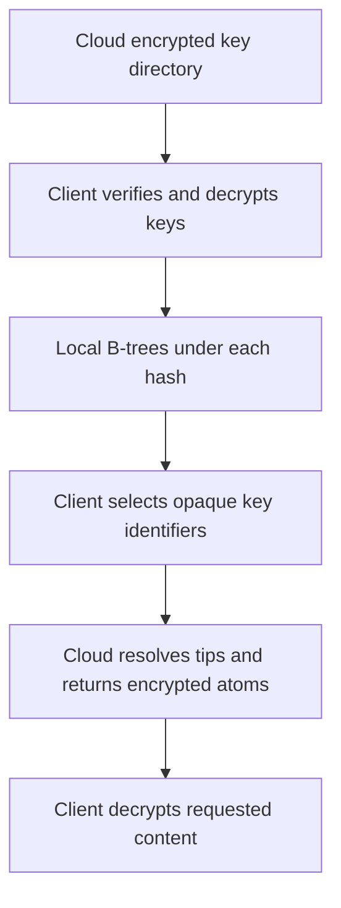

# Encrypted Range Keys With Local Preload

Status: Alternative design, 2026-10-24. The discussion later removed mandatory preload as an assumption.
The [OPE recommendation and implementation plan](ope-range-keys-implementation-plan.md) is the current proposal.

The [work plan](encrypted-range-keys-local-preload-plan.md) defines delivery packages, dependencies, and release checks.
The [reader and writer inventory](encrypted-range-keys-reader-writer-inventory.md) identifies the current source changes and preload exceptions.

LastDB keeps hash blinding, run-file block encryption, and file-blob encryption.
The client loads and decrypts the required range keys before it serves reads for a HashRange schema.
It builds ordinary local B-trees and asks the cloud for data by opaque key identifiers.
This design removes the need for OPE or ORE on that read path.

## Gap: per-atom content encryption

This design assumed per-atom content encryption.
Disk format v2 removed it.
Tom approved compact plain values on 2026-10-24 (workspace disk size plan, section 9.6).
A disk format v2 atom row is plain JSON inside an AES-256-GCM run-file block.
Block encryption does not protect one atom that the cloud sends to a browser.
The cloud and browser path must add its own atom encryption before this design can ship.
In this document, "encrypted atom" and "atom content key" name that required addition, not current code.

## Current state

The [current preload design](../lastdb-schema-range-preload-design.md) loads complete keys only for explicitly selected HashRange schemas.
Its local trees retain encoded range keys.
Other schemas, and some capacity failures, use the ordered disk route.
The current key allowance defaults to 128 MiB, separate from the warm set byte limit (256 MiB by default).

The current `ope_v1` range codec preserves order and prefixes, but a decoder recovers the original bytes without its key.
It does not supply range confidentiality.
Hash blinding uses a keyed hash and serves a separate purpose.

Native backups copy stored bytes.
The [cloud byte transport proposal](cloud-byte-transport-v2.md) defines opaque backup objects, rather than direct logical queries.
Browser reads by opaque key require additional cloud and client work.

## The change

Every HashRange schema that a client uses for reads requires a complete, authorized key directory.
The first read waits for that directory, including an exact read through the HashRange schema.
Concurrent first reads share one load.
Hash-only schemas retain direct reads without a complete range-key load.
Writes alone do not require a preload.

A key directory contains range values, opaque key identifiers, and essential membership facts.
It does not contain all tips, atom contents, or file bytes.
The directory covers the existing authoritative membership sources for the schema.
It preserves field-source precedence and record visibility rules.

The client decrypts the range values and builds a B-tree under each hash.
It uses those plaintext ranges only in local memory for range and prefix selection.
Local disk and cloud storage retain encrypted range values and opaque lookup identifiers.
The server does not compare range values.
Use the existing unsigned UTF-8 byte order for range and prefix bounds.
Do not add locale order or Unicode normalization as part of this change.

Preload is a product requirement for this design, rather than an inherent B-tree requirement.
A B-tree can also use partial reads from disk.
This design chooses complete local keys to avoid encrypted range comparisons in storage.

## Browser and cloud read path

1. The client authenticates to the cloud and selects a schema within its permitted scope.
2. Its private key unlocks the required molecule key bundles locally.
3. It selects one published directory revision and fetches its complete encrypted chunks in bounded batches.
4. It verifies those chunks and builds the local trees before it marks the schema ready.
5. A query names one hash and selects ranges from the local tree under that hash.
6. The client sends the selected opaque key identifiers in one batch.
7. The cloud checks permissions and resolves the current tips for the selected revision.
8. The cloud returns the required encrypted atoms, which the client verifies and decrypts. This step needs the per-atom encryption that the gap section names.
9. An explicit file request fetches only its referenced encrypted file blob.

The browser needs no local daemon or full database restore.
Its initial download contains the schema's required keys, rather than every atom or file blob.
Exact reads after readiness use the same opaque identifiers without another complete key load.

The client cannot use an incomplete key directory to claim that a key is absent.
A missing chunk, wrong key, invalid revision, or failed verification prevents readiness.
Include original hash values inside encrypted directory entries only where the API requires their recovery.

## Stored identifiers and encryption

| Part | Stored form | Purpose |
|---|---|---|
| Schema and molecule | Required definitions and opaque or public identities | Select the correct authorized key directory |
| Hash | Existing blinded token | Route exact requests without the original hash value |
| Range value | Ordinary authenticated encryption inside directory chunks | Let the client recover and order range values |
| Range lookup | Stable opaque token | Find a tip without a range comparison |
| Tip | Atom reference and required revision facts | Resolve the selected key to its atom |
| Atom content | Local disk: plain JSON inside an encrypted run-file block, with no per-atom seal. Cloud read path: per-atom encryption that this design must add (see the gap section) | Protect the requested field data |
| File blob | Existing file encryption | Protect referenced file bytes |
| Molecule keys | Explicit encrypted key bundle | Grant access to the required data |

Use the same opaque key identifier for an unchanged logical key across ordinary value updates.
Do not use an atom identity as that identifier: a new value can change the atom without a key change.
A key move changes the lookup identifier and directory membership together.

A keyed hash can produce the range lookup token from the exact range bytes and the key's scope.
The input must bind the format version, molecule, key epoch, and blinded hash with unambiguous lengths.
Use a separate purpose key from the required atom content encryption and hash blinding.
The final token size and collision rule remain implementation decisions.
An opaque token supplies an address; the cloud still checks access permission.

Encrypt directory chunks with an established authenticated encryption implementation.
Bind each chunk to its domain, format, key epoch, revision, and chunk identity.
Any public authentication fields remain visible, so they contain no plaintext range value or secret key.
Follow the selected encryption suite's nonce rules.
Freeze encrypted bytes before upload retries.
[Ordinary authenticated encryption](https://developers.google.com/tink/aead) supplies confidentiality and detects changes to protected bytes.

Randomized directory encryption does not supply stable lookup identifiers.
The separate opaque token supplies that stability.
No order-preserving encryption or ciphertext-prefix property enters the new format.

## What the cloud can see

The cloud sees the identities, tokens, revision facts, sizes, and file locations required for authorized reads.
It can observe repeated identifiers, requests, upload times, and shared access relationships.
It does not need plaintext ranges, atom contents, filenames, or private descriptive metadata.
Put sensitive descriptive metadata inside the appropriate encrypted value.

Readable navigation metadata still requires integrity protection.
The client verifies the connection between each requested key, selected tip, atom, and revision.
Signed records or authenticated manifest proofs can supply that protection without a secret key on the server.
The exact proof format belongs to the revision protocol.

Keep directory entries and chunk boundaries independent of plaintext range order.
For example, arrange entries by their opaque lookup tokens before chunk encryption.
Do not expose plaintext range minima, maxima, or sorted positions in a public manifest.
The client sorts the decrypted keys itself.

Exact fetches can use opaque identifier order, with result order restored locally.
This reduces direct disclosure through request sequence, but access patterns can still reveal relationships.
The design does not conceal all access patterns or promise anonymity.

Pack files hold the encrypted values and the metadata required to locate them.
They do not require whole-file encryption for this model.
The cloud needs either individual encrypted objects or bounded reads of independently accessible values inside a pack file.
An opaque whole-file backup alone does not supply this query service.

## Complete directories and current reads

A schema can reference several membership molecules, including shared fields and record-envelope membership.
Readiness requires every source that the query can select under the existing membership contract.
Do not combine unrelated field keys into a new record-existence rule.
Compatible copied schemas can share a complete directory; named alternate address layouts remain distinct.

Each directory revision has an authenticated manifest.
It names its membership domains, key epochs, covered change position, complete chunk list, and expected counts.
The client verifies all listed chunks, their contents, and the final counts before publication in memory.
Missing, extra, duplicate, or incompatible entries prevent readiness.

Directory membership and tip reads must describe one coherent published revision.
An insert becomes visible only with its directory entry, tip, and required encrypted atom.
A delete or key move changes membership and tip visibility at the same boundary.
A value-only update keeps membership and changes the selected atom at that boundary.

Writers upload required encrypted objects before they publish a new cloud revision.
The cloud publication rule prevents concurrent writers from replacing a newer revision without conflict resolution.
A client retains one revision throughout a query.
The cloud either serves that revision or rejects the request so the client can refresh and retry.
It never silently combines an old directory with newer tip state.
This bounded query requirement does not add a general old-value query API.

An authenticated change sequence keeps a retained directory current after the initial load.
The client verifies continuous coverage from its accepted revision before it publishes a new local tree state.
A gap or incompatible key epoch invalidates readiness and requires a complete refresh.
Local accepted writes update membership and sparse warm paths at the existing publication boundary.

Authentication proves integrity, but it does not prove that a valid revision is the newest revision.
A returning client rejects a revision older than its last trusted state.
A fresh browser needs a trusted source for the current published head.
The exact head authority and protection against old valid revisions remain open protocol decisions.
An unavailable cloud can still refuse service.

## Load limits and failures

Reserve memory for decrypted keys, B-tree nodes, build buffers, and concurrent changes before readiness.
Fetch and decrypt bounded chunks without a complete second copy of the directory in memory.
Use one shared load per compatible domain and bound its lifetime and temporary work.

The complete key allowance remains separate from the 10,000-record warm set.
Atom and tip fetches continue to use that warm set.
A used schema does not fetch every field value or file blob.

| State | Read behavior |
|---|---|
| Unloaded | Start one bounded directory load |
| Loading | Join the load within the caller's deadline |
| Ready | Select keys locally, then fetch required paths in batches |
| Capacity refused | Return an explicit capacity result |
| Invalid or incomplete | Return the cause and require a verified refresh |

A caller timeout does not cancel a shared load that other callers still need.
A clean directory purge clears readiness before a later query can use it.
A restart requires a new load, or verification of a locally cached encrypted directory.
Cache encrypted chunks only; do not write decrypted directories to disk or logs.

The new format cannot fall back to ordered ciphertext comparisons.
Capacity refusal therefore cannot silently select the current OPE disk route.
Oversized schemas require an explicit later decision, such as smaller authorized domains or client-controlled encrypted tree pages.
Neither alternative forms part of this initial design.

## Shared data and keys

Directory encryption follows the existing molecule access boundaries.
A schema directory is a view of the authorized molecule directories, rather than one account-only key for all fields.
A share grants the required molecule keys without a whole-pack key or a separate copy of each encrypted atom.
File access continues through the encrypted atom's file reference and file key.

Keep distinct key purposes for the required atom content encryption, hash tokens, directory encryption, and range lookup tokens.
Private identity keys and unwrapped molecule keys stay with authorized clients.
Directory manifests, cloud metadata, and ordinary logs contain no plaintext secret keys.
Key rotation changes the relevant epoch and directory compatibility facts.
It cannot remove plaintext or keys that a former recipient already obtained.

This design does not select a second generic encryption wrapper around every stored value.
Explicit encryption of secret key bundles remains necessary.
The local CAS wrapper and older file formats require a separate compatibility decision.
They cannot be removed safely through a change to the range codec alone.

## Costs and limits

| Benefit | Cost or limit |
|---|---|
| Ordinary encryption replaces OPE and ORE | First use loads all required schema keys |
| Plaintext ranges stay on authorized clients | Client memory grows with the complete key set |
| Prefix and range selection use normal local byte order | The cloud cannot independently select a plaintext range |
| Atoms and file blobs remain available on demand | The cloud needs a logical read service beyond byte backup |
| Shared encrypted content can retain one copy | Directory publication and permissions must preserve the same access boundaries |

The initial work grows with all required schema keys, including hashes absent from the first query.
After readiness, a range seek depends on keys under its named hash, plus the candidates and results it visits.
Exact reads use known opaque identifiers; batch reads collect their identifiers before one batch request.
Value filters can require additional atom fetches under the existing rules.
This design does not add a public query without a hash.

## Compatibility and implementation sequence

1. Fix the new directory format, identifiers, byte order, key purposes, and maximum sizes.
2. Define authenticated revision publication, current-head authority, and query revision checks.
3. Add the new local stored form and complete plaintext key trees.
4. Define a separate-target conversion for existing homes and a clear old-reader refusal.
5. Add cloud directory publication, batched logical reads, and browser key access.
6. Measure first use, memory, transfer bytes, later queries, and update costs before a default cutover.

The range format change replaces physical lookup identifiers as well as encrypted range bytes.
It affects tips, membership, related control records, key bundles, and all readers or writers of those structures.
Backup and restore must retain the new directory and revision dependencies.
New encryption cannot protect older copies that already expose plaintext ranges.
The existing wrapper PR is narrower and does not implement this design.
The primary home and current shared services stay outside this design-only work.

Use CI for builds and measurements.
Use format, source, security, and fresh synthetic DEV operational checks for implementation validation.
Required operational cases include first use, prefix bounds, key moves, concurrent updates, restart, wrong keys, incomplete chunks, and stale revisions.
Do not add or run tests, use the primary, or copy the primary for validation.
Keep raw output outside Git and link the CI summary and artifacts for any implementation PR.

## Open decisions

- Exact directory chunk format, maximum key size, token size, and browser memory allowance.
- The common publication boundary for directory membership, tips, atoms, and shared writers.
- Integrity proofs for readable tip references and file locations.
- A trusted current-head source for a fresh browser and a rule for old valid revisions.
- Whether cloud reads use individual objects, pack byte ranges, or a logical service over both.
- The nonce and key-epoch rules for new directory encryption.
- The compatibility path for legacy control values that contain plaintext ranges or sensitive metadata.
- The later product choice for schemas whose complete authorized keys exceed the client's memory allowance.

## Design references

- [LastDB canonical model](../lastdb-canonical-model.md) defines schemas, molecules, tips, atoms, files, and shared fields.
- [Current preload design](../lastdb-schema-range-preload-design.md) defines existing readiness, membership sources, and memory limits.
- [Access complexity requirements](../lastdb-access-complexity-requirements.md) separate first use from subsequent keyed queries.
- [Native element encryption](native-element-encryption-v1.md) describes the current wrapper proposal and existing file encryption.
- [Cloud byte transport proposal](cloud-byte-transport-v2.md) defines the separate opaque backup boundary.
