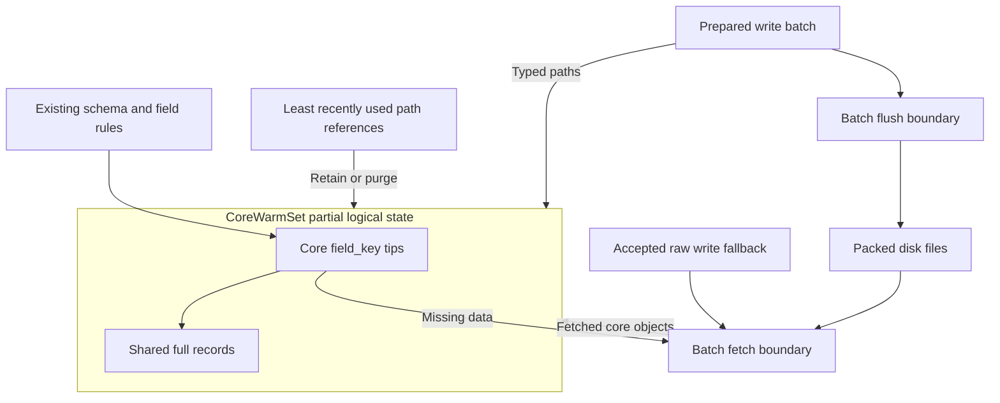

# LastDB core model warm set spike

> **Model note (2026-11-01).** This page was written for the field key model:
> schema → field → field key → record → file. Since home format 7 (the record model)
> a schema stores one record per primary key, and separate field-key rows and tips do not exist. The [canonical model](lastdb-canonical-model.md) wins where this
> page differs.

Status: historical exact-read spike, 2026-10-17.
The later [schema preload design](lastdb-schema-range-preload-design.md) supersedes its range recommendation.
The [product receipts](https://github.com/EdgeVector/lastdb/tree/0b0a79d4c10949e2f0570e82d9bc4fdb9513a285/docs/proofs/schema-preload-product-20261017/) record the subsequent implementation and measurements.

The later [use-case design](lastdb-logical-warm-set-design.md) and
[execution plan](lastdb-logical-warm-set-plan.md) define completeness for ranges,
sample, predicates, pages, counts, and concurrent calls before further route conversion.
The [key selection study](lastdb-key-selection-study.md) records an intermediate disk-first alternative.
Tom later selected complete key preload for selected schemas.
The measurements below describe the earlier spike, not the final preload route.

The spike reuses the engine's field key and record objects for exact Hash and
HashRange reads. `CoreWarmSet` owns those partial field keys and full records.
The separate least recently used list holds logical path references.

The [logical warm set design](lastdb-logical-warm-set-design.md) describes the
target. The [work plan](lastdb-logical-warm-set-plan.md) covers the full conversion.
The spike supplies part of that work. Accepted storage records still use
`NativeWriteGraph` when the typed path cannot supply the answer.

## Core objects and ownership

A stable path contains the storage scope, schema identity, canonical field,
field key, hash, and range. Its current record UUID is the target, not its key.
A write can replace the target without another logical path.

The owner stores the existing `FieldKeyHashRange` and `Record` types. Each field key
holds the existing `RecordEntry` and optional `KeyMetadata` at its keys.
The existing key filters operate on that field key. Schema definitions retain
their existing load route; the path records their identities.

| Part | Current responsibility |
|---|---|
| `CoreWarmSet` | Own partial core field keys, full records, and logical path lifetime. |
| `CorePath` | Name a stable logical path without its current record UUID. |
| `FieldKeyHashRange` | Hold current tips in the existing hash map and ordered range map. |
| `RecordEntry` and `KeyMetadata` | Retain the complete selected tip and its per-key metadata. |
| Shared `Record` references | Retain full content, source, metadata, and creation time. |
| Least recently used list | Hold path references and select eligible paths for purge. |
| Per-call receipts | Retain the full selected tip and actual file source for safe admission. |

A record UUID can match while metadata or creation time differs. The owner marks
conflicting warm slots unknown. A later fetch supplies the correct full record.
It shares one record object only when the complete record values match.

The cap counts logical paths, up to 10,000. An operational setting can lower
the cap. Shared field keys and records do not consume extra logical path slots.
A call holds only its selected paths. Purge skips held paths and paths that
need a flush.

## Partial field key operations

The core field key has neutral operations for fetched slots. Admission copies
the complete tip and metadata. Purge removes a slot and its metadata.
Neither operation changes mutation time, version, or history.

Every field key in the new owner carries an explicit partial marker. The full
field key rewrite guard rejects that state before it creates storage records.
The marker does not establish range completeness.

Bounded core range filters borrow the existing B-tree directly. They copy only
the selected results. The earlier helper first copied the entire hash's ordered
map, then selected its range.

## Exact reads

The current fast route supports exact Hash keys and exact HashRange pairs.
It also supports a batch of exact keys. Every requested path needs a known
tip before the existing core filter can supply that batch.

1. Capture the current disk state and accepted changes.
2. Select exact tips through the shared core field key when their sources permit direct warm reuse.
3. Otherwise, use the existing keyed disk route to select the tips.
4. Reuse each path's full record, or fetch the missing records in a batch.
5. Admit fetched objects only while the captured change number remains current.
6. Return the values with the existing metadata and tombstone rules.

The primary field and the related requested fields use the same core filter
route for known exact keys. A partial batch falls back to the existing keyed
route. The spike does not treat unknown keys as absent.

An old call can finish from its captured disk and accepted-write state.
It cannot admit an old value after a newer publication. The change number
guards the active call; it does not remove unchanged record values.

Tip and record receipts belong to that call. They leave with the call.
They hold no saved query answer or list of past writes.

## Writes and flush

Supported local writes prepare full core tips, metadata, and records privately.
They fetch each distinct file target with its exact field key and hash hint.
The receipt must confirm the requested file location and full record data.
Without that confirmation, the request uses the durable path and skips typed
warm admission.

The request reserves its complete logical path set before publication.
Publication updates the shared core field keys and marks the paths dirty.
The flush queue retains the exact storage work. A completed flush marks only
the covered write sequence clean. It leaves known records warm.

Ordinary reads do not retain the complete accepted request list. Their path
holds protect only their selected logical records. Flush completion releases
the write request's path holds. An old flush cannot clear a newer write.

Related fields can share the same full record reference. Field value does not
get a separate serialized copy for every field path. The write size checks
still account for the prepared data and its limits.

## Source changes and safe fallback

The owner records exact links to the disk sources that supply its values.
A change to a linked source marks the affected logical slot unknown.
An incomplete source set also makes the slot unknown instead of rejecting
an otherwise valid read or accepted write.

Tip writes conservatively clear direct warm tip reuse across the owner.
Typed publication restores that reuse for its changed paths.
Unchanged record values remain available after the normal route selects a tip.
This guard covers alternate accepted key forms until the source conversion
can name every affected logical path precisely.

Generation changes and delete barriers also clear direct warm tip reuse.
Generation changes mark the affected field key unknown. These controls use
the same publication boundary as the accepted storage changes.

The fallback preserves correct reads while the conversion remains partial.
It can add tip reads after an unrelated write. A shared record at another file
location can also require the durable write path.

## Next work

Keep the core model and its separate least recently used list. Complete these
routes before the full range work:

1. Retain the actual winning tip source in exact batch fetches. The current loader returns API keys after it tries encoded keys.
2. Route document-copy reads through the same owner. Admit confirmed absence and batch the missing keys.
3. Carry the prepared record objects and byte sizes into write publication. Avoid another fetch of the same prepared bytes.
4. Add complete range bounds, including empty gaps and page limits.
5. Complete all writer routes, then remove the raw write fallback and its conservative source guards.

The source review identifies specific extra work. It does not assign the
measured request time to each function.

The document-copy helper checks each result key separately. For each key, it
can request an API-form tip and an encoded tip. It bypasses the core owner.
Confirmed absence there needs a place in the same logical state.

Each query also resolves its schema snapshot. Present field key encryption
keys use the existing process cache. Missing key bundles lack an absent entry.
Do not attribute all remaining file work to encryption keys.

Write preparation already holds full records. The typed admission adapter fetches
those prepared targets again and checks their full source and size.
Carry those existing objects forward. Retain source checks for a reused old record
or a different file location.

The initial source review also finds a page-bound route that skips core lookup.
The current source corrects that route. It preserves key order, duplicate removal,
offsets, cursors, and the existing tombstone gates before body fetch.

## Remaining conversion work

- Add complete range bounds, empty range facts, and correct page coverage.
- Admit known absent keys and accepted deletes through the same logical owner.
- Move all writers, imports, backfill, administrative changes, and shared storage scopes onto the typed route.
- Replace conservative tip reuse guards with exact logical publication for every writer.
- Retain actual fallback record sources where a shared file supplies several field key paths.
- Remove the accepted raw-record lookup in `NativeWriteGraph` after every required path moves.
- Reconcile and remove the compatibility state in `LogicalResidentSet` and the older mutable graph.
- Remove Single and standalone Range across schema declarations, query validation, callers, and clients.
- Complete the shared schema and field lifetime rules around the same logical paths.
- Extend the product observations to overlapping calls, protected purge, deletes, and all storage scopes.

The earlier plan proposed `LogicalResidentSet` as the owner. The spike uses
`CoreWarmSet` instead. The remaining conversion must preserve one core value
owner rather than retain both as competing current state.

## Product receipts

The initial paired Mini workload completed on two fresh synthetic homes. It uses
96 HashRange records and eight Hash records. Each body contains 1,024 bytes.
The path cap is 128 for this workload. The normal cap remains 10,000.

The before version uses the preserved prior release binary. The initial after
version uses the branch draft before the page-bound correction. It includes the
earlier graph-first changes.
The comparison measures those complete versions. It does not isolate one core method.

| Identity | Receipt |
|---|---|
| Before binary | [Preserved binary identity](https://github.com/EdgeVector/lastdb/blob/0b0a79d4c10949e2f0570e82d9bc4fdb9513a285/docs/proofs/core-model-warm-spike-20261017/before-binary.json) |
| Initial after source and binary | [Initial source and binary hashes](https://github.com/EdgeVector/lastdb/blob/0b0a79d4c10949e2f0570e82d9bc4fdb9513a285/docs/proofs/core-model-warm-spike-20261017/candidate-source-initial.json) |
| Final after source and binary | Final source and binary hashes (receipt not kept in this repository) |
| Initial workload and configuration | [Inputs](https://github.com/EdgeVector/lastdb/blob/0b0a79d4c10949e2f0570e82d9bc4fdb9513a285/docs/proofs/core-model-warm-spike-20261017/run/inputs.json) and [exact driver sources](https://github.com/EdgeVector/lastdb/blob/0b0a79d4c10949e2f0570e82d9bc4fdb9513a285/docs/proofs/core-model-warm-spike-20261017/run/driver-sources/manifest.json) |
| Product observations | [Owner counters and outcomes](https://github.com/EdgeVector/lastdb/blob/0b0a79d4c10949e2f0570e82d9bc4fdb9513a285/docs/proofs/core-model-warm-spike-20261017/run/observations.json) |
| Detailed request receipts | Request records (receipt not kept in this repository) |
| Source and build checks | [Initial checks](https://github.com/EdgeVector/lastdb/blob/0b0a79d4c10949e2f0570e82d9bc4fdb9513a285/docs/proofs/core-model-warm-spike-20261017/checks-initial.json) and [final checks](https://github.com/EdgeVector/lastdb/blob/0b0a79d4c10949e2f0570e82d9bc4fdb9513a285/docs/proofs/core-model-warm-spike-20261017/checks.json) |

All 112 query calls and 96 Hash item replies returned the expected values.
The driver also checked keys, required metadata, page flags, flush, and normal reopen.
Successful receipts retain response hashes and validation results. They omit full response bodies.
No call received a refusal. All 12 owned node stops returned exit code zero.

### Initial paired request times

Each repeated case has five samples. The numbers measure complete local request
time. The Hash case measures one batch call with four independent keyed queries.
The operating system disk cache remains uncontrolled. These are preliminary measurements.

| Repeated read | Before median | After median | Before p95 | After p95 |
|---|---:|---:|---:|---:|
| 16 exact HashRange keys | 0.810 ms | 4.135 ms | 0.900 ms | 4.301 ms |
| 16 keys in one HashRange interval | 7.452 ms | 3.909 ms | 7.647 ms | 4.187 ms |
| Four Hash queries in one batch | 0.563 ms | 6.503 ms | 0.627 ms | 6.609 ms |

The range case improves by 48 percent. The exact cases regress substantially.
The current spike needs more work before a merge.

Queued writes also cost more in this run. These are single observations,
not a stable throughput result. Both versions returned the queued ack type.

| Update batch | Before request time | After request time |
|---|---:|---:|
| Eight related HashRange keys | 122.119 ms | 253.115 ms |
| Eight unrelated HashRange keys | 17.863 ms | 157.302 ms |
| Two Hash keys | 112.830 ms | 237.569 ms |

### What the owner counters establish

The candidate never exceeds 128 logical paths. The purge phase removes 184 paths.
The final hot cohort produces 40 hits and no misses. The older cohort produces
24 misses and no hits. A hit can occur more than once per path in one query.

Repeated 16-key exact reads each produce 80 core hits and no core misses.
The four-item Hash batch produces 20 core hits and no core misses.
The core objects therefore supply warm values despite the request cost above.

The related and unrelated range calls observe pending writes before and after
their reads. Both return the current values. The exact and Hash calls do not
establish that preflush window. Explicit flush returns dirty counts to zero.

All sampled active-call hold counts are zero. This workload does not prove
purge protection during an overlapping call. Source review supplies evidence
for those controls; the operational observation remains future work.

### Remaining file work

The repeated exact request still performs 42 instrumented file read operations.
The prior version performs zero. The Hash batch still performs 21, compared
with zero before. These counters do not establish physical device reads.

The repeated range request performs 49 file read operations, compared with 95
before. Its warm records reduce file work. Complete range knowledge remains absent.

These results expose incomplete query conversion. A warm record hit alone does
not prove that the complete query avoids disk. The next change must remove
those remaining fetches through the same logical owner.

### Final replay after the page-bound correction

The final candidate repeats the same workload on another fresh synthetic home.
This run contains one candidate node and no baseline node. It supplies behavior
and cost observations for the final source. It is not a second paired comparison.

The [final receipts](https://github.com/EdgeVector/lastdb/blob/0b0a79d4c10949e2f0570e82d9bc4fdb9513a285/docs/proofs/core-model-warm-spike-20261017/run-final/observations.json)
record 56 query calls and 48 Hash item replies. All values and required metadata
match. All six owned node stops return exit code zero. No call receives a refusal.

| Final repeated read | Median | p95 | File read operations |
|---|---:|---:|---:|
| 16 exact HashRange keys | 4.335 ms | 4.701 ms | 42 |
| 16 keys in one HashRange interval | 3.569 ms | 3.695 ms | 51 |
| Four Hash queries in one batch | 6.558 ms | 7.058 ms | 13 total |

Each case has five samples. The Hash batch uses 13 file read operations,
compared with 21 in the initial spike. Its elapsed request time remains high.
The page-bound correction therefore removes file work but does not resolve
the full exact-read problem.

Every warm exact and range call records 80 core hits and no misses.
Each warm Hash batch records 24 core hits and no misses. The cap remains
128 paths. Purge removes 184 paths and retains the hot cohort.

Queued update ack times are 277.493 ms for eight related keys and 162.608 ms
for eight unrelated keys. The two-key Hash update costs 236.249 ms.
Each number is one sample. The final run supplies no paired write baseline.

Dirty counts return to zero after flush. Only the two range calls establish
pending disk work before and after their reads. All sampled holds remain zero.
The earlier preflush and overlapping-call limits therefore still apply.

The final [inputs](https://github.com/EdgeVector/lastdb/blob/0b0a79d4c10949e2f0570e82d9bc4fdb9513a285/docs/proofs/core-model-warm-spike-20261017/run-final/inputs.json),
request receipts (receipt not kept in this repository),
and [driver sources](https://github.com/EdgeVector/lastdb/blob/0b0a79d4c10949e2f0570e82d9bc4fdb9513a285/docs/proofs/core-model-warm-spike-20261017/run-final/driver-sources/manifest.json)
remain separate from the initial run.

### Checks and cleanup

Format, whitespace, core/host/node Clippy, and the release build pass.
The run uses ordinary product calls on generated data. It adds no test suite
and does not use an existing home.

The supported cleanup command removes only the two fresh owned synthetic roots.
The [initial cleanup](https://github.com/EdgeVector/lastdb/blob/0b0a79d4c10949e2f0570e82d9bc4fdb9513a285/docs/proofs/core-model-warm-spike-20261017/cleanup.json) and
[final cleanup](https://github.com/EdgeVector/lastdb/blob/0b0a79d4c10949e2f0570e82d9bc4fdb9513a285/docs/proofs/core-model-warm-spike-20261017/cleanup-final.json) each record
exit code zero. Both roots no longer exist. Product receipts remain here.

## Source locations

| Area | Source |
|---|---|
| Core owner and path lifetime | [Core warm set](../fold_db/crates/core/src/resident/core_set.rs) and [lifetime rules](../fold_db/crates/core/src/resident/core_set/lifecycle.rs) |
| Partial field key lifecycle | [Neutral slot operations](../fold_db/crates/core/src/record/field_key_hash_range/loaded.rs) |
| Bounded range selection | [Core range filters](../fold_db/crates/core/src/schema/types/field/filter_utils/hash_range.rs) |
| Exact field reads | [Core model resolver](../fold_db/crates/core/src/db_operations/field_read/core_model.rs) and [warm filter adapter](../fold_db/crates/core/src/storage/disk_pack/logical_paths/core_filter.rs) |
| Typed write preparation | [Native logical write paths](../fold_db/crates/core/src/fold_db_core/mutation_manager/write/native_paths.rs) |
| Publication and flush | [Current view](../fold_db/crates/core/src/storage/disk_pack/view.rs) and [batch queue](../fold_db/crates/core/src/storage/disk_pack/queue.rs) |
| Source protection | [Source receipts](../fold_db/crates/core/src/storage/disk_pack/logical_paths/source.rs) and [tip controls](../fold_db/crates/core/src/storage/disk_pack/logical_paths/controls.rs) |
