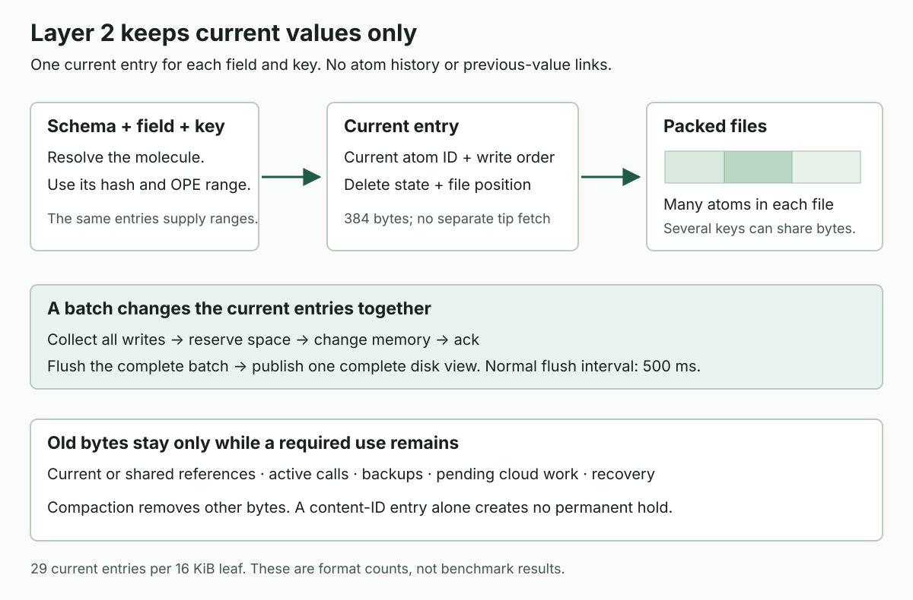

# LastDB current value record format v1

**Superseded physical format proposal, 16 October 2026.**
The [LastDB and LastStore boundary](lastdb-laststore-storage-boundary.md) is the current design proposal.
It keeps stable atom references in tips and leaves physical file positions inside LastStore.
The current-only and write-order rules below remain relevant.
The 384-byte entry, direct extents, and tip relocation plan are historical details, not the next build target.

Defined 16 October 2026. Tom selected current values only on 16 October 2026.

Layer 2 keeps one current entry for each field and key.
It keeps no atom history, previous-write entries, predecessor links, or separate WriteID.
A batch writes packed bytes and changes its current entries together.

| Record | Responsibility |
|---|---|
| Current entry | Holds the current atom ID, write-order facts, delete state, and direct file position. |
| Packed body | Holds exact stored atom bytes. Several current entries can share one body. |
| Required support entry | Holds current metadata, a live atom-ID reference, or bounded work for recovery and cloud sync. |

A current entry occupies 384 bytes, down from the earlier proposal's 512 bytes.
A 16 KiB leaf holds 29 entries rather than 23.
These are format calculations, not benchmark results.

An ordinary single-context current read uses one current-entry lookup, then the value bytes.
It performs no separate tip or history lookup.
Payload decode metadata and bounded entry overflow still count as disk work.

This was an implementation proposal. No current reader implements these bytes.
It changes no primary, existing home, or cloud setting.
The earlier history-bearing proposal is superseded.
Existing pack v1 homes remain a separate format.

## 1. Current values and write order

Use one typed ordered map and one atomic complete-publication selector.
The map holds current entries, live atom-ID representatives, and required side/control records.
Schemas and canonical fields resolve the molecule before the current lookup.
Copied schemas that share a molecule retain one current-key authority.
Different protein key layouts retain different current keys and can share one body.

| Identity | Meaning |
|---|---|
| Logical address | Existing storage scope, canonical molecule, shape, and API key coordinates |
| Stored current key | That address under one explicit codec context |
| Atom UUID | Existing external content identity; ContentHash conditions use this exact ID |
| BodyID | SHA-256 of one complete immutable BodyRecord |
| Generation | One complete disk view for publication, active reads, and backups |

An atom UUID does not identify a write.
Equal content IDs can have different stored metadata or encrypted representations.
Reuse exact stored bytes only when BodyID and storage domain match.
There is no WriteID and no map of previous writes.

### Logical writes and replay

Native winner order remains:

    (written_at, logical_counter, effective_device, mutation_uuid, exact_atom_uuid)

Use the existing exact UTF-8 string order.
effective_device is device_id, or writer_pubkey when device_id is empty.
Position, journal order, BodyID, and disk generation never break a logical tie.

The owner validates the input and compares it with the captured current entry before Atom construction:

1. A greater tuple replaces the current facts and body, even when its content ID is unchanged.
2. A lower tuple leaves the current entry unchanged.
3. An equal tuple keeps the exact selected current representation. It creates no new Atom, timestamp, or encrypted body.
4. For an equal complete tuple, a conflicting delete state or content that fails its named atom identity causes refusal.

The identified current write uses all five tuple fields, including the exact atom UUID.
Different atom UUIDs use the existing final tie-break rule; they are not an equal tuple.

Equal content with different encrypted bytes does not by itself create a conflict or another retained value.
Validate the content and retain the selected representation.
Required delivery receipts and side work keep their existing keyed idempotency rules.
They need no permanent per-write value archive.

The first increment refuses unidentified or ambiguous legacy replay before admission.
It never generates a fresh UUID to make an imported write win.
A supported owner can reuse a saved effective UUID only when its exact source facts establish the same current write.
Conversion can import a captured authoritative legacy head without a new author event.
Zero-clock legacy heads must agree across contexts, or conversion refuses that address.

Physical journal recovery has a different job.
It replays the complete recorded templates and body definitions in order.
It does not rerun winner selection, Atom construction, or clock allocation.
It needs no saved previous-write entry.

### Deletes and conditional writes

A delete retains its write-order facts and DELETED flag.
A delayed older cloud write cannot restore the key.
Tombstone removal needs the existing sync/delete authority's proof that stale writers cannot restore it.

Preserve the conditional-write API.
Value compares the current JSON value.
ContentHash compares the exact current atom UUID.
Absent succeeds for a missing or deleted entry.
Value and ContentHash fail for a missing or deleted entry.
Check the condition and publish the complete mutation under the same writer ownership.

### Current-only retention

The current API supplies no as_of read, previous-value walk, or conflicting-write archive.
An unsupported history request returns an explicit unsupported result.
It does not return an empty history or silently use the current value.

An old body remains only while a current/shared reference, active call, backup, recovery batch, or pending delivery requires it.
Those uses do not create a history API.
Pending delivery has finite byte and reference caps.
Its owner releases the required bodies after a durable completion receipt.
A body becomes reclaimable after every required use ends.

A file format number and captured disk generations remain necessary.
They describe the bytes and protect complete reads. They are not atom history.

## 2. Common bytes and ordered keys

U16BE, U32BE, and U64BE are unsigned big-endian integers.
LP16(x) is U16BE(byte_length(x)) followed by exact x bytes.
LP32(x) uses U32BE.
Only ordered keys and explicitly named canonical digest inputs use these big-endian forms.
Stored headers, leaf values, and metadata packets use little-endian integers.

Object UUIDs use 16 raw bytes. Digests use 32 raw bytes.
Unless stated otherwise, a checksum is SHA-256 over the complete object with its checksum field zeroed.
External IDs retain exact bytes, including UUID, hex, and base64 spellings.
Compare complete map keys as unsigned bytes.
Inline prefixes and digests never establish final equality or order.
Check arithmetic before allocation or I/O.
Unknown kinds, codecs, flags, malformed lengths, or nonzero reserved bytes cause refusal, not absence.

    Scope = 00
          | 01 | LP16(exact_existing_storage_prefix)

The first form means no prefix.
A present empty prefix remains distinct.
Scope is the complete existing storage/encryption isolation identity, not a database display name.

    Molecule = 01 | existing_digest[32]
             | 02 | LP16(exact_supported_legacy_literal)

The literal form preserves a supported legacy identity.
It does not hash an unknown molecule into a new identity.

    Context = spelling:u8
              hash_codec:u8 | hash_epoch:U64BE
              range_codec:u8 | range_epoch:U64BE

| Field | Codes |
|---|---|
| Shape | 00 Single; 01 Hash; 02 Range; 03 HashRange |
| Spelling | 01 base64url without padding; 02 lowercase hex; 03 exact legacy literal |
| Hash codec | 00 plain; 01 existing BlindV1 |
| Range codec | 00 plain; 01 existing OpeV1 |
| Epoch | Zero for plain; nonzero immutable epoch for encoded keys |

Spelling chooses the exact molecule text supplied to the existing key codec.
A literal molecule requires spelling 03.
Spelling 03 can also preserve an admitted noncanonical spelling of a digest molecule.
The profile retains that exact text, including an admitted uppercase hex spelling.
Never reconstruct lowercase text and assume that its encoded keys match.
A captured molecule profile declares shape, key-layout identity, one write context, and at most eight read contexts.
It retains existing key-adapter locators, never raw secret keys.
An epoch never changes meaning in place.

### Key families

Family codes are hexadecimal.

    CurrentKey = LDF1 | 01 | LP16(Scope) | Molecule | shape | Context
                 | LP16(encoded_hash) | encoded_range_to_end
    ContentKey = LDF1 | 03 | LP16(Scope) | LP16(exact_atom_uuid)
    SideKey = LDF1 | 10 | LP16(Scope) | LP16(exact_collection)
              | exact_existing_key_to_end
    ControlKey = LDF1 | 20 | LP16(Scope) | control_kind:u8 | control_name_to_end

LDF1 is four ASCII bytes.
Families 02, 04, and 05 are reserved and invalid in this current-only format.
A history record cannot enter through SideKey or a control body.
The terminal range has no length prefix.
Its encoded order and prefixes remain usable.
Binary keys require byte-safe storage APIs.
Do not use lossy UTF-8 conversion or hash the entire range to fit a string API.

| Shape | Hash | Range |
|---|---|---|
| Single | Empty | Empty |
| Hash | Encoded supplied hash | Empty |
| Range | Empty fixed hash | Encoded supplied range |
| HashRange | Encoded supplied hash | Encoded supplied range |

A missing required API component does not silently become empty.
Explicit empty values retain existing schema validation.
A Range molecule still has one named implicit hash; this adds no unkeyed query.

Control kinds are 01 molecule profile, 02 relocation job, 03 retiring source, 04 durable reference root.
Section 14 defines their common envelope and the first supported profile codec.
Kinds 02 through 04 remain reserved until their byte layouts and closure walkers exist.
The first increment refuses those records rather than accepting arbitrary owner bytes.
The writer registers every local file reference those codecs contain.
An unknown control codec prevents activation and relocation.

### Range reads and limits

For one context, P is CurrentKey through LP16(encoded_hash).
An exact key is P|encode(range).
Between reads [P|encode(start), P|encode(end)).
The start is inclusive and the end is exclusive.
Reversed API bounds return empty under the existing rule.

Prefix lower is P|encode(prefix).
Its exclusive upper is the unsigned byte-prefix successor, bounded by the end of P.
An empty prefix selects all entries under that one P.
A boundary need not exist in the map.

Keep separate cursors for separate contexts.
Never compare OPE bytes across contexts.
Merge in API string order, select the logical winner, then mask deleted entries.
A current read performs one entry lookup for each required context, at most eight.
A stale value cannot win merely because its context is active.
Current OpeV1 preserves byte prefixes. Future codecs must declare prefix behavior.

The same entries supply range membership and current values.
There is no second range list.
Current OpeV1 remains unchanged and reversible without its key.
This format claims no range secrecy.

HashRange ranges and pages require one supplied hash.
Range molecules use their explicit implicit-hash identity.
This hash-major map supplies no global HashRange page in range-first order.
An unsupported whole-molecule page refuses; it does not become an unkeyed read.

A complete encoded key is at most 65,535 bytes, including every frame.
OpeV1 expands each API UTF-8 byte to eight stored ASCII bytes.
Apply the bound after encoding.
Refuse the entire mutation before admission if any generated key exceeds it.
Long keys use at most five overflow pages.
Never truncate an ordered key or replace it with a digest.

## 3. Fixed 384-byte map value

Hex families 01, 03, 10, and 20 use decimal kinds 1, 3, 4, and 5 respectively.
Kind 2 is invalid.
The home/selector codec identifies this layout; the entry has no separate format-version field.

| Offset | Bytes | Field |
|---:|---:|---|
| 0 | 1 | Kind: 1 current; 3 live content representative; 4 side; 5 control |
| 1 | 1 | Flags: bit 0 HAS_BODY; bit 1 DELETED |
| 2 | 2 | Zero |
| 4 | 4 | Complete MetadataPacket bytes |
| 8 | 8 | Original written_at |
| 16 | 8 | Original logical_counter |
| 24 | 96 | BodyExtent, including the only stored BodyID in this value |
| 120 | 32 | MetadataDigest |
| 152 | 16 | Metadata overflow object UUID |
| 168 | 8 | First metadata overflow page |
| 176 | 8 | Overflow creation generation |
| 184 | 2 | Inline metadata bytes |
| 186 | 1 | Metadata overflow page count |
| 187 | 5 | Zero |
| 192 | 192 | Inline metadata; unused bytes zero |

Inline bytes equal min(metadata_bytes,192).
Packet bytes are at most 65,535.
Overflow pages equal ceil((metadata_bytes-inline_bytes)/16,256), at most five.
Without overflow, its UUID, page, generation, and count are zero.
With overflow, the object is nonnil and its generation is no later than the captured generation.

    MetadataDigest = SHA256(
        ASCII "lastdb:direct-field:metadata:v1" | 00
        | U32BE(packet_length) | complete_packet)

The exact atom UUID stays in the packet.
Compute AtomIDDigest from it when the body header needs validation.
Do not store a duplicate AtomIDDigest or a second BodyID in the map value.

    AtomIDDigest = SHA256(
        ASCII "lastdb:direct-field:atom-id:v1" | 00
        | LP32(exact_raw_atom_uuid))

Side/control bodies and bodyless deletes use a zero AtomIDDigest.

### State rules

A live current entry requires HAS_BODY.
A tombstone atom retains HAS_BODY, DELETED, and its exact current body.
This preserves current include_tombstones and required atom-ID reads.
A bodyless delete is allowed only when no source atom body or atom UUID exists.
Its extent and raw atom ID are empty; its write-order facts remain.

A content representative requires HAS_BODY and a raw atom ID.
Its clocks and write-order strings are zero or empty.
Side/control entries require HAS_BODY, with zero logical clocks and an empty atom ID.
DELETED is valid only on current entries and matching current tombstone content representatives.
Unknown flag bits are invalid.
An empty present value still has a BodyRecord.

### Live atom-ID representatives

ContentKey supports existing reads by atom ID and explicit shared/delivery references.
It is not a permanent record of every atom that once existed.
Its first accepted live occurrence selects the owner-compatible representative body.
An update with the same content ID does not silently replace that representative's bytes.

The existing reference owner supplies a keyed proof of current/shared/delivery use.
The representative itself creates no retention right.
When the last such use ends, bounded cleanup removes its entry.
Publish that removal before physical reclaim of its extent.
Every present entry retains a valid physical dependency until its removal publishes.
A bare atom-ID read without required ownership returns absence, even if obsolete bytes await cleanup.
The owner check uses the same captured view.
An unsupported ownership path refuses instead of an unkeyed search.

Old query roots and backups retain their own required files.
They do not keep an obsolete atom addressable through the current home.
Compaction preserves the selected BodyID and changes only its physical position.
No history chain or previous-write entry exists.

## 4. MetadataPacket

All header integers are little-endian.
The packet has four fields and this 32-byte header:

| Offset | Bytes | Field |
|---:|---:|---|
| 0 | 4 | ASCII DFM1 |
| 4 | 1 | Packet codec version, 1 |
| 5 | 1 | Flags, zero |
| 6 | 1 | Field count, 4 |
| 7 | 1 | Zero |
| 8 | 4 | Complete packet bytes |
| 12 | 2 | Owner-proof codec: 0 absent; 1 existing current AtomEntry JSON |
| 14 | 2 | Zero |
| 16 | 16 | Four u32 field lengths |
| 32 | Variable | Fields in the order below |

Fields are effective_device, mutation_uuid, raw_atom_uuid, and optional_owner_proof.
Total bytes equal 32 plus the four lengths.
Strings retain exact UTF-8, including admitted embedded NUL.
No trim, case change, or Unicode normalization is allowed.

There is no predecessor, external history-version ID, or separate original-UUID field.
The ordinary 44-byte device, 36-byte mutation, and 64-byte atom IDs need 176 bytes with this header.
They fit within the 192 inline bytes.

Proof codec 0 requires an empty proof field.
Proof codec 1 retains the exact supported current AtomEntry JSON bytes from the existing owner codec.
Codec 1 is valid only for current entries.
Content, side, and control entries require codec 0.
Required delivery proofs stay in their registered owner records.
The owner validates its identity, clocks, effective device, signature, and provenance against the current entry.
Do not strip signed proof bytes because the new format has no history.
An old predecessor string inside signed proof remains opaque proof data.
It grants no history lookup or retention right and never becomes a traversed local reference.

Native source envelopes and delivery facts remain in their existing bounded owner records when required.
Current metadata does not duplicate those records.
Refuse an unsupported proof or an oversized packet before admission.
Do not discard proof metadata to make it fit.

## 5. BodyExtent and immutable BodyRecord

### BodyExtent

BodyExtent uses 96 bytes.
It keeps the existing Location128 used-field offsets and removes 32 reserved trailing bytes.

| Offset | Bytes | Field |
|---:|---:|---|
| 0 | 1 | Source: 1 journal; 2 pack |
| 1 | 3 | Zero |
| 4 | 8 | Physical body-creation batch |
| 12 | 4 | Physical body-creation operation |
| 16 | 8 | Complete BodyRecord bytes |
| 24 | 16 | Journal stream or pack UUID |
| 40 | 8 | First logical block |
| 48 | 4 | Position in first decoded block |
| 52 | 4 | Consecutive block count |
| 56 | 32 | BodyID |
| 88 | 8 | Zero |

An all-zero extent is valid only without HAS_BODY.
Otherwise its source is 1 or 2, object UUID is nonnil, and creation operation is below 4096.
Journal source names the actual body-definition batch.
Its creation batch is nonzero.
Pack source keeps the creation pair; its frame sequence is zero.
A builder can create a body directly in a pack with creation pair (0,0).
That pair is valid only for pack source.
Relocation preserves an existing pair.

First position is below 4096.
Blocks equals ceil((first_position+record_bytes)/4096).
The contiguous extent stays inside captured immutable object bounds.
A short block occurs only at the object's end.

This pair is the body's physical birth.
It is not the current record's author clock or latest map edit.
Never compare it with the referencing MAPPUT's ordinal.

### BodyRecord

| Offset | Bytes | Field |
|---:|---:|---|
| 0 | 8 | ASCII LDFBODY1 |
| 8 | 2 | Version, 1 |
| 10 | 1 | Kind: 1 atom; 2 side; 3 typed control |
| 11 | 1 | Flags, zero |
| 12 | 4 | Header bytes, 128 |
| 16 | 8 | Payload bytes |
| 24 | 2 | Codec: 1 existing stored Atom; 2 existing opaque side value; 3 typed control |
| 26 | 6 | Zero |
| 32 | 32 | ScopeDomainDigest |
| 64 | 32 | AtomIDDigest; zero for side/control |
| 96 | 32 | SHA-256 of exact payload |
| 128 | Variable | Exact stored payload |

    ScopeDomainDigest = SHA256(
        ASCII "lastdb:direct-field:scope:v1" | 00 | LP32(Scope))
    BodyID = SHA256(complete_128_byte_header | exact_payload)

BodyID equals the digest stored once inside BodyExtent.
Complete record bytes equal 128 plus payload bytes.
Kinds 1, 2, and 3 require codecs 1, 2, and 3 respectively.
Current and content entries name kind 1 bodies.
Side entries name kind 2 bodies. Control entries name kind 3 bodies.
Scope must distinguish the existing storage/encryption domains.
An adapter that cannot establish that identity refuses the representation.
An atom UUID alone never authorizes cross-domain sharing.

The header contains no current key, author clock, physical generation, or file position.
The current entry validates the requested key.
The body validates scope, content identity, complete bytes, and owner encoding.
Different keys can therefore share one exact body.

The opaque stored-payload cap is 32 MiB.
This is separate from the pre-encryption atom-content cap.
The existing 256 KiB default and 1 MiB hard content ceiling remain unchanged.
Owner encryption and stored headers remain unchanged.
Large file blobs retain their existing references; their bytes do not enter this record.

Readers validate leaf key, packet digest, full IDs, extent bounds, frame identity, body header, payload digest, and whole BodyID.
They use the existing owner adapter before content becomes visible.
SHA-256/CRC detect damage; they do not authenticate unsigned structural metadata.
Physical frames remain plain initially.
Unsupported physical encryption and cloud adapters remain explicit compatibility refusals.

### R record molecules

An R atom UUID names its whole original R body.
Keep that whole body.
The captured schema adapter can project a requested field after decode.
Only requested logical fields enter the warm set.

Do not substitute a field projection under the whole atom's UUID.
A future projection needs a distinct BodyID and explicit source/field semantics.
The first implementation reuses original whole-R bodies.

## 6. Pages and one map root

Map pages remain 16,384 bytes with a 128-byte common header.
Use new magic LDFPAGE1 and version 1.
Retain the 176-byte key descriptor and full-key validation.

A leaf entry is 176 + 384 = 560 bytes.
A leaf holds at most 29 entries.
Internal separators remain 184 bytes: 88 separators and 89 children.
Maximum path height remains 8 pages.
The earlier 512-byte/23-entry quote and old 128-byte/53-entry quote are invalid for this format.

Unified-map kinds are 1 internal, 2 unified leaf, 4 key overflow, and 6 metadata overflow.
Kind 3 directory leaves and other kinds are invalid in this namespace.
Payload block maps retain their separate LDPAGE1/kind 5 codec and payload-object namespace.
They do not use the unified-map decoder.
Generation receipt pages use their separate codec from section 15.

The unified-map header uses these offsets:

| Offset | Bytes | Field |
|---:|---:|---|
| 0 | 8 | LDFPAGE1 |
| 8 | 2 | Version, 1 |
| 10 | 1 | Kind |
| 11 | 1 | Flags, zero |
| 12 | 2 | Header bytes, 128 |
| 14 | 1 | Level; leaf and overflow use zero |
| 15 | 1 | Zero |
| 16 | 8 | Nonzero creation generation, no later than captured generation |
| 24 | 16 | Map object UUID |
| 40 | 8 | Page number |
| 48 | 4 | Used payload bytes, at most 16,256 |
| 52 | 2 | Entry count |
| 54 | 2 | Entry width |
| 56 | 8 | Left child |
| 64 | 8 | Next overflow page |
| 72 | 8 | Auxiliary value |
| 80 | 32 | Full-page checksum |
| 112 | 16 | Zero |

Normal unused fields are zero.
Checksum covers the full page with bytes 80..112 zeroed.

The key descriptor uses u32 length at 0, u16 inline length at 4, and u16 overflow flag at 6.
Bytes 8 through 135 hold at most 128 key bytes, followed by zero padding.
The first overflow page occupies u64 at 136; SHA-256 of the complete key occupies bytes 144 through 175.
The overflow flag is 1 exactly when the key exceeds 128 bytes.
Otherwise the first overflow page is zero.
Key-overflow pages use the same consecutive-tail rules as metadata overflow.
Their auxiliary value is the full key tail length.

Internal entries contain one key descriptor and its right-child u64 page number.
The left child resides in the header. Child numbers are nonzero.
Separators equal the minimum full key of their right subtree.
Leaf keys and separators are strictly ordered by complete bytes.
Every map object starts with a valid zero-count sentinel leaf at page zero.
Only an empty map can select it as the root.
Child and overflow references never name page zero.

Metadata overflow uses level 0, width 0, count 0, and left child 0.
Auxiliary equals the complete overflow-tail length.
Next points to the next consecutive page or zero on the last.
Used bytes equal min(16,256,remaining_tail).
The entry names the exact object, span, and creation generation.
Check every page and the complete MetadataDigest.
This is entry overflow, not a separately keyed tip record.

Files use maps/<object-uuid>/part-<u32-hex>.
Each part holds at most 512 pages and 8 MiB.
Key overflow belongs to its map object.
Metadata overflow can retain an older object; the dependency receipt includes it.

Initially retain existing payload frame, part, compression, and block-map bytes.
Body codec 0x0201 means BodyRecord v1 inside that existing payload-container codec.
Blocks decode to at most 4096 bytes.
Parts are at most 8 MiB including their 128-byte header.
Bounded block-map reads remain decoder work.
This document does not claim one physical read per current lookup.

## 7. New descriptor and selector

Create a separate home with marker laststore-direct-home-v1.
Write the legacy downgrade fence before valid data:

    version=2
    layout_mode=direct_field_v1

Never reinterpret the old directory/locator selector as this map root.
Old readers refuse the new marker, magic, feature, and codec IDs.
The earlier unimplemented 512-byte draft's codec IDs cannot open this 384-byte layout.

### Descriptor

The descriptor is 4096 bytes.

| Offset | Bytes | Field |
|---:|---:|---|
| 0 | 8 | ASCII LDFHOME1 |
| 8 | 2 | Version 1 |
| 10 | 2 | Bytes 4096 |
| 12 | 4 | Flags 0 |
| 16 | 16 | Nonnil home UUID |
| 32 | 8 | Four u16 codecs: map 0x0202; key 0x0201; body 0x0201; journal 0x0202 |
| 40 | 2 | Key descriptor bytes 176 |
| 42 | 2 | Value bytes 384 |
| 44 | 4 | Page bytes 16384 |
| 48 | 4 | Block bytes 4096 |
| 52 | 4 | Part cap 8388608 |
| 56 | 4 | Key cap 65535 |
| 60 | 4 | Metadata cap 65535 |
| 64 | 8 | Stored payload cap 33554432 |
| 72 | 8 | Complete journal cap 134217728 |
| 80 | 4 | Operation cap 4096 |
| 84 | 4 | Context cap 8 |
| 88 | 8 | Required features |
| 96 | 32 | Zero |
| 128 | 32 | Full descriptor checksum, this field zero |
| 160 | 3936 | Zero |

Mandatory features are 0x20 direct records plus existing object-metadata, journal-lifecycle, native-home, and file-lifetime rules.
The v1 mask is 0x2f.
Bit 0x10 is not repurposed. Its earlier schema-reference contract needs separate support.
Unknown extra required bits refuse access.

### CURRENT

CURRENT is an atomically replaced 4096-byte selector.

| Offset | Bytes | Field |
|---:|---:|---|
| 0 | 8 | LDFCUR1 followed by one zero byte |
| 8 | 2 | Version 1 |
| 10 | 2 | Bytes 4096 |
| 12 | 4 | Flags 0 |
| 16 | 8 | Nonzero generation |
| 24 | 8 | Smaller previous generation, or 0 initially |
| 32 | 8 | Complete readable frontier F |
| 40 | 8 | Durable journal frontier J |
| 48 | 16 | Unified map object UUID |
| 64 | 8 | Root page |
| 72 | 2 | Height 1..8 |
| 74 | 6 | Key 0x0201; entry 0x0202; journal 0x0202 |
| 80 | 16 | Journal stream UUID |
| 96 | 32 | Complete descriptor digest |
| 128 | 32 | Full selector checksum, this field zero |
| 160 | 8 | Required features matching descriptor |
| 168 | 8 | Publication time, Unix milliseconds |
| 176 | 3920 | Zero |

F cannot exceed J.
Codec profiles and required metadata use this same captured root.
Startup recovers a complete durable suffix before new admission.
The generation receipt identifies this descriptor/selector and their exact closure.
It must not reuse the old directory-only dependency walker.
Section 15 defines the new receipt coordinates and magic.

## 8. Journal operations

Retain existing 128-byte BEGIN/COMMIT field offsets and checksum rules.
Use LDFJBG1 plus one zero byte and LDFJCM1 plus one zero byte as the new magics.
Version is 1.
Stream, sequence, predecessor, operation count, full bytes, accepted time, and ordered batch digest retain their meanings.

Every operation has this 64-byte header:

| Offset | Bytes | Field |
|---:|---:|---|
| 0 | 1 | Kind:1 BODYDEF;2 MAPPUT;3 MAPDELETE |
| 1 | 1 | Flags 0 |
| 2 | 2 | Version 1 |
| 4 | 4 | Header bytes 64 |
| 8 | 4 | Contiguous operation ordinal |
| 12 | 4 | Zero |
| 16 | 8 | Payload bytes |
| 24 | 8 | Zero |
| 32 | 32 | SHA-256(zeroed-digest header followed by payload) |

BEGIN has a zero batch_digest.
COMMIT.batch_digest is SHA-256 of the complete encoded BEGIN followed by every operation header and payload, in order.
BEGIN/COMMIT agree on stream, sequence, predecessor, count, complete bytes, and accepted time.
Their batch_digest and marker-checksum fields differ by definition.
Unknown operations or failed references refuse the whole batch.
A partial batch never becomes a visible root.

### BODYDEF and BodyRef

BODYDEF payload is:

    body_index:u32LE | zero:u32LE | record_bytes:u64LE | complete_BodyRecord

Indexes start at 0 and are contiguous.
Definitions contain no references.
Its physical birth is this batch and this operation ordinal.
Exact identical body bytes can share one definition.

BodyRef is 176 bytes:

| Offset | Bytes | Field |
|---:|---:|---|
| 0 | 1 | Tag: 0 none; 1 prior BODYDEF; 2 existing extent |
| 1 | 7 | Zero |
| 8 | 4 | Body index |
| 12 | 4 | Zero |
| 16 | 96 | BodyExtent |
| 112 | 32 | BodyID |
| 144 | 32 | ScopeDomainDigest |

Tag 0 requires all zero.
Tag 1 names a prior matching definition and has a zero extent.
Tag 2 requires index 0 and a complete verified matching extent.
Its BodyID matches the extent's digest.
An existing extent belongs to the owned captured closure.
It cannot introduce another reference to a retiring source.

### MAPPUT

    key_bytes:u32LE | metadata_bytes:u32LE
    BodyRef[176] | entry_template[384]
    complete_key | complete_MetadataPacket

Total length must agree exactly.
The template carries kind, state, clocks, metadata digest, and inline prefix.
Bytes [24,120), byte 186, and bytes [152,184) are zero.
These fields hold the persisted extent and physical metadata-overflow coordinates.
Reserved bytes [2,4), [187,192), and unused inline bytes are also zero.
Its metadata length equals the complete packet length.
Its inline length is min(packet_length,192), with that exact packet prefix.
Its MetadataDigest covers that complete packet.

HAS_BODY requires BodyRef tag 1 or 2.
The referenced body must match the requested Scope, kind, and raw atom UUID.
Without HAS_BODY, BodyRef is tag 0.
Replay resolves BodyRef and stores the resulting BodyID once inside the filled extent.
It writes metadata overflow and fills the persisted value.
Admission validates these rules before BEGIN. Recovery repeats them before publication.

Keep every ordered mutation, including intermediate same-key writes.
Combine only the final page edits.
Required recovery and delivery work remains in the batch.
Intermediate bodies lose their temporary retention after every required recovery/delivery use ends.
They do not become queryable history.

### MAPDELETE

    key_bytes:u32LE | zero:u32LE | expected_state_digest[32] | complete_key

Define CanonicalEntry from the validated 384-byte value.
Zero bytes [24,80), [112,120), byte 186, and bytes [152,184).
Keep bytes [80,112): the BodyID within the extent.
Also retain logical fields, metadata length, MetadataDigest, and inline bytes.

    EntryStateDigest = SHA256(
        ASCII "lastdb:direct-field:entry-state:v1" | 00
        | LP32(complete_key) | CanonicalEntry[384])

The expected digest cannot be zero.
Compare it with the private map state at this operation's ordered position.
This check survives replay with different physical page allocations.
Removal also requires the owner's physical-retention authority.
A user delete uses a DELETED MAPPUT with its current write-order facts.
It never removes the only evidence that rejects an older write.

## 9. Admission, flush, and recovery

Cap the complete container at 4096 total operations and 128 MiB.
Count BEGIN/COMMIT, every operation header, full key, template, metadata packet, BodyRef, and body.
Unique body bytes alone are not the batch size.

Recalculate quotes for 384-byte values and 29-entry leaves.
Reserve key/value overflow, splits, frames/maps, receipts, selector replacement, and directory barriers.
Include active reservations and earlier accepted-view bytes.
Take no credit for later reclaim.
Include MAPDELETE removal, rebalance, separator changes, and empty-root work.
Every accepted batch fits dedicated finite write and recovery budgets.
Ordinary query limits must not create a new recovery refusal after ack.
Recovery can reset call-local buffers between bounded steps while it retains complete-batch ownership.

For journal bytes D and B=ceil(D/4096), the old uncompressed payload component remains:

    D + 80*B + 128*ceil(B/2008) + 16384*ceil(B/677)

Add the new map/overflow/receipt/publication quote.
The suffix cap remains 512 MiB and 4096 complete batches.
The read call keeps finite page, block, byte, key, and handle limits.
The exact dependency cap remains 65,536 entries.
Refusal precedes memory change and ack.

Publish the complete immutable memory view before ack.
Dirty and held logical paths share the 10000-record budget.
Retain accepted bytes and logical holds for earlier queries after disk publication.
The normal flush interval remains 500 ms.

One native writer owns one accepted stored batch at a time.
It keeps the writer gate, reservations, and accepted state through complete CURRENT publication.
Caller cancellation does not release that ownership.
A later writer or flush can wake publication before the idle deadline.
A failed or uncertain append/publication blocks later admission until recovery resolves it.
The accepted state and its complete file holds remain protected.

One stored batch is an all-or-none mutation unit.
An API batch can retain its existing independent per-item results.
This format does not change that API contract.
Every accepted unit includes its required fields, side records, and durable later-work intents.

Sync the complete journal, referenced bodies, final map/overflow pages, and dependency receipt.
Publish CURRENT last with required directory barriers.
Only then can write-only protection end.

Normal shutdown drains accepted batches.
Crash recovery retains complete durable journal batches.
A pre-flush memory ack does not promise crash survival.
JOURNAL_TAIL retains its existing 4096-byte codec and stream-transition protocol under the new home fence.
Recovery reads batches F+1 through the captured TAIL frontier in sequence.
Operation guards use the immediately preceding private state.
Recovery installs one complete resulting root before admission resumes.
A malformed declared durable batch is an error; recovery never skips it.

## 10. Reads and file lifetime

Exact current reads visit CurrentKey for each required context and body bytes directly.
The ordinary single-context path needs one current-entry lookup.
Each query atomically captures the disk root and optional immutable accepted batch.
All field, schema, range, and child reads use that same view.
Disk publication atomically replaces the pair with the new root and no accepted overlay.
Atom-ID reads visit ContentKey.
History and as_of requests return an explicit unsupported result.
A call deduplicates body work by BodyID/domain and orders reads by file/position.

A complete warm query reports zero file opens, read calls, and read bytes.
Only used logical fields enter the warm set.
Disk pages, payload buffers, and file handles leave memory after the call.

Continuation captures home/descriptor identity, generation/map root, selected schema/fields,
full codec-context list, hash/bounds, last examined full key, and per-context progress.
It retains any accepted-memory view.
Use the existing authenticated continuation protocol.
A memory-overlay continuation is process-local.
Expiry returns an expiry result, not a newer view.
Deleted/examined entries still consume work budgets.

Registered extent owners are current, live content, side, and control entries.
Registered dependencies also include key/value overflow, page children, block maps, object metadata, and receipts.
Typed jobs/references register their complete source and replacement closures.
Opaque user/proof bytes cannot hide mutable local pack positions.

Relocation retains the selected source root and a durable bounded job.
The job records its plan, exact source/output identities, durable receipts, phase, and full-key cursors for every owner family.
Before the retiring marker, drain earlier accepted batches under the writer gate.
Capture the owner-walk root at that marker's complete publication.
After a retiring marker publishes, new writes cannot add source references.
Prepared writes revalidate, resolve a replacement, or refuse before ack.

Redirect in bounded complete batches.
Change a position only when EntryStateDigest and the old extent still match.
The digest protects the selected current facts and side/control metadata.
A newer write wins.
Progress and redirects publish together.
Old/new extents contain identical BodyRecord bytes.
Earlier generations are never rewritten.
Walk every owner family from the captured retirement root.
Confirm zero remaining movable source references before the final publication.
Job source holds are retention dependencies, not movable BodyExtents.
The final publication records completion and releases the job's source hold together.

Reclaim uses current/held roots, durable refs, jobs, recovery suffixes, backups, conversions, rollback, and grace.
Age or a stalled job never authorizes removal.
Only current/shared ownership and required temporary uses retain a body.
Content-ID entries alone cannot prevent reclaim.
Tombstone removal has its separate stale-writer safety rule.

## 11. Backup and current-state conversion

A backup captures one complete root and exact closure.
During relocation include job state and required old/replacement files.
Restore resumes that job under the same source-reference rules.
A backup restores its captured state; it does not supply per-key history in the active home.

Conversion uses a separate destination and a clean stopped source first.
Capture every authoritative current head, tombstone, current/shared atom body, and required delivery owner.
Preserve exact current IDs, winner facts, body bytes, scopes, epochs, and supported proof bytes.
The converter can retain existing encoded key coordinates without a new plaintext API key.
It never invents an API hash from a blind token.

Omit old history-only tv:, tvr:v2:, and history: records.
Do not copy them into SideKey or a control record.
Omit history-derived AtomRefEdge TipVersion and MutationHistory owners and their counts.
Rebuild reference summaries from retained current/shared/delivery owners.
Remove operational predecessor links from the destination's current metadata.
Signed opaque proof can retain an old predecessor string without a history reference.
Preserve unrelated current/shared ownership edges.
The conversion receipt states that history is omitted and records its omitted record/byte counts.

An oversized key, metadata packet, body, unsupported proof/codec, or missing current winner fact refuses its boundary.
Never truncate, silently normalize, or discard required current metadata.

Online handoff additionally needs complete accepted-write capture and final drain.
Low-level stored-write capture alone is insufficient.
Reverse conversion preserves the latest current state and all required post-handoff write facts.
It writes no predecessor chain and cannot recreate discarded history.
A retained stopped source or old backup remains a separate recovery asset.
It is not a current history API.

An environment change is not rollback.
Retain fences, receipts, and exact dependencies until an explicit transition succeeds.
No primary or cloud setting changes implicitly.

## 12. First implementation proof

Use ordinary node commands on a fresh generated home.
Batch two fields under one hash and OPE ranges.
Read exact keys, ranges, missing keys, and repeated keys.
Delete, flush, stop, reopen, and compare current values and original winner facts.

Report zero separate tip fetches on current reads.
Verify that an old write cannot replace a newer value or a tombstone.
Verify that history requests refuse and unowned replaced bodies become reclaimable.
Count actual map/payload metadata work.
Report zero disk work for a complete warm query.
These receipts remain future work.

Retain earlier executables as benchmark baselines.
Use non-test format, lint, build, security, and real product checks.
Add no test suite or fixture harness.

## 13. Implementation sequence

The current-only entry, key, body, journal, page, profile, selector, and receipt bytes are fixed here.
The next increment builds their codecs and one complete batch through the ordinary node API.
The first increment supports molecule profiles and refuses reserved control kinds.
Relocation jobs, retiring markers, and durable reference records need their explicit owner codecs before those later features activate.
The format reserves those identities without accepting an unspecified payload.

## 14. Typed control bodies

BodyRecord kind 3 and payload codec 3 contain this envelope:

| Offset | Bytes | Field |
|---:|---:|---|
| 0 | 8 | DFCTRL1 followed by one zero byte |
| 8 | 2 | Owner codec: 1 molecule profile; 2 relocation job; 3 retiring source; 4 durable reference |
| 10 | 2 | Owner codec version |
| 12 | 4 | Bytes after this 16-byte envelope |
| 16 | Variable | Owner payload |

Codec must equal the ControlKey kind.
The body and key use the same Scope.
Unknown or reserved codecs refuse the complete operation and root activation.
Only codec 1/version 1 is defined for the first increment.
Its complete envelope and payload occupy at most 65,535 bytes.

### Molecule profile v1

ControlKey name is the exact Molecule bytes followed by shape.
The profile payload starts with this 16-byte header:

| Offset | Bytes | Field |
|---:|---:|---|
| 0 | 2 | Molecule byte length |
| 2 | 1 | Shape |
| 3 | 1 | Context count, 1 through 8 |
| 4 | 1 | Active write-context index |
| 5 | 3 | Zero |
| 8 | 4 | Exact key-layout identity byte length |
| 12 | 4 | Zero |
| 16 | Variable | Molecule bytes, key-layout identity, then context records |

Molecule and shape must match the control name.
Key-layout identity uses the existing owner's exact UTF-8 identity bytes.
The write index is smaller than the context count.
Context records are strictly ordered by their complete Context bytes.
They contain no duplicates.

Each context record has this 32-byte header and three terminal byte fields:

| Offset | Bytes | Field |
|---:|---:|---|
| 0 | 19 | Exact Context bytes from section 2, including its big-endian epochs |
| 19 | 1 | Zero |
| 20 | 4 | Exact molecule-text length |
| 24 | 4 | Hash adapter-locator length |
| 28 | 4 | Range adapter-locator length |
| 32 | Variable | Molecule text, hash locator, range locator |

The three fields use exact UTF-8 bytes.
Spelling 01 requires canonical base64url molecule text; spelling 02 requires canonical lowercase hex.
Spelling 03 retains the exact supported legacy text.
A digest spelling must decode to the key's molecule digest.
A literal molecule's text must equal its literal bytes.
The key adapter receives this exact text.

Plain codecs require epoch zero and an empty locator.
Encoded codecs require a nonzero epoch and a supported nonsecret locator.
A locator is at most 4096 bytes.
The resolver must supply the existing immutable codec meaning for that context.
An absent component uses its declared plain codec.
The profile contains no raw encryption key or new plaintext API key.
Complete lengths must close exactly; no trailing payload bytes are allowed.

## 15. Generation receipt v1

The receipt uses generations/<generation>/part-<u32-hex>.
Its pages use the section 6 common header with magic LDFRCPT1, version 1, and kind 11.
This kind is valid only in the receipt namespace.
Page zero is the first receipt page.
Level, flags, and left child are zero. Width is 80.
Auxiliary is the total receipt page count.
Next is the consecutive page number, or zero on the last page.
The receipt object UUID is nonnil and constant across its pages.
Its creation generation equals the captured generation.

Each payload starts with this 128-byte prefix:

| Offset | Bytes | Field |
|---:|---:|---|
| 0 | 8 | Captured generation |
| 8 | 8 | Readable frontier F |
| 16 | 8 | Total dependency count N |
| 24 | 8 | First dependency ordinal in this page |
| 32 | 4 | Dependency entries in this page |
| 36 | 4 | Embedded selector bytes: 4096 on page zero, zero otherwise |
| 40 | 32 | SHA-256 of the complete captured CURRENT |
| 72 | 8 | Total receipt pages |
| 80 | 8 | Captured publication time |
| 88 | 8 | Captured required feature mask |
| 96 | 32 | Zero |

Page zero follows the prefix with the exact captured CURRENT and at most 150 dependency entries.
Later pages contain at most 201 entries after their prefix.
Use full pages except the last dependency page.
Total pages equal 1+ceil(max(N-150,0)/201).
N is at most 65,536. Unused page bytes are zero.
The common-header count is the dependency-entry count.
Used bytes equal 128 plus embedded selector bytes plus 80 times count.

Each dependency entry uses these 80 bytes:

| Offset | Bytes | Field |
|---:|---:|---|
| 0 | 1 | Coordinate kind |
| 1 | 3 | Zero |
| 4 | 4 | Part number |
| 8 | 16 | Object UUID |
| 24 | 8 | Physical batch; zero for nonjournal parts |
| 32 | 8 | Exact immutable part length |
| 40 | 32 | Zero; this codec has no whole-part checksum |
| 72 | 8 | Nonzero creation generation, no later than captured generation |

| Kind | Exact path and rule |
|---:|---|
| 1 | maps/<object>/part-<part>; batch zero; unified map, key overflow, or metadata overflow |
| 3 | journal/<object>/batch-<batch>/map/part-<part> when batch is nonzero; packs/<object>/map/part-<part> otherwise |
| 4 | journal/<object>/batch-<batch>/part-<part>; batch nonzero |
| 5 | packs/<object>/part-<part>; batch zero |

Kind 2 and unknown kinds are invalid.
Batch text uses 16 lowercase hex digits. Part text uses eight lowercase hex digits.
Object text uses canonical UUID spelling.
Entries are strictly ordered by (kind, UUID bytes, numeric batch, numeric part).
Page-part lengths are positive multiples of 16,384; all parts remain at most 8 MiB.
Payload-part lengths include their 128-byte existing header.
Verify exact paths, lengths, object identities, creation generations, page checksums, and frame checksums.
Value reads additionally verify complete BodyID.

The writer computes the complete closure from the unified map and registered typed references.
This includes body extents and older metadata-overflow objects.
The held receipt itself, immutable home descriptor, fence, captured selector, and required journal boundaries join the inventory explicitly.
They do not create a recursive receipt entry.
Recovery suffix files and accepted-memory closures remain additional reclamation roots.
Never infer dependencies from filenames or the old directory/locator tree walker.

## 16. Source basis

Referenced inherited codec rules use source revision 5c0a415a.
New bytes above override only the explicitly named fields and namespaces.

- [Existing keys and codec rules](../fold_db/crates/core/src/atom/molecule_key_codec.rs).
- [Winner order and tip fields](../fold_db/crates/core/src/atom/mod.rs).
- [Existing content identity](../fold_db/crates/core/src/atom/atom_def.rs).
- [Conditional-write API](../fold_db/crates/core/src/schema/types/cas.rs).
- [Current extents](../vendor/laststore/src/disk_pack/location.rs).
- [Current key-bound payload header](../vendor/laststore/src/disk_pack/record.rs).
- [Page and leaf constants](../vendor/laststore/src/disk_pack/mod.rs).
- [Journal operation/admission shape](../vendor/laststore/src/disk_pack/journal/batch.rs).
- [Journal markers](../vendor/laststore/src/disk_pack/journal/marker.rs).
- [Journal boundaries](../vendor/laststore/src/disk_pack/journal/tail.rs).
- [Original and effective mutation UUIDs](../fold_db/crates/core/src/sync/mutation_intent.rs).
- [Atom counters and references](lastdb-atom-counter.md).
- [Existing payload and receipt coordinates](../vendor/laststore/src/disk_pack/dependency.rs).
- [Existing receipt shape](../vendor/laststore/src/disk_pack/generation.rs).
- [Access requirement](lastdb-access-complexity-requirements.md).

This contract supersedes no existing on-disk codec.
The next increment implements this separate format.
