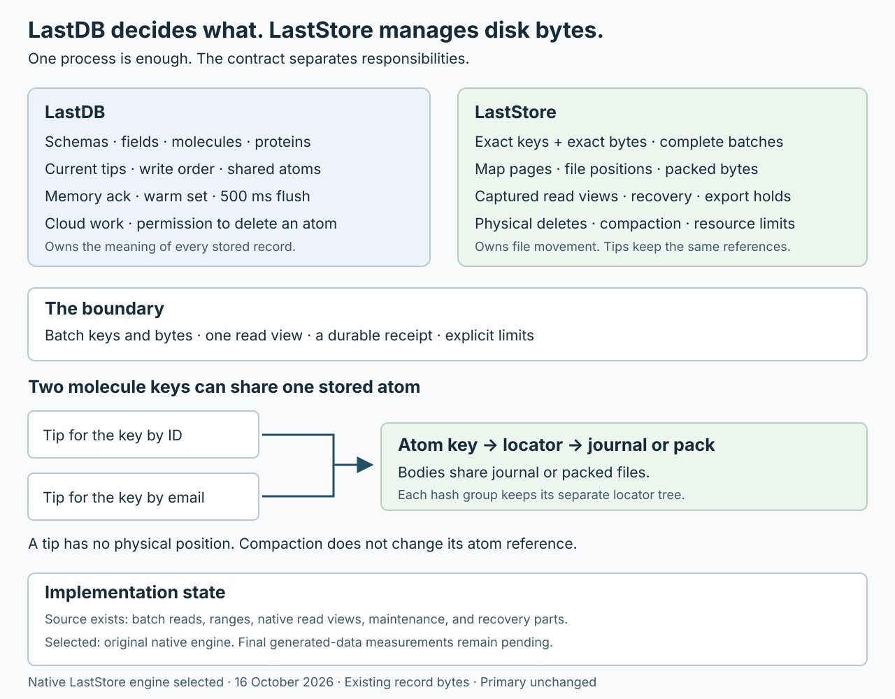

# LastDB and LastStore storage boundary

Selected engine and boundary design, 16 October 2026.

Tom selected the original native LastStore packed-file engine for completion.
R5′ finds file positions through directory and locator pages.
R6′ reads the required bytes from packed files.
The final node work reuses these parts and preserves existing atom and tip records.
The default backend and primary remain separate adoption decisions.

LastDB decides what a record means and whether it must remain.
LastStore stores exact keys and bytes, then manages their disk space.
The two components can stay in one process and share one release.
Their boundary is a complete batch, a captured read view, and explicit resource limits.

Keep molecule sharing, atom sharing, ordered ranges, and current values only.
Keep physical file positions out of molecule tips and cloud records.
Use one storage engine for tips, atom bytes, and required control records.
The selected engine is the existing native LastStore engine.
An alternate engine comparison is optional later work, not a completion prerequisite.

## Responsibilities

| LastDB owns | LastStore owns |
|---|---|
| Schemas, canonical fields, molecules, and proteins | Exact keys and exact stored bytes |
| Key encoding, OPE range meaning, and storage scope | Byte order within the supplied key bounds |
| Current tips, write order, conditions, and tombstones | Complete batch publication and recovery |
| Atom identity, exact body references, and shared use | File positions, pages, large-value pages, and file handles |
| The 10000 logical records in the warm set | Bounded temporary storage objects for each call |
| The memory ack and the 500 ms flush schedule | The separate durable disk receipt |
| Cloud mutation order, pending cloud work, and cloud receipts | Captured read and export views |
| Permission to delete an atom key | Safe physical reclaim after storage holds end |
| Encryption scope, key access, and logical identity | Required physical encryption state and file integrity |

LastStore does not follow protein links or select a winning cloud write.
LastDB does not redirect molecule tips when a physical atom moves.
The node calls maintenance through LastStore and receives counts, progress, and limits.
It does not receive positions that it must repair.

## Records and shared atoms

A current tip contains the atom UUID, current write facts, delete state, and a stable reference to its exact stored bytes.
That reference contains no file number, page number, or byte position.
An atom entry holds the stored bytes under that stable reference.
Different protein molecules can refer to the same entry.

Small atom bytes sit beside their atom key inside a storage page.
Larger atoms use additional pages under LastStore's control.
Large file blobs keep their separate file service and references.
The precise page size and value threshold belong to the selected engine.

Compaction can move an atom without a logical change to any referencing tip.
LastStore changes its internal page references and protects earlier captured views.
An engine can reuse free space during normal writes.
Reuse does not necessarily shrink a file; a separate compact operation can reduce the allocated size.

### Exact bytes and atom identity

The current atom UUID hashes the source schema and content.
It excludes creation time, metadata, and the source file name.
Encryption can also produce different stored bytes for the same atom UUID.
LastStore must not equate those representations or select one silently.

The later boundary proposal supplies a stable body key within the existing storage scope.
The existing BodyID concept can identify exact stored bytes without a file position.
The current tip carries that body key directly, beside the atom UUID.
The body key must bind the exact bytes and their scope under a documented codec.
The earlier 384-byte entry and BodyExtent layout do not define this new record format.

The original engine completion preserves existing atom UUID keys and exact stored record bytes.
It does not introduce the proposed body-key codec or the earlier direct-position format.

An ordinary read needs no intermediate atom-UUID-to-body-key lookup.
An existing read by atom UUID can use its separate LastDB-owned live representative rule.
That representative creates no permanent history or retention right.
No new atom version or previous-value chain is introduced.

## Read sequence

The ordinary sequence is:

**Schema and field → molecule → current tip → shared atom bytes**

1. LastDB captures one disk view together with one complete accepted memory view.
2. It resolves the schema, field, saved molecule UUID, and encoded key through that view.
3. It collects missing tip keys and sends one batch read.
4. It collects the distinct body keys from those tips and sends one batch read.
5. It validates and decrypts the results, then returns them in request order.
6. It keeps only the logical records that the call used in the warm set.

Each storage call uses the same captured disk view.
LastDB's accepted memory view supplies newer complete changes, including deletes.
Cached schema and field metadata must be valid for that captured view.
The schema can already be in memory; its molecule UUID then needs no disk read.
Two logical lookups do not promise two physical disk reads.
LastStore reports page work, file opens, read calls, and read bytes.

All temporary page buffers and file handles end with the call.
A continuation can retain an opaque view hold with an explicit limit and expiry.
It does not retain decoded storage pages or admit a hash group to the warm set.
No global atom-position map stays in application memory.

### Ordered ranges

LastDB supplies the storage scope, molecule, encoded hash, and encoded range bounds.
LastStore compares the supplied bytes and returns ordered pages within those bounds.
It does not decode an OPE range or infer its original value.
Range work stays under the requested hash.

A range page returns tip records first.
LastDB then batches the distinct atom requests.
A continuation binds the disk view, accepted memory view, range bounds, and codec context.
An expired view returns an explicit expiry result.

Budget the examined keys, pages, bytes, and handles as well as the returned records.
Do not read a complete hash group to answer one key.
Do not fetch all range values and truncate them to a requested page.
A codec change retains its existing compatibility rules and logical winner order.

## Write sequence and durability

LastDB collects one complete logical mutation before the memory change.
It checks conditions and write order under one writer scope.
It creates the exact atom bytes, changed tips, reference facts, and required later work.
Queued protein updates keep their existing delivery semantics.
A queued update and its required atom hold enter the same complete batch.

1. LastDB asks LastStore to reserve the complete disk work and replacement space.
2. LastDB reserves logical records and protects the accepted batch from cancellation.
3. LastDB publishes the complete memory change and sends the memory ack.
4. At the flush, LastDB submits complete accepted batches in their accepted order.
5. LastStore commits each stored batch completely and returns a durable receipt.
6. LastDB publishes the new disk view and removes its covered memory changes together.

The normal flush interval stays 500 ms.
A crash before the flush can lose a write with a memory ack.
The durable receipt means recovery returns every operation in that stored batch.
Recovery must not expose a subset across namespaces, hashes, or files.
A logical API batch can still contain independent item results.

LastStore can combine page work across submitted batches while it preserves their required order and receipt boundaries.
Repeated operations on one key retain the complete ordered input.
LastDB can reduce input only after it proves that no condition or required side action depends on the removed operation.

LastDB writes state changes and the required pending cloud work in the same durable batch.
The pending record can contain the bytes or retain their body references.
LastStore treats those records as ordinary keys and values.
The cloud upload occurs later and does not delay an ordinary memory ack.

### Failures and resource limits

Reserve memory, disk output, publication work, and required side records before the memory ack.
Count other reservations, held exports, incomplete maintenance, and replacement output.
Take no credit for future compaction.
Refuse a batch before the memory change when the complete reservation cannot fit.

An accepted batch remains owned after caller cancellation.
Normal shutdown drains accepted work.
A failed or uncertain disk commit stops further write admission and retains the required recovery state.
Recovery resolves the saved batch token without a new author clock or atom identity.
The token identifies disk work, not atom history.

Each submitted batch has an owned stable token and an exact input digest.
LastStore records its receipt or committed frontier in the same atomic operation as the batch.
After reopen, it resolves that token before a retry.
A repeated committed token returns its receipt; the same token with different input causes refusal.
Receipt cleanup needs a durable coordinator frontier and explicit bounds.

An implementation must report unsupported guarantees before admission.
A sequence of independent writes followed by a flush does not satisfy the complete-batch contract.
The engine can use its own journal or page publication method.
LastDB does not prescribe either physical format.

## Deletes and safe reclaim

LastDB's tombstone and LastStore's key delete have different duties.
A tombstone remains a stored current value until LastDB permits its removal.
It prevents a delayed older cloud write from restoring a deleted key.
A LastStore delete removes a storage key from the new disk view.

LastDB deletes atom bytes only after all current, shared, and required delivery uses end.
The delete and its reference changes use the same complete batch.
A bare atom-ID representative does not keep unused bytes forever.
LastStore does not decide whether a protein still needs an atom.

LastStore separately protects bytes that an active read, export, backup, or recovery operation still needs.
It can reuse those bytes only after those storage holds end.
A physical compact operation receives finite byte, time, and temporary-space limits.
It reports progress or a deferred result when a hold prevents reclaim.
It never returns molecule positions for LastDB to redirect.

## Backup and cloud

LastStore supplies a bounded export from one complete captured disk view.
The export returns opaque keys and exact values, or an engine-owned backup operation.
LastDB does not assemble a physical file list or retain file positions.
An opaque export handle carries its hold, progress, and release rules.
Export is a maintenance operation; it adds no query without a key.

LastDB defines the logical cloud snapshot and its mutation frontier.
The snapshot records and frontier come from the same captured durable view.
Store the frontier with its complete state changes and read it through the export view.
A frontier from newer memory or a separate live queue read cannot describe that snapshot.
The snapshot contains stable keys, current facts, atom references, and each required body once.
Mutation records after the frontier carry later logical changes.
Neither format contains local file positions.
A local compaction creates no user mutation and no cloud mutation.

LastDB owns cloud receipts and releases pending work after durable completion.
LastStore owns any physical view that the export still holds.
Long exports need explicit byte limits, expiry, and a resumable or retry result.
Restore creates a separate destination and keeps encryption counters and required identity rules intact.
An engine change must not weaken current encryption, recovery, or restore protections.

## Minimum LastStore contract

These names describe responsibilities. They do not fix Rust method names.

| Operation | Required result |
|---|---|
| Open | Read the format and limits; refuse unsupported required features before a write. |
| Reserve a batch | Reserve complete output, temporary memory, and replacement space; return an owned reservation. |
| Commit a batch | Accept a stable token, exact input digest, and ordered puts and deletes; return one durable receipt and captured view. |
| Resolve a commit | After recovery, resolve a batch token from its atomic receipt or frontier before any retry. |
| Capture a view | Return an opaque complete view; keep its required bytes until release or defined expiry. |
| Read many keys | Return exact values or absence in request order through one view and one explicit budget. |
| Read a range page | Read only the supplied hash and bounds; return ordered results and a view-bound continuation. |
| Export a view | Stream bounded exact records or create an engine-owned backup; preserve the captured state until completion. |
| Maintain and report | Reuse or reclaim space within limits; report counts, holds, progress, and read/write costs. |

Single-key convenience calls can wrap these operations.
The product path must collect keys and writes before it calls LastStore.
Conditions that depend on current LastDB values remain under the same LastDB writer scope.
An engine-level conditional primitive is acceptable when it has an explicit complete-batch meaning.

No public contract exposes page roots, pack extents, file retirement receipts, or engine-specific hash-group identifiers.
The LastStore adapter can use those objects internally.
The implementation can stay tightly integrated with LastDB without a separate service or transport.

## Current implementation and required changes

The status below describes source in the preserved candidate, not the primary.

| Area | Current state | Required change |
|---|---|---|
| Batch reads | LastStore and native adapters provide them. Generic defaults can issue serial reads. | Require a real batch path for the product adapter. |
| Ordered range pages | Methods exist. Some generic defaults read a larger set before truncation. | Require bounded native range work. |
| Atomic durable batches | The native path has complete publication machinery. The generic mixed-batch contract disclaims cross-group crash atomicity. | Require all-or-none recovery across the complete batch. |
| Read views | The native adapter captures disk state, accepted writes, and a hold. | Add a storage-neutral view and a LastDB coordinator. |
| Shared atom records | Tips already identify atoms; the direct-position format is only a proposal. | Keep stable exact body references and remove physical extents from the proposed tip. |
| Backup and export | Backup paths expose LastStore-specific file operations. | Add bounded coherent export and opaque holds. |
| Space reservation | Native reservations exist. The current caller uses a default with the hard cap disabled. | Connect a configured whole-home cap and concurrent reservations. |
| Encryption and restore | Wrappers, counter checks, and recovery protection exist. | Preserve those rules through the storage contract and any engine change. |

The previous 384-byte direct-position format remains a historical proposal.
It is not the next implementation target.
Its current-only, write-order, scope, and codec requirements remain useful.
Its physical sizes, extent fields, and tip relocation plan no longer govern this design.

## Build order

Complete the original native engine through the real node path.
Preserve the current default engine as a separate baseline with its documented guarantees.
Use the existing native complete-publication code for the first adapter where it fits.
Do not add another journal to the legacy engine merely to make it enter the comparison.

| Step | Work | Completion result |
|---|---|---|
| 1. Preserve the baseline | Record exact source, executable, configuration, and generated input. Keep the existing receipts. | Later results identify the actual old and new implementations and durability settings. |
| 2. Define and implement the narrow boundary | Define owned batches, reservations, receipts, outcome recovery, views, and budgets. Define stable body identity separately from atom UUID. Preserve the existing record bytes in the first adapter. | LastDB submits keys and bytes. File positions and complete publication remain inside the adapter. Unsupported guarantees refuse before admission. |
| 3. Complete the first node path | Use generated data, a hash with ordered ranges, two fields, and two protein lookup keys. Batch create, read, update, and delete; flush and reopen. | Read the same current values through both keys. Retain a shared atom when one reference ends. Recover every operation in a durable batch together. |
| 4. Measure the original engine | Compare the preserved native baseline and completed candidate through identical product commands. Keep the legacy node comparison separate. | Report read and write costs, space costs, and every regression. Separate the memory ack from disk completion. |
| 5. Finish the selected path | Complete conditions, repeated keys, queued protein work, tombstones, continuations, the warm set, bounded maintenance, and export. | Preserve LastDB semantics. Atom movement changes no molecule tip. Whole-home reservations include replacement and held-view space. |
| 6. Finish recovery and adoption | Complete source-free restore, current-state conversion, compatibility refusal, packaging, and the final measurements. | Preserve current facts, shared bodies, encryption rules, and pending cloud work. Report regressions. Keep primary activation separate. |

Start with the contracts and one complete batch path.
Keep the existing native page and pack format.
An engine must meet the memory rules without a retained storage-object cache outside the logical warm set.
Do not convert an existing home implicitly.
Keep primary activation as a separate action.

The first reviewable implementation is one real node batch through the new boundary, followed by exact and range reads, flush, and reopen.
It includes the atom bytes, tips, reference facts, and required pending work.
The memory ack and durable receipt remain separate results.

The first code change adds a concrete LastStore facade around the existing native home.
Move physical reservation, complete publication, and captured disk-view ownership behind that facade.
Keep LastDB's schema preparation, protein work, and logical memory ownership in LastDB.
Use the existing node routes; add no service, backend registry, or new physical format in this unit.
Keep a new logical body-key encoding outside this completion unit.

Later steps must preserve encryption, memory, and backup requirements from the start.
Each comparison states its supported path, configuration, and durability boundary.
Reject an engine that cannot meet a required rule instead of expanding the custom engine to hide the gap.

### Measurements

Use independently generated homes, not primary data or a copy of the primary.
Use the real product commands for the receipts.
Keep format, lint, build, and security checks; add no tests or fixture harness.

Compare exact keys, absent keys, ranges, updates, deletes, and shared atoms.
Include batch sizes 1, 16, 64, and 256, and several value sizes.
Report the memory ack separately from the durable flush.
Report median and p95 latency, throughput, file opens, read bytes, written bytes, and temporary memory size.
Report disk size before deletes, after reuse, and after compact.
Report export holds and the cost of a source-free restore.
Keep operating system cache state explicit; fresh-process reads do not establish an empty system cache.

## Source basis

- [Current storage API](../fold_db/crates/core/src/storage/traits/kv.rs): batch reads, ranges, conditions, and the mixed-batch durability limit.
- [Current storage capabilities](../fold_db/crates/core/src/storage/traits/namespaced.rs): engine-specific flush, read, and backup access.
- [Native read capture](../fold_db/crates/core/src/storage/disk_pack/read.rs): one captured disk and accepted-memory view.
- [Native write admission](../fold_db/crates/core/src/storage/disk_pack/write.rs): reservation and complete publication work.
- [Space policy](../vendor/laststore/src/disk_pack/maintenance/space.rs): disabled default hard cap and reservation rules.
- [Atom identity](../fold_db/crates/core/src/atom/atom_def.rs): content UUID inputs.
- [Earlier storage decision](../vendor/laststore/docs/DECISION_BRIEF_VS_SLED.md): disk reclaim as a reason for the previous engine change.
- [redb design](https://github.com/cberner/redb/blob/master/docs/design.md): one example of keys and values in managed pages.
- [LMDB documentation](https://raw.githubusercontent.com/LMDB/lmdb/mdb.master/libraries/liblmdb/lmdb.h): free-page reuse and held-read constraints.
