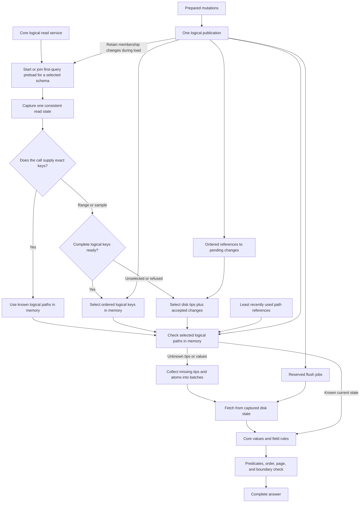

# LastDB logical warm set design

CAUTION: This design records the October 18 implementation and its earlier write policy and record-count limit.
Use the [memory and disk routes](lastdb-rehydrate.md) and [native summary](lastdb-disk-native-node.md) for current behavior.
Native writes now wait for disk commit and clean memory publication. The warm set uses a byte limit.
The historical design below does not authorize an early memory ack or a 500 ms collection timer.

Status: native storage and shared core memory merged in [PR 214](https://github.com/EdgeVector/lastdb/pull/214), 2026-10-18.
Selected tips without values merged in [PR 215](https://github.com/EdgeVector/lastdb/pull/215).
The [core model spike](lastdb-core-model-warm-spike.md) records the earlier implementation.
The retention choice below extends the full-record model with selected tips that do not yet hold values.
The [schema preload design](lastdb-schema-range-preload-design.md) defines the first-query load and complete logical key part.
The [work plan](lastdb-logical-warm-set-plan.md) records the implementation and its evidence limits.
The [fast range design](https://github.com/EdgeVector/lastdb/blob/2f4ba44bd0688b0c0361db325d037524d8bb243a/docs/lastdb-fast-range-design.md) defined disk work for the initial load and fallback route. It targeted disk format v1, which is removed.
The [schema key study](lastdb-schema-range-preload-study.md) preserves the synthetic memory and disk-component measurements.

The core model exposes complete logical operations through a read service.
For a selected HashRange schema, the first query loads all required membership keys into that logical model.
Later ranges and sample select from its complete key part.
Tips and atom values remain partial; the resolver reuses current warm paths and fetches missing paths in batches.
Unselected or explicitly refused schemas retain the bounded disk selector.

The warm set uses the existing schema, field, molecule, tip, and atom types.
The separate least recently used list holds logical path references.
Keep one whole-domain readiness fact, not facts for each query interval or saved sample window.
A partial key structure cannot determine a complete range answer.

## Two read routes

Selected schemas first pass the shared preload gate, including their first exact query.
The first query waits for the full schema key load; concurrent queries share it.
After that gate, the call either supplies its exact keys or asks the engine to select them.

| Route | First action | Disk work |
|---|---|---|
| Exact Hash, exact HashRange pair, or explicit key batch | Trust current known logical paths in memory. | Fetch only unknown tips or required values. No key enumeration or routine disk check follows a warm hit. |
| Range or sample on a ready schema | Select complete current membership from the logical key part. | Fetch only unknown required tips, values, and predicate fields in batches. No disk key discovery. |
| Range or sample on an unselected or DiskOnly schema | Select current membership from disk plus captured writes that await flush. | Read bounded tip pages, then fetch unknown required values in batches. |

An exact HashRange pair supplies both parts of its key. It uses the exact route.
A hash alone in a HashRange molecule can name many range keys. It requires key discovery.

Pages and counts over a range inherit the range route.
A count over supplied exact keys uses the exact route.
Filters over explicit keys use those keys and fetch only unknown required fields.
Both routes use the same logical warm set after key selection.

The key part covers every required hash and membership source for the selected schema.
It keeps keys and essential membership flags without every AtomEntry or atom value.
The full logical-record cap remains 10,000; complete keys use a separate explicit byte allowance.
The [preload contract](lastdb-schema-range-preload-design.md) defines load states, current-write maintenance, purge, refusal, and reload.
The earlier 5,000-tip preload option is superseded.

## Supported calls

Ordinary reads use Hash or HashRange. Every range supplies one hash.
Schema preview remains an explicit inspection call, capped at 10 records.
It cannot become a general record list.

| Call | Required knowledge before a complete answer |
|---|---|
| Exact Hash key | Current tip or confirmed absence for that key; required atom data. |
| Exact HashRange pair | The same facts for one hash and range. |
| Exact batch | Resolve each distinct key; fetch only unknown tips and required atom data. |
| All keys under one hash | Complete membership for the requested part of that hash. |
| Prefix or bounded range | Complete membership inside the selected interval, including empty gaps. |
| Page or cursor | A complete examined prefix and one extra qualifying record, or confirmed exhaustion. |
| Count | Complete key membership; also predicate and visibility facts when the count includes those rules. |
| Ordered sample under one hash | The same rule as a small first page. |
| Whole schema sample | Explicit authoritative membership selection with the existing capped preview rules. |
| Field predicates | Known values or known absence for every field that the predicate needs. |
| Value order | Known sort values for the full candidate domain, unless the key order already supplies that order. |
| Write or delete | One publication of logical changes, dirty state, and reserved flush work before the ack. |
| Explicit database catalog reference | The referenced schema uses the same current objects and publication rules. |
| Cloud import | The same current-value selection and publication as a local write. |

Remove Single and standalone Range through schema declarations, callers, and clients together.
Reject cross-hash range selectors and unsupported patterns explicitly.
An enum entry does not establish a supported operation.
Reject as_of at the common public boundary. The current-value design supplies no history read.

## One logical owner

CoreWarmSet owns the complete key parts, sparse core tips, and shared atom objects.
It also retains immutable definitions through the existing Schema and molecule control types.
These objects include schema state, molecule headers, generation selectors, molecule encryption-key metadata, and receiver and conflict controls.
A confirmed absence can enter memory; a failed read cannot establish absence.
This state contains no saved query answers.

Each query captures one logical boundary before it uses shared definitions.
The query and the core hold the same object reference.
Every recorded dependency includes each supported physical key form, including forms that are currently absent.
An accepted write removes affected definitions before the new logical boundary becomes visible.
An older query retains its earlier objects or fetches from its captured disk state.
Physical flush and LastDB compaction do not clear unchanged definitions.

The definition allowance is 16 MiB per native runtime, with at most 10,000 entries in shared memory.
The charge stays with the object until the last query releases it, even after its removal from shared memory.
A refused object stays local to its query; refusal does not fail the read.
This allowance is separate from the complete-key allowance and the 10,000 logical-record cap.
It measures conservative charges, not the complete process memory size.
Active conflict histories retain their existing event reads.

A recognized per-key generation record or delete marker clears the affected key's source links.
A generation-pointer change or structural molecule replacement clears the affected molecule's warm slots.
An unknown control identity clears authorization rather than permits an unchecked warm answer.
The first read of an invalidated record fetches it again; its repeat can use memory.
Without an active generation, its row and delete markers do not add keys to a ready key part.
A later generation-pointer change clears readiness before a query can use it.
This rule prevents a delete marker from restoring an absent key candidate.

Write preparation uses its captured core state and matching disk root.
A memory ack requires a complete core change and the corresponding reservations.
The [core memory results](https://github.com/EdgeVector/lastdb/blob/0b0a79d4c10949e2f0570e82d9bc4fdb9513a285/docs/proofs/core-memory-state-20261018/RESULTS.md) record the operational checks and matched synthetic measurements.

The flush queue owns exact disk work. It does not serve current-key reads.
Packed files, file locations, encryption, and LastDB compaction remain disk responsibilities.
A file blob stays outside the warm set. An atom keeps its file reference.

A partial molecule never replaces the complete disk molecule.
Flush writes the prepared changes. A snapshot reads a completed disk state.

Exact lookup uses direct core slot references.
It never enumerates a hash to resolve one exact key.
Ready range membership comes from the core ordered keys under the captured logical boundary.
The initial load and fallback cursor combine disk with accepted changes.
The ordered pending references name the existing core slots; they contain no second copy of current values.

The logical cursor selects the ready key part or the existing disk adapter.
It adds no persistent B-tree or pager.
The engine's read service owns fetch and completeness decisions.
The molecule and atom types remain logical objects; their existing field rules process the selected objects.
A batch collects missing paths before disk work.
After the initial schema load, fixed-hash ranges seek to their bounds and process bounded pages.
Hidden or rejected candidates can require additional work.

## Logical identity and four states

A logical path names the scope, schema identity, canonical field, molecule, hash, and optional range.
Its current atom UUID is its target. A replacement atom does not create another path.
A complete key can establish membership while its field paths remain unknown.
That key alone is not a known tip or a full logical path under the 10,000-record cap.

| State | What memory knows | Required action |
|---|---|---|
| Unknown tip | The current key state is unknown. | Fetch the tip by key. |
| Known absence | An authoritative read or accepted delete establishes absence. | Return the operation's absent result. |
| Known tip | The current AtomEntry and metadata are known; its atom data is not loaded. | Fetch atom data only when the call needs it. |
| Known value | The current tip and its full atom object are known. | Use the existing core operation. |

### Retention choice

A tip links one key to its current atom and includes the key metadata.
The atom contains the value. A known tip does not establish that its value is in memory.
The core keeps a selected tip without its value when a call needs only the tip.
A later value fetch adds the full atom to that same logical record.
A metadata-only call preserves an already retained full value when the tip is unchanged.
Accepted writes retain complete values and their memory charges through flush and any older calls that still hold them.

The earlier implementation retains only complete records and confirmed absence.
Its selected tips live only within one call, so repeated counts can repeat disk tip reads.
The mixed choice permits reuse of those selected tips without a second warm set or a separate tip limit.
Complete range keys remain smaller: they contain candidate keys and visibility flags, without a tip or an atom.
Preload retains candidate keys and flags; it does not retain every tip or atom.

| Choice | Repeated value read | Repeated call that needs only tips | Retention cost |
|---|---|---|---|
| Complete records only | Reuses a retained full atom. | Can repeat tip reads when no value fetch follows. | Fewer retained record states. |
| Selected tips, with values added when used | Reuses the same retained full atom. | Reuses valid selected tips that fit the warm set. | One additional state under the same record limit and purge rule. |

The second choice is intentional. A tip alone never becomes an absent value or a complete range answer.
Source changes invalidate the tip and its value together.
The selected physical copy and all required source controls remain part of that authority.
An unverified or capacity-refused tip stays local to its call; the read still uses its ordinary disk route.
Only selected tips enter this part of memory, within the 10,000 logical-record limit.
Large counts can exceed that limit and still require disk tip reads.

Current tip-only admission adds no atom payload to memory.
For comparison, 10,000 distinct 64 KiB values contain 625 MiB of payload before metadata and allocation costs.
Counts already omit those values; the added benefit is reuse of their tips across calls.
This calculation is not a measured speed gain or a whole-process memory bound.

The path consumes one budget slot in either known-tip or known-value state.
An exact absent path also consumes one slot.
Temporary cursor pages do not require retention of every examined key.

The read service separates key selection from value resolution.
Its ready selector returns keys, membership flags, continuation, exhaustion, and the captured boundary.
The fallback selector can also supply current selected tips.
Its resolver collects unknown exact tips and required atom values into batches.
Callers cannot run an unrestricted filter on a partial molecule and interpret its output as complete.
Existing pure filter helpers operate on the authoritative candidate selection.

Unknown never means absent. A missing field, a missing record, and a missing document copy have different meanings.
A missing document copy permits the field route. It does not establish an absent record.

## Sharing and metadata fidelity

One actual molecule slot can have several schema paths.
A write updates that slot once. Existing aliases see the same change.
An unused copied schema does not enter memory merely because a reverse link names it.

Atom UUID identifies content in the current code. It does not identify all metadata or creation time.
Share a full Atom reference only when its complete immutable value matches.
Legitimate variants with one content UUID remain distinct core Atom objects.

Each slot needs its own resolved atom association.
An atom with the same UUID elsewhere does not establish that this slot's full value is loaded.
No additional atom UUID or content hash is required.
Metadata conflicts must not substitute another slot's metadata.

A used path does not fetch other fields or keys.
Named alternate addresses select the same primary records.
The record and its alternate addresses enter one logical publication when the request becomes accepted.

## Key order

Normal HashRange order belongs to one molecule, one hash, and one key-encoding domain.
The core uses canonical logical keys. The disk adapter translates bounds to the stored typed range payload.
Both use the same comparison and endpoint rules.

Values from different molecules or key domains cannot share one comparison domain.
The selector therefore names the scope, molecule, hash, key layout, and encoding identity.
A key-layout or encoding change requires a new selection and cursor.

Use explicit included, excluded, and unbounded endpoints.
The existing public bounded range remains start-inclusive and end-exclusive.
A cursor excludes its last returned key.
Use a structured prefix bound or a correct prefix successor. Do not construct bounds by appending a NUL.

When stored key forms coexist, the adapter reads every relevant form and merges their current winners.
A nonempty primary result does not prove that fallback forms contain no additional keys.
Retain each winning source during the fetch. Do not reconstruct it from the returned API key.

## Authoritative key selection

The selected route uses complete core keys after the first-query preload.
Select their membership under the same logical boundary as current values.
Check known warm tips before any missing-tip batch.
Then use matching warm atoms and batch-fetch missing values.

The initial loader and fallback route use bounded current-tip pages, called A0 in the earlier study.
A tip carries the key and current atom reference; it is not the field's atom payload.
The loader keeps only the resolved key and essential membership flags unless a normal warm path also needs the tip.

The disk adapter combines all relevant stored forms, generation rules, and delete controls.
It then merges captured pending inserts, deletes, replacements, and key moves before limits or counts.
No forced flush is required.

Each selected tip retains:

- The canonical logical key and its encoded logical slot.
- The actual winning stored source and storage scope.
- The full AtomEntry and KeyMetadata.
- The order token, atom placement hint, and key-encoding identity.
- The captured read boundary.

The page also reports the examined continuation and explicit exhaustion.
Exhaustion covers the merged disk and pending streams, including pending keys after the final disk key.
A limit, cancellation, error, or incomplete source merge cannot establish an empty interval.
Zero warm keys establish nothing about keys on disk.
An exhausted authoritative selection establishes absence for that call without a retained interval fact.

Use the selected tip to find its matching warm atom association.
Do not substitute the latest warm value by key if it differs from the selected state.
Do not infer full metadata equality from the content UUID alone.
Fetch unresolved associations from the captured source in batches.

After resolution, selected logical records can enter the warm set under its path budget.
The cursor can discard rejected chunks without retention of their tips.
The next ready range selects memory keys and reuses any matching warm values.
Only a fallback range repeats disk membership selection.

A directory-only cursor remains an optional study, called A1.
Bare directory keys still need current tip, delete, and generation resolution.
The current key-only trait fallback loads records and drops their values.
It does not establish A1's performance.

Do not add retained per-query intervals.
The complete schema key part supplies membership with one domain lifecycle.

## Pages and counts

For a page of N qualifying records, continue until N+1 qualify or the interval ends.
The extra record establishes has_more. It does not establish completeness beyond that record.
Unknown predicate fields require a batch fetch before the engine can decide whether a record qualifies.

Keep the internal examined position separate from the public cursor.
The public cursor names the last returned record.
It must not skip the extra record selected for the next page.

An offset also requires knowledge of the preceding keys.
Large offsets can require substantial work even with an ordered molecule.
Prefer a key cursor for repeated pages.

Process large ranges and filtered pages in bounded chunks.
Release each discarded chunk's path holds before the next chunk.
Select the next chunk from the same logical boundary and authoritative key source.
Fallback chunks retain the required captured disk state and pending changes.

Make exact total count an explicit request in the target API.
A normal page needs lookahead rather than a mandatory traversal of the whole hash.
Use null for an unrequested total, never the number of warm records.

Distinguish live-key count from count after value predicates.
Key count needs current membership and delete metadata.
A count after predicates also needs their values and visibility rules.
Do not label a metadata-only count as exact when content tombstones or unresolved values can change it.
Count and returned records use the same primary key source and fallback decision at the captured boundary.

Each page reads current state at one boundary.
A later page can see newer writes. A cursor does not retain an old database.
An insertion behind the cursor requires a new traversal to appear.
A changed key layout requires a new cursor.

## Sample

The plan preserves the current ordered sample, capped at 10.
It does not select whichever records remain warm.
A random sample would require a separate selection contract.

Under a supplied HashRange hash, sample uses the authoritative cursor as a small first page.
It selects the first eligible tips under the existing sample visibility rules.
It reuses selected warm values and fetches missing values through the normal batch route.
It does not infer the first keys from the partial warm molecule.

The existing whole-schema SampleN remains an explicit capped inspection operation.
Keep its primary-field selection and known-empty fallback rules.
An unloaded primary molecule does not justify that fallback.

Repeat source selection at the captured read boundary on each call.
Use fallback molecule B only after authoritative exhaustion establishes that primary molecule A is empty.
Merge accepted inserts into A before that decision.
A budget stop cannot justify fallback.

The current native selection order uses stored key coordinates before API-key recovery.
Hash preview follows its stored token order.
HashRange preview is range-major, with stored hash tokens as ties.
Retain the relevant order token as metadata. Do not compare tokens across molecules or encoding epochs.

For selected HashRange schemas, the first query completes the full key load before preview selection.
Later previews use ready membership without another disk key discovery.
Unselected and DiskOnly schemas use bounded small-tip pages.
Prevent full atom materialization before a small output limit.
Physical key candidates do not prove current membership.
Resolve candidate tips, active generations, delete barriers, and pending changes in bounded batches.
Skip metadata tombstones under the existing sample rules, then refill until N eligible tips or exhaustion.

For global HashRange order, keep at most 10 selected eligible tips while the cursor examines membership.
Fetch full atom data only for that final selection and its required secondary fields.
Existing content-level exclusions can reduce the returned count after that selection.
Additional body-level refill would change that sample behavior.

This preserves the current selection without another disk membership artifact.
Global preview can still examine many schema keys, even when the keys are in memory.
If the work budget ends before selection is complete, return a clear limit error.
Do not return a biased or falsely complete sample.
A budget stop or unresolved candidate cannot establish an empty primary source or justify the fallback.

Keep no leading-window fact or saved sample answer.
Each preview selects keys from its current authoritative source and resolves the required unknown tips and atoms.
A random sample requires a separate selection contract.

The current source disables the derived secondary directory.
Ready complete keys can support global preview without another disk key discovery.
The fallback route keeps its present disk work.
This plan restores no derived disk directory and promises no constant-cost global preview.

## Filters and value order

Use the existing core field operations on a complete candidate set.
The warm subset cannot stand in for that set.

Fetch predicate and sort fields even when the response omits them.
Unknown requires a fetch. Known absence follows the declared operation's truth rules.
The current numeric value filter ignores an absent target; a present nonnumeric value fails.
Preserve that behavior until an explicit API change replaces it.

An include-tombstones option changes visibility, rather than completeness.
It cannot recover an old value or make an unknown key absent.

Choose the authoritative current values before predicates, order, limits, and response projection.
Document-copy values cannot replace field values after those decisions.
Complete and partial document copies must use one explicit precedence rule.

- A complete current document copy supplies its fields; an omitted field is known absent.
- A partial copy supplies its included fields; other fields use their current field molecules.
- An absent copy uses the field route. An unknown copy requires a fetch.
- Returned value metadata follows the selected atom, without metadata from an overridden source.

Use one stable tie order throughout predicate selection and response output.
Retain sort metadata through response construction when the sort field is not projected.
A key cursor serves key order. Other value orders need a compatible cursor or a clear rejection.

An arbitrary value sort may need every candidate under the named hash.
A small output limit does not remove that requirement.
Frequent queries of that form need an appropriate keyed molecule.
The warm set does not add a query over all schemas.

Examine a large candidate domain in complete bounded chunks under one read lease.
Count and bounded value order can retain an aggregate or current selection while earlier chunks leave memory.
Apply global limits and order across that complete examination, rather than independently to each chunk.
Discarded value chunks need no retained interval fact; the complete key domain has its own lifetime.

## One complete read boundary

A read includes schema bindings, key membership, tips, atom values, document-copy rules, counts, and page flags.
A shared query batch uses the same boundary for its complete answer.

1. Capture schema definitions, the disk root, its covered logical change number, and the current logical change number.
2. Retain immutable relevant changes after the disk root's covered number.
3. Select ready logical keys, merge the changes with fallback disk selection, or resolve the exact supplied keys.
4. Hold selected warm entries and their full atom associations.
5. Collect unknown required paths, then fetch the batches outside the publication lock.
6. Recheck the logical change number under the lock.
7. Restart the complete call if it changes; do not retry fields independently.
8. Otherwise admit eligible fetched records and finish the complete answer.

Publish the disk root and its covered logical change number atomically.
A capture sees either the old root with its required changes or the new root that includes them.
Physical file frontiers, queue delivery completion, and logical publication numbers are different facts.
Do not compare their numeric values as if they share a sequence.

A held stable path alone does not preserve its previous atom after an overwrite.
The call retains its selected immutable entry, metadata, absence state, atom reference, and write sequence.
These are temporary call references. They do not provide a history query.

Relevant unflushed changes must survive a concurrent flush while the call uses an older disk root.
A disk-only fallback loses accepted writes that the captured root does not yet contain.
The call's retained logical references supply that missing state.

Retries obey the request deadline.
If protected dirty records prevent capacity, release the call's holds before a wait for flush.
A flush failure returns an error.
Continuous writes can cause a retryable refusal; they cannot cause an endless retry loop.

A file-root lease prevents file removal during a read.
It is separate from logical path holds.
File handles and segment maps leave after the fetch. They do not enter the warm set.

## Writes and flush

Prepare each distinct atom and its size once.
Carry its actual core object into publication instead of another fetch of the prepared bytes.
Retain exact source checks when a tip reuses an older atom or a different file location.

Reserve logical capacity and queue space before the ack.
Publish changed core tips, atom associations, absence, ordered membership, dirty state, and flush jobs together.
Publication cannot fail after it exposes only part of the batch.

Every writer participates, including durable writes, alternate-key changes, imports, retention, backfill, schema changes, and administrative changes.
Ordinary mutations publish typed per-key changes.
A replacement larger than the path budget uses a typed root transition.
A durable write still changes the logical owner before its ack.
Its disk wait does not justify a bypass.

An insert enters the ordered pending references before the ack.
A ready key domain receives its membership change in that same publication.
A loading domain retains the required change until readiness publication or explicit load cancellation.
A delete preserves absence and the required delivery state until flush.
A key move publishes its old-key delete and new-key insert together.
Every writer supplies these current changes to the selector.
A bypass remains unfinished conversion work. Final compatibility removal requires every writer to publish through the logical owner.

For a logical bulk replacement, prepare the new disk state before visibility.
Include the accepted prefix in that state or complete its flush first.
Reserve the publication metadata, then publish the new root, covered logical number, bindings, and generation controls together.
Publish replacement complete keys or invalidate affected key domains with their warm slots before the ack.
Physical flush and LastDB compaction preserve readiness when logical membership stays unchanged.

The logical service resolves subsequent unknown paths through the new root.
Old calls retain their old root and required immutable entries, or retry.
Do not force the replacement into an over-cap pending path batch.

An older flush cannot clean a later write.
Flush completion leaves hot records warm.
Accepted work survives cancellation of the client call.
The queue keeps only the exact work that disk or cloud delivery still needs.

## Capacity and purge

Proposal (2026-10-19, not implemented): [the warm set byte limit design](lastdb-warm-set-byte-limit-design.md) replaces the path count below with a byte limit.

The logical cap is 10,000 paths.
The least recently used list names those paths and stores no values.
Purge skips held paths and unflushed write paths, including required atom data.

Count distinct required paths across projection, predicate fields, lookahead, and relevant dirty changes.
N returned records can require more than N paths.
A filtered page can examine more than N+1 candidates.

Purge removes one schema path.
Remove an actual core slot only after its last required owner leaves.
Then remove its atom object after its last required reference leaves.

Logical-record purge removes its tip and value together and preserves complete key membership.
A separate whole-domain key purge clears readiness before removal and can require another preload on the next query.
Capacity refusal uses DiskOnly rather than a failed full load on every query.
A ready call retains its complete-domain lifetime reference across all chunks.
Clean key purge does not change the logical change number, so that number alone cannot protect the key domain.
This design adds no independent body purge policy. Other retained records remain useful.

Bound temporary cursor pages and selected atom batches.
Count active path holds and dirty paths against the path budget.
Enforce the existing memory guard and coordinate-size limits as well.
The complete key allowance counts allocation capacity, domain metadata, build work, and active read references separately.
The [preload design](lastdb-schema-range-preload-design.md#memory-and-purge) defines the proposed 128 MiB initial setting and whole-domain lifecycle.

A new call either reserves enough room, waits within its deadline, or receives a retryable refusal.
It never turns capacity pressure into a complete empty answer.

## Cloud and unavailable data

Cloud imports select the current winner, then publish through the same logical owner.
A losing or repeated mutation cannot replace a newer current value.
The warm set supplies no old-value read.

A snapshot names a completed disk prefix and retains the files that its upload needs.
It does not require every record in memory.
An offline fresh restore can start with an empty warm set.
An import into an active node uses the normal publication boundary.

Absence requires an authoritative source for the named domain.
If local disk omits cloud-only data, a local miss remains unknown.
A future cloud fetch must use the same boundary and local-write precedence rules.
If that source is unavailable, return an error rather than claim absence.

## Earlier proposal and current boundaries

The original proposal predates complete selected keys and the native cutover.
The table below records the current boundaries; historical source gaps remain in the earlier proof reports.

| Area | Current behavior | Limit |
|---|---|---|
| Logical records | Unknown, confirmed absence, selected tip, or selected tip with its full atom. | Tips require complete current-source authority; values retain their selected physical copy. |
| Complete keys | Selected schemas preload complete candidates separately from partial records. | Readiness does not prove an exact visible count or that all values are in memory. |
| Purge | One logical-record limit and recency order cover tips and full records. | A purge removes both together; this design adds no independent body purge. |
| Writes | Covered changes enter the core together; uncovered operations finish on disk before success. | Accepted writes cannot become tip-only before flush. |
| Evidence | The merge report records fresh synthetic API results for the native cutover. | Those earlier results do not measure this tip-retention change or every caller and database size. |
| Cloud | Activation remains disabled. | Future backup and restore work must preserve the same read and publication rules. |

Source detail and the execution order appear in the [work plan](lastdb-logical-warm-set-plan.md).
