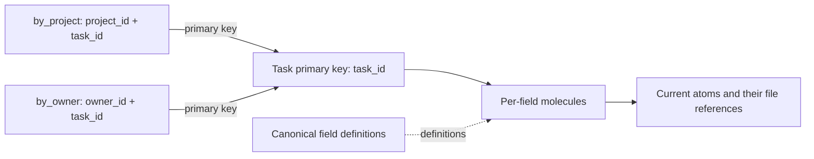

# One schema with alternate keys

Status: design spike, 2026-10-29. Tom requested a plan and prohibited a merge.
Source base: `b2419f5a8b510306411bb9c84a2fece0019ceec3`.
The examples below describe the unmerged spike API. Accepted main does not support this API.

## Recommendation

Give one schema one primary key and named alternate keys.
Store each field value through its primary field molecule.
Each alternate molecule maps its key to the primary record key.
Remove proteins after an explicit conversion of existing schema relationships.

Keep canonical field reuse separate from record identity.
An equal canonical field describes the same kind of value.
It does not prove that two records describe the same fact.
This changes the current automatic cross-schema write rule and requires explicit adoption.

The [implementation plan](PLAN.md) lists the source changes, conversion gates, and future CI comparisons.
The spike now includes the fresh-home product slice and a CI comparison.
It does not convert an existing home or remove the old protein route.

## Current state

Each field has a molecule that maps the schema key to an atom.
The current protein code connects equal canonical fields across schema molecules.
A write derives each peer key from available field values.
The peer loop omits a member when its required key values are absent.

The source record supplies its own key values and fetched fields.
That path does not retain a complete record identity map between schemas.
Equal field identities therefore cannot establish complete alternate access to one record.

Sources:

- [Canonical model](../../lastdb-canonical-model.md).
- [Field membership](../../../fold_db/crates/core/src/schema/core/load/coherence.rs).
- [Key values for peers](../../../fold_db/crates/core/src/fold_db_core/mutation_manager/molecules/protein_key_fields.rs).
- [Peer update selection](../../../fold_db/crates/core/src/protein/ops/batch.rs).

## Proposed schema

Use `Task` for one logical record.
Its primary key is `task_id`.
The other keys select those same records by project or owner.

```json
{
  "name": "Task",
  "schema_type": "Hash",
  "key": {"hash_field": "task_id", "range_field": null},
  "fields": ["task_id", "project_id", "owner_id", "title"],
  "alternate_keys": {
    "by_project": {
      "hash_field": "project_id",
      "range_field": "task_id",
      "missing": "reject"
    },
    "by_owner": {
      "hash_field": "owner_id",
      "range_field": "task_id",
      "missing": "omit"
    }
  }
}
```

The schema service still supplies canonical names, field identities, and field types.
Alternate declarations reference resolved fields within this schema.
They do not create another schema or request cross-schema field propagation.
The first Task slice has a Hash primary key and scalar Hash or HashRange alternate keys.
It uses the existing typed key codec.

Each complete alternate key in this slice must include the primary key field.
For `Task`, `project_id + task_id` permits many tasks under one project.
The complete pair identifies one task.
A key of `project_id` alone cannot identify one task and receives an explicit refusal.
Alternate uniqueness without the primary key suffix remains outside the first implementation.
Compound primary keys need an explicit tuple design before an alternate can add another coordinate.

Key fields use schema-local names after the app alias map resolves them.
Canonical field identities establish their definitions and types.
They do not supply values from other records.
The first implementation rejects computed keys, arrays, objects, and mapped key fields.
It permits exact empty text keys and uses the current numeric and Boolean key rules.

## Record identity and field reuse

The record identity is `(storage scope, schema identity, primary KeyValue)`.
The primary key remains immutable for that record.
A primary key change requires an explicit new record and deletion of the old record.
No additional record UUID or whole-record value copy is necessary.

| Relationship | Meaning | Effect of a write |
|---|---|---|
| Canonical field reuse | Schemas use one field definition and type. | Equal definitions alone cause no value update elsewhere. |
| Alternate key | Another key within one schema names the same record. | All keys reach the current primary field values. |
| Explicit same-key field mapper | A declared alias names an existing field molecule with proven equal coordinates. | The alias sees that molecule's current atom without a protein. |
| Reference to another record | A field names another schema and its exact record key. | A caller can request those exact keys in a batch. No implicit recursive fetch. |

Keep explicit same-key field mappers as a separate facility.
Do not discover mutable value aliases from equal field identities.
Do not extend a same-key mapper across unequal keys.
A reference between records does not become a new alternate key.

The first alternate-key slice uses ordinary owned fields and canonical definition reuse.
It rejects `field_mappers` on that schema.
Existing same-key mapper schemas remain outside that slice.
Later support needs explicit write, delete, and alternate-dependency rules.
This avoids hidden cross-schema work when a mapped value supplies an alternate key.

## Stored shape



The schema owns one alternate molecule for each named alternate key.
An alternate entry contains a typed primary `KeyValue`.
It contains no payload atom, per-field tip, or separate field clock.
The alternate molecule has its own key type profile and schema reference.
It is a proposed new molecule entry kind; current field-tip readers cannot interpret it.

Keep the existing per-field molecule-to-atom route for primary data.
Use the primary key fields to establish record membership.
Alternate entries reference the primary key, not an atom.
They therefore add no atom body reference.
Their molecule references, counts, memory charges, and removal still require explicit native effects.

Keep each entry within the record's authorized storage scope.
Use the native encryption and typed key codec.
Do not construct compound keys with text separators.
Do not keep an uncharged second store of alternate entries or fetched payload values.

## Record and key rules

Each eligible primary record has one entry in each alternate molecule.
Each entry names a live primary record whose current fields derive that alternate key.
An alternate read returns the current primary field values.
The primary field molecules remain the only route to their atoms.

Each supported alternate key in this slice contains the complete primary key.
Thus two different primary keys cannot claim one complete alternate key.
An entry that names an absent primary record or mismatched coordinates is an integrity error.
The reader must report an integrity error rather than silently omit the result.

For the original propagation question, the required key fields now belong to one schema.
Preparation supplies their values from the addressed record.
There is no need to infer whether another schema represents that record.

## Missing key values

`missing: reject` requires every key field to contain a valid scalar value.
A partial update can use the current stored value for an omitted field.
A create or accepted update without a required value fails before any batch member becomes visible.

`missing: omit` declares a sparse alternate key.
A missing or null component produces no alternate entry.
A valid value creates the entry; loss of that value removes its old entry.
An array, object, or scalar type mismatch still fails.
The declaration permits omission explicitly; the writer does not silently skip an unknown destination.

## Direct write flow

All mutations address the primary key in the first implementation.
The native request remains the owner of validation, private changes, disk commit, and core publication.

1. Resolve the schema, scope, field aliases, and primary keys for the complete batch.
2. Enter the existing native write boundary. Check authorization, idempotency, CAS, and delete barriers.
3. Batch-fetch the old key-dependent fields and changed-field headers.
4. Resolve accepted field changes through the existing author-clock rules.
5. Compute the accepted record state and each old and new alternate key.
6. Validate required values, types, budgets, and alternate targets.
7. Stage field changes, old-entry removal, and new-entry insertion in one native transaction.
8. Stage normal counters, history, retention, capture, and change-feed effects.
9. Complete the disk commit. Publish the complete clean core change. Send the durable ack.

For repeated keys in one batch, later preparation sees earlier accepted private changes.
A rejected older field cannot move an alternate entry.
An idempotent retry changes no entries or counters.
Delete, Purge, and TTL remove every current alternate entry for the addressed primary record in the same transaction.
The source record's delete barrier governs replay; derived entries have no independent conflict winner.

Schema metadata records which alternate declarations depend on each field.
An ordinary update fetches dependencies only for affected declarations.
Create and whole-record removal consider all declarations.
Field removal considers each declaration that uses that field.

```text
plan_alternate_delta(definitions, before, accepted_after):
    for each affected alternate definition:
        old = derive(definition, before)
        new = derive(definition, accepted_after)
        if old != new:
            if old is present: remove(old, expected_primary_key)
            if new is present: insert(new, primary_key)
```

The planner receives values and returns typed changes.
It performs no storage calls.
The existing request code collects reads, calls the planner, and stages its output directly.
Do not add a forwarding service, trait stack, or alternate commit coordinator.

Example: change task `t7` from project `p1` to `p2`.
Remove `by_project[p1,t7]`, insert `by_project[p2,t7] -> t7`, and update the field value together.
The `by_owner` entry stays unchanged.
A title-only change creates no alternate-entry write.

## Direct read flow

The proposed query adds an optional named key selector:

```json
{
  "schema_name": "Task",
  "key_name": "by_project",
  "filter": {"HashKey": "p1"},
  "fields": ["task_id", "title"]
}
```

An omitted `key_name` retains the primary key route.
Unknown names, unsupported filters, and an absent hash receive explicit errors.

1. Resolve the named molecule within the authorized schema and storage scope.
2. Capture one core view and its committed disk root.
3. Select alternate entries by exact key or a bounded range under one hash.
4. Collect primary keys. Batch-fetch primary fields and key dependencies within that same capture.
5. Check membership and required access fields before the result window.
6. Return fields in alternate order and the primary key for future mutations.

The response retains `key` as the primary `KeyValue`.
It adds `matched_key` for the selected alternate coordinates.
A cursor carries the alternate name, declaration revision, typed comparison identity, and last selected alternate key.
The node rejects a cursor from another key or declaration revision.
Separate requests do not promise a retained snapshot across pages.

Field conditions retain their current keyed candidate scope.
Apply conditions before their result limit and fetch only the required fields.
Do not turn a rejected record or an empty body page into a false end of membership.
Counts, key lists, and watches need the same named-key rules before the public feature is complete.

An alternate entry never grants access to fields or another database.
The first release exposes alternate keys only within the owner's database scope.
Received-data queries remain unsupported for alternate keys until their field grants and scoped entries receive an explicit design.

## Cost and limits

Let `N` be the record count, `A` the alternate count, and `K` the selected result count.
Let `D` be the alternate declarations whose input fields change.
The field count and `A` are bounded schema constants.

| Operation | Proposed cost |
|---|---|
| Exact primary read | Existing direct molecule lookup. |
| Exact alternate read | One alternate lookup, then primary field lookups; expected O(1). |
| Range under one hash | Existing seek cost plus O(K) entries and a batch of K primary reads. |
| Field-only update | Existing field work; no entry rewrite when alternate inputs remain equal. |
| Key-dependent update | At most D old removals and D new entries. |
| Delete | At most A alternate removals plus current field removal. |
| Extra storage | O(N A) key-to-primary entries; no alternate payload tips. |

These are algorithmic bounds, not measured latency results.
The extra primary lookup can increase cold-read latency.
Fewer duplicate tips can reduce write bytes and counter work.
The future CI comparison must measure both effects.

A rename of proteins retains the current peer-key inference problem.
Per-field alternate tips reuse the current tip route, but retain field fanout and duplicate reference work.
One key-to-primary entry makes record identity explicit and removes that payload fanout.
The extra read hop is its main latency tradeoff.

Use the existing request limits and typed range limits.
Add explicit per-schema alternate-count and per-request derived-entry budgets.
Calculate bytes before admission; refuse an oversized request before publication.
Do not use a timer, a background repair, or an unlimited queue to complete an acknowledged write.

## Compatibility and removal

Retain the existing schema primary identity when named alternates change.
Add a versioned alternate declaration digest and generation to schema metadata.
Freeze each active generation; a new generation becomes visible only after complete backfill.
Include that generation in cursors, schema synchronization, and mutation compatibility checks.
Do not change identity hash inputs without the required shared algorithm version change.

Advertise an alternate-key capability through the existing API version route.
Require explicit refusal by unsupported clients, nodes, and schema-service versions.
Unknown fields that an older component silently ignores are not a safe deployment sequence.
Advance the logical home format before the first alternate entry; old writers must refuse that home.
Current homes use format 4. An extra marker that an old binary ignores is insufficient.
This change is separate from the native disk file version.

Convert only relationships that an owner explicitly identifies as one logical record.
Equal field identities, equal values, or equal atom UUIDs do not establish that identity.
Keep unrelated schemas separate.
Keep valid same-key field aliases explicit.
Convert cross-key same-record schemas to named alternates with declared field maps and source keys.
An ambiguous or divergent record blocks that conversion.

No startup conversion, primary access, or old-home format fallback belongs in this spike.
Remove protein code only after the explicit converter covers accepted relationships and all live callers use the new model.
The final reader and writer each use one route; migration support must not become permanent competing semantics.

## Next action

Review the record identity, field reuse rule, and conversion scope first.
Then implement the fresh-home `Task` slice through the existing native request boundary.
Run the generated-data operational checks and latency comparison in CI before any future merge decision.
Keep this design spike unmerged.
