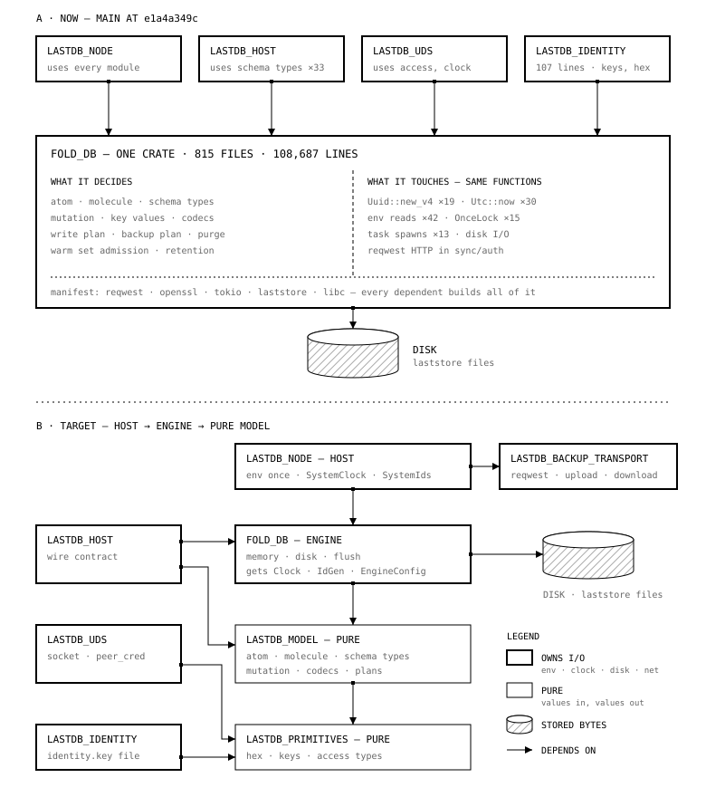

# Spike: separate decisions from effects in `fold_db`

**Date:** 2026-10-30
**Base:** `main` at `e1a4a349c`
**Status:** proposed. Decisions D1 to D5 wait for Tom.
**Verdict:** GO. Copy the `schema_service_core` PR sequence to `fold_db`.
Split the crate last, after the module cycles are gone.

## Question

`fold_db` is the database engine and also the shell around the engine.
Its functions mix decisions with effects:

- A decision says what a mutation is, what a backup contains, or what stamp an atom gets.
- An effect reads or changes the world: the clock, random ids, env vars, disk, network, and tasks.

Tom named four problems:

1. Records get their time and id in their own constructors. `Mutation::new` calls `Uuid::new_v4` directly.
2. The cloud backup HTTP client sits next to the codecs.
3. Process-wide `OnceLock` budgets read env vars deep inside the engine.
4. Every crate above `fold_db` depends on all of it.

The spike answers two questions:

1. Which boundary separates the decisions from the effects?
2. In which order do we move the code, so that each PR is safe to merge?

## Short answer

1. **Use three layers.** The host reads the world once and passes values down.
   The engine executes plans on memory and disk with the ports that it gets.
   The model decides, with values in and values out.
2. **The template is in this repo.** On 2026-10-29, six PRs changed
   `schema_service_core` (20,762 lines) to this shape. A crate-local
   `clippy.toml` now denies the clock, env vars, files, tasks, and random ids in that crate.
3. **Split the crate last.** Rust does not permit a cycle between crates.
   Today `schema`, `storage`, and `db_operations` reference each other in both directions.
4. **The first step is small.** Two moves take `fold_db` out of `lastdb_identity` and `lastdb_uds`.
   Those crates then stop the build of `reqwest`, `openssl`, `laststore`, and `tokio` through `fold_db`.

The template PRs:

| PR | Change in `schema_service_core` | Files |
|---|---|---|
| [#747](https://github.com/EdgeVector/lastdb/pull/747) | Pass `SchemaConfig` into the core. Stop the env reads. | 32 |
| [#757](https://github.com/EdgeVector/lastdb/pull/757) | Add a deterministic snapshot of core outputs. | 8 |
| [#759](https://github.com/EdgeVector/lastdb/pull/759) | Inject `Clock`. Stop the system clock reads. | 38 |
| [#767](https://github.com/EdgeVector/lastdb/pull/767) | Inject the runtime and cache ports. | 29 |
| [#771](https://github.com/EdgeVector/lastdb/pull/771) | Drop `chrono` and the heavy `tokio` features. | 18 |
| [#774](https://github.com/EdgeVector/lastdb/pull/774) | Add the `clippy.toml` deny list. Inject `IdGen`. | 28 |

## Terms

| Word | Definition in this spike |
|---|---|
| decision | A function that computes a result from its inputs only. It reads no clock, env var, file, socket, or random source. |
| effect | An action that reads or changes the world: a clock read, a random id, an env var, disk I/O, network I/O, or a task spawn. |
| port | A trait that the engine calls for an effect, for example `Clock` or `IdGen`. The host supplies the implementation. |
| model | The pure layer: data types and decisions. |
| engine | `fold_db` after the change: memory, disk, flush, and the execution of plans. |
| host | `lastdb_node`: the process that reads env vars, owns the runtime, and builds the ports. |
| plan | A value that a decision returns and the engine executes. |

## Current state

All counts are for `fold_db/crates/core/src` at `e1a4a349c`.
The crate has no test code (`cfg(test)` count is 0), so each count is product code.
The appendix has the commands.

### Size

`fold_db` is one crate with 815 files and 108,687 lines.

| Module | Lines |
|---|---|
| `db_operations` | 36,531 |
| `fold_db_core` | 23,690 |
| `storage` | 22,136 |
| `schema` | 8,362 |
| `resident` | 5,183 |
| `atom` | 3,061 |
| 11 other modules and the top-level files | 9,724 |

### Effect sites

| Effect | Calls | Files |
|---|---|---|
| `Uuid::new_v4` | 19 | 15 |
| `chrono::Utc::now` | 30 | 24 |
| `SystemTime::now` | 4 | 4 |
| `crate::clock::unix_*` helpers | 37 | 27 |
| `Instant::now` | 76 | 46 |
| env reads (`std::env::var`, `env_flag::var_*`) | 42 | 27 |
| `OnceLock` statics | 7 | 7 |
| other process-wide statics (atomics, a mutex, a thread-local cell) | 6 | 6 |
| task spawns (`tokio::spawn`, `spawn_blocking`) | 13 | 13 |
| `reqwest` | 15 | 7 |

Most `Instant::now` calls measure latency for metrics.
They do not change stored data, so this spike leaves them in the engine.

### Problem 1: records stamp their own time and id

| Constructor or method | Effect | Location |
|---|---|---|
| `Mutation::new` | `Uuid::new_v4()` for `uuid` | [mutation.rs:146](../../fold_db/crates/core/src/schema/types/mutation.rs#L146) |
| `Atom::new` | `Utc::now()` for `created_at` | [atom_def.rs:91](../../fold_db/crates/core/src/atom/atom_def.rs#L91) |
| `MoleculeHashRange::new`, `with_uuid` | `Utc::now()` for `updated_at` | [construct.rs:17](../../fold_db/crates/core/src/atom/molecule_hash_range/construct.rs#L17), [:40](../../fold_db/crates/core/src/atom/molecule_hash_range/construct.rs#L40) |
| `MoleculeHashRange` write methods | `Utc::now()` for `updated_at` | [ops.rs:67](../../fold_db/crates/core/src/atom/molecule_hash_range/ops.rs#L67), [:122](../../fold_db/crates/core/src/atom/molecule_hash_range/ops.rs#L122), `import.rs:128`, `overlay.rs:23` |
| `Ed25519KeyPair::generate` | `OsRng` | [security/keys.rs:19](../../fold_db/crates/core/src/security/keys.rs#L19) |

One write reads the clock three times:

1. The author clock gets the time as an argument:
   `state.advance_local_batch(unix_nanos(), local_count)`
   ([author_clock.rs:341](../../fold_db/crates/core/src/fold_db_core/mutation_manager/author_clock.rs#L341)).
   This part already has the target shape.
2. `AtomStore::create_atom` calls `Atom::new`, which reads `Utc::now()` for `created_at`.
3. The molecule write methods read `Utc::now()` for `updated_at`.

The three values differ for one mutation.
A replay of the same mutation gives a new `created_at` on an atom with the same content UUID.
The [warm set spike](../lastdb-core-model-warm-spike.md) has to handle that case.

`create_atom` also reads a process global.
It calls `enforce_atom_content_limit`, which reads `max_atom_content_bytes()`.
That function returns a `OnceLock` value from `LASTDB_MAX_ATOM_CONTENT_BYTES`.

### Problem 2: a decision and its effects in one function

The backup planner is in
[planner.rs](../../fold_db/crates/core/src/storage/disk_pack/byte_backup/planner.rs).

- `build` (line 19) lists the files on disk (`inner.files()`) and writes `job.json` two times.
- `input` (line 100) reads a frozen plan from disk.
  It then mints `request_id` with `Uuid::new_v4` (line 119).
- The file header says "No network authority."
  The network is out, but the disk and the random source are in.

The pack rule is a decision.
Its inputs are a file list and the policy constants. Its output is a list of planned objects.
Since 2026-11-01 the rule is in the `cloud_backup_plan` crate.
That crate reads only through the readers that the caller gives, and it keeps no store.
The snapshot capture and the mutation log capture both call it.
The job state of the snapshot capture is still in the core.

The schema types also fetch their own data.
`schema::types::field::variant::read` and `schema::types::field::filter_utils::fetch` call `DbOperations` directly.
23 files under `schema/` reference `storage`, `db_operations`, or `fold_db_core`.

### Problem 3: HTTP next to the codecs

- `sync/auth/backup_transport` holds the `reqwest` client for upload, download, feed, URLs, and auth.
  All 15 `reqwest` references in `fold_db` are under `sync/`.
  `sync/auth` has about 950 lines.
- Only `lastdb_node` calls `fold_db::sync::auth`.
- The `fold_db` manifest lists `reqwest` without a feature gate.
  It also enables the `otel` feature of `observability` for one call:
  `inject_w3c` in `sync/auth/backup_transport/http.rs`.
- `sync::capture` is not HTTP. It is the mutation admission
  (`MutationLogCaptureRouter`, `with_mutation_admission`).
  Its name puts it next to the transport.

### Problem 4: configuration as process globals

The engine reads env vars in constructors and in hot paths:

- `FoldDB` boot reads the conflict janitor and molecule drain task policies
  ([init_boot.rs:50, :74, :101](../../fold_db/crates/core/src/fold_db_core/fold_db/init_boot.rs#L50)).
- The `MutationManager` constructor reads `ResidentPolicy::from_env()`
  ([mutation_manager/mod.rs:185](../../fold_db/crates/core/src/fold_db_core/mutation_manager/mod.rs#L185)).
- `EncryptingKvStore::new` reads `KvCompressionPolicy::from_env()` (`encrypting_store/mod.rs:68`).
- The schema key budget reads `CoreKeyBudget::from_env()` (`disk_pack/schema_keys.rs:80`).
- The disk node reads `space::policy_from_env()` (`disk_pack/run_node.rs:220`).
- `create_fold_db_with_options` reads `LASTDB_ENGINE`
  ([factory/mod.rs:59](../../fold_db/crates/core/src/fold_db_core/factory/mod.rs#L59)).

Three budgets live in `OnceLock` statics:

| Function | Static | Location |
|---|---|---|
| `process_memory_budget()` | `BUDGET` | [process_budget.rs:196](../../fold_db/crates/core/src/memory_budget/process_budget.rs#L196) |
| `max_atom_content_bytes()` | `EFFECTIVE_LIMIT` | [size_limit.rs:55](../../fold_db/crates/core/src/atom/size_limit.rs#L55) |
| `core_warm_bytes()` | `CORE_WARM_BYTES_IN_FORCE` | [warm_bytes.rs:17](../../fold_db/crates/core/src/resident/warm_bytes.rs#L17) |

The first read sets each value for the life of the process.
Two `FoldDB` instances in one process cannot have different budgets.
`core_warm_bytes()` returns the default until a caller runs `init_core_warm_bytes_from_env()`.
`lastdb_node` runs it in `main.rs:175`. A caller that does not run it gets the default and no error.

### Problem 5: every crate above gets all of it

| Crate | Lines | What it uses from `fold_db` |
|---|---|---|
| `lastdb_identity` | 107 | `security` keys and `hex` |
| `lastdb_uds` | 3,208 | `access` types, `access::peer_cred`, one clock call |
| `lastdb_host` | 5,319 | `schema::types` (33 references), `db_operations`, `mutation_manager`, `access` |
| `lastdb_node` | 60,194 | almost every module |
| `generate_schema_org_classifications` | 859 | nothing: the manifest declares `fold_db`, and the source has no `fold_db` path |

Each crate in the table builds the full `fold_db` dependency set:
`reqwest`, `openssl`, `laststore`, `tokio`, `aes-gcm`, `ed25519-dalek`, and `libc`.
`lastdb_uds` has no direct `tokio` dependency. It gets the runtime through `fold_db`.

`exemem-infra` depends on `observability` only, not on `fold_db` (checked at `d5ec53482`).

### Module cycles

The table counts `crate::<module>` references between top-level modules.

| From | To (references) | Direction |
|---|---|---|
| `schema` | `storage` (28), `db_operations` (26), `fold_db_core` (1) | model to engine: wrong direction |
| `crypto` | `storage` (2) | model to engine: wrong direction |
| `atom` | `schema` (4), `security` (1), `crypto` (1), `sharing` (1) | model to model: small |
| `storage` | `schema` (22), `db_operations` (16), `sharing` (6) | engine to model and engine |
| `db_operations` | `schema` (294), `storage` (157), `atom` (123) | engine to model: correct direction |

The wrong-direction edges are the work.
Most `schema` to engine edges come from the fetch code in `schema::types::field`.
The `crypto` to `storage` edge is `content_key_proof.rs`.
Cycles inside the engine (`storage` and `db_operations`) can stay, because they stay in one crate.

### Patterns that already work

- A pure parse function sits next to most env reads, for example
  `parse_core_warm_bytes(Option<&str>)`, `parse_max_atom_content_bytes`, and `parse_interval`.
  Only the `std::env::var` call has to move.
- `advance_local_batch(now, count)` gets the time as an argument.
- `FoldDbOptions` already carries open-time inputs (`offline_maintenance`, `search_outbox_inbox`).
  It can carry the config and the ports.
- Pure leaf crates exist: `schema_types`, `cloud_backup_protocol`, `lastdb_storage_policy`, `env_flag`, and `app_identity_crypto`.
- `schema_service_core` has the ports (`Clock`, `IdGen`, `BlockingRuntime`),
  the config struct (`SchemaConfig`), and the deny list
  ([clippy.toml](../../schema_service/crates/core/clippy.toml)).

## Target

### The boundary rule

1. The **host** (`lastdb_node`) is the only crate that reads env vars.
   It reads them once at boot, logs one config, and passes the config down.
2. The host builds the ports: `SystemClock`, `SystemIds`, the backup transport, and the runtime.
3. The **engine** (`fold_db`) gets its config and ports when it opens.
   It holds no process global, reads no env var, and opens no network connection.
4. The **model** (`lastdb_model`) gets time, ids, config, and data as arguments.
   It returns values and plans.
   It does not depend on `tokio`, `reqwest`, `laststore`, or the file system.
5. A constructor gets its time and id as arguments. It does not read a clock or a random source.
6. A decision returns a plan, and the engine executes the plan.
   The plan is a value, so the engine can log it.



FIG. 1 — A: one crate holds the model, the decisions, and the effects.
B: the host reads the world, the engine executes, and the model decides.

### Ports and config

The engine ports use the same names as `schema_service_core`.

```rust
pub trait Clock: Send + Sync {
    /// Wall-clock nanoseconds since the Unix epoch.
    fn unix_nanos(&self) -> u64;
}

pub trait IdGen: Send + Sync {
    fn fresh_uuid_v4(&self) -> Uuid;
}

/// One field for each subsystem that reads an env var today.
/// The host builds it once at boot and logs it once.
pub struct EngineConfig {
    pub memory: ProcessMemoryBudget,
    pub warm_set: WarmSetConfig,      // LASTDB_CORE_WARM_BYTES
    pub atoms: AtomLimits,            // LASTDB_MAX_ATOM_CONTENT_BYTES
    pub resident: ResidentPolicy,
    pub drain: MoleculeDrainPolicy,
    pub janitor: ConflictJanitorPolicy,
    pub disk: SpacePolicy,
    pub at_rest: AtRestConfig,
    pub search: SearchConfig,
    // ...
}

pub struct FoldDbOptions {
    pub offline_maintenance: bool,
    pub search_outbox_inbox: Option<PathBuf>,
    pub config: Arc<EngineConfig>,
    pub clock: Arc<dyn Clock>,
    pub ids: Arc<dyn IdGen>,
}
```

### Constructor changes

| Today | Target |
|---|---|
| `Mutation::new(schema, fields, key, pub_key, kind)` | `Mutation::new(id, schema, fields, key, pub_key, kind)` |
| `Atom::new(schema, content)` | `Atom::new(schema, content, created_at)` |
| `MoleculeHashRange::new(schema, field)` | `MoleculeHashRange::new(schema, field, at)` |
| `set_atom_uuid_from_values(...)` sets `updated_at` from the clock | the same method gets `at` |
| `Ed25519KeyPair::generate()` | `Ed25519KeyPair::generate(&mut rng)`; the host supplies `OsRng` |
| `planner::build(inner, state, key)` | `plan_objects(&inventory, &policy) -> Vec<PlannedObject>` in the model, and a shell step in the engine that lists files and writes `job.json` |

## Move order

Each row is one PR.
No PR changes a stored format. Each PR updates every caller of a changed signature.
Steps 1 to 4 follow the `schema_service_core` sequence.

### Step 1: cut the dependency edges (no behavior change)

| PR | Change | Done when |
|---|---|---|
| 1a | Remove the unused `fold_db` dependency from `generate_schema_org_classifications`. | The manifest has no `fold_db`. |
| 1b | Add the leaf crate `lastdb_primitives` with `hex`, the `security` key types, and the `access` request types. Move `access::peer_cred` (libc FFI) into `lastdb_uds`. `lastdb_uds` reads its one clock value directly. | `lastdb_identity` and `lastdb_uds` do not depend on `fold_db`. |
| 1c | Move `sync/auth` into a new crate, `lastdb_backup_transport`, that `lastdb_node` uses. Rename `sync::capture` to `fold_db_core::admission`. Drop `reqwest` and the `otel` feature from the `fold_db` manifest. | `fold_db` has no `reqwest` reference. |

### Step 2: one config, passed in (template #747)

| PR | Change |
|---|---|
| 2a | Add `EngineConfig` to `FoldDbOptions`. The host builds it from env vars and logs it once. Move the three `OnceLock` budgets: process memory, warm set bytes, and atom content limit. |
| 2b | Move the task policies: molecule drain, conflict janitor, lane breaker cooldown, writer watch, `keep_small` interval, blob dwell, and conflict retention. |
| 2c | Move the storage settings: disk cap, logical capture, schema preload, at-rest compression, and the inflate limit. Move the query and search settings: query concurrency, search inbox and queue, manifest TTL, `LASTDB_ENGINE`, attribution events, and the conflict index flags. |
| 2d | Move the other process state into the `FoldDB` instance (appendix list). Keep a static only with a written reason, for example the process start time in `footprint.rs`. |

Done when: `fold_db` has 0 env reads and 0 `OnceLock` statics.

### Step 3: time and ids as inputs (template #759, #774)

| PR | Change |
|---|---|
| 3a | Add `Clock` and `IdGen` to `fold_db`. The host passes `SystemClock` and `SystemIds`. `FoldDB` holds them. |
| 3b | `Mutation::new` gets the id. `lastdb_host` takes it from `IdGen` in `into_mutation` ([handlers/mutation.rs:86](../../lastdb_host/src/handlers/mutation.rs#L86)), where the comment already says "Allocate one mutation identity". Update the 10 callers. |
| 3c | `Atom::new` and the `MoleculeHashRange` writes get the time. The write path passes the mutation admission time (D2). |
| 3d | Replace the other clock and id calls: repair and guard tokens, generation ids, backup request ids, erase meter keys, and report times. |

Done when: `fold_db` has 0 `Uuid::new_v4`, 0 `Utc::now`, and 0 `SystemTime::now`.
`Instant::now` stays for latency metrics.

### Step 4: deny the effects (template #774)

| PR | Change |
|---|---|
| 4a | Add `fold_db/crates/core/clippy.toml` and `#![deny(clippy::disallowed_methods, clippy::disallowed_types)]` in `lib.rs`. The required `clippy` job then enforces the list. |

The engine list is a subset of the `schema_service_core` list:

- Deny: `SystemTime::now`, `Utc::now`, `Local::now`, `std::env::var*`, `Uuid::new_v4`, `rand::thread_rng`, `rand::rng`, `OnceLock`, `LazyLock`, `once_cell`, and `reqwest` types.
- Permit: file I/O, `Instant::now`, and task spawns. The engine is the disk layer, and step 6 decides the task schedule.

### Step 5: cut the cycles, then extract `lastdb_model`

| PR | Change | Done when |
|---|---|---|
| 5a | Move the fetch code out of `schema::types::field` (`variant::read*`, `filter_utils::fetch*`) into the engine query layer. | `schema` has no reference to `storage`, `db_operations`, or `fold_db_core`. |
| 5b | Cut the small model edges: `crypto::content_key_proof` moves to the engine. `atom::file_pointer` gets the cipher suite constant from the model. `atom::history_event_memo` moves to the engine. | `atom` and `crypto` have no engine reference. |
| 5c | Split the backup planner: `plan_objects(&inventory, &policy)` in the model; file list, `job.json` writes, and request ids in the engine. Do the same split for the mutation write plan (`write_preparation.rs`, `TipCommit`). | The pack rule runs on a file list without a store. |
| 5d | Create `lastdb_model` with `atom`, `schema::types`, the mutation type, key values, `canonical`, `kind_partition`, `json_order`, and the codecs. Its manifest has `uuid` without `v4`, `chrono` without `clock` and `now`, and no `tokio`, `reqwest`, or `laststore`. Its `clippy.toml` uses the full `schema_service_core` list. | A CI job runs `cargo check -p lastdb_model` alone, and the job passes. |
| 5e | `lastdb_host` uses `lastdb_model` for its 33 `schema::types` references. | |

The 5d CI job builds `lastdb_model` alone, so a feature from another crate cannot enable `v4` or `clock`.
A call to `Uuid::new_v4` or `Utc::now` in the model then fails to compile.

### Step 6 (optional, D4): the host owns the task schedule

The engine owns tasks for molecule drain, conflict janitor, atom history,
the author clock queue, the flush lanes, the cleanup worker, the change feed, the schema key load,
the disk queue, and three `spawn_blocking` calls.
Step 6 changes each periodic task to `run_once(budget, now)`, and the host calls it on its schedule.
`offline_maintenance` then means "the host schedules no task".

## Proof without tests

Tests stay retired. Each PR uses these checks:

1. **Build and lint in CI.** The required `clippy` job compiles the workspace.
   After step 4 it also enforces the deny list.
   Do not run `cargo check` or `cargo clippy` on a local machine.
2. **Site counts in the PR body.** Each PR gives the appendix counts before and after.
   The count for its step goes to 0.
3. **Product operations and latency in CI.** Product PRs need `benchmark-complete`.
   Speed changes are advisory. Step 5 moves hot code across a crate boundary,
   so read the latency comparison for 5d with care.
4. **Live smoke on synthetic data.** After a step merges, run the `lastdb-smoke-test` skill.
   It does not touch the primary.
5. **Optional output snapshot (D5).** #757 added a deterministic snapshot of `schema_service_core` outputs,
   so later PRs diff outputs without a test suite.
   After step 3, `fold_db` can do the same.
   A fixed clock and fixed ids give identical molecules and atoms for one scripted write sequence.

## Constraints

- No stored format changes. The serialized fields stay the same. No data conversion.
- No compatibility shim and no re-export. Each PR updates every caller.
- The primary stays unchanged. This work includes no upgrade.
- Builds, clippy, and benchmarks run in CI only.
- `main` is not strict. Before each move PR, check the open PRs that touch the moved files.

## Risks

1. **Lost inline calls across crates.** The workspace has no `[profile.release]` section.
   Release builds thus have no LTO across crates.
   A small non-generic function in `lastdb_model` does not inline into `fold_db` without `#[inline]`.
   Mark the hot codec and key-compare functions `#[inline]`, or decide on `lto = "thin"`.
   The 5d latency comparison shows the cost.
2. **Merge conflicts.** Steps 1 and 5 move many files. Keep each PR to one module.
3. **Value change in 3c.** `created_at` and `updated_at` get the admission time, not a new clock read.
   The stored format stays the same. Each value moves by microseconds.
4. **Dispatch cost.** A `Clock` call through `Arc<dyn Clock>` costs nanoseconds for each write batch.
   A config field read costs less than a `OnceLock` read.
5. **Scale.** `fold_db` has 5.2 times the lines of `schema_service_core`, and more effect sites.
   Steps 1 to 5 need 17 PRs, not 6.
6. **A stale design doc.** [lastdb-kernel-constitution.md](../designs/lastdb-kernel-constitution.md)
   names an automated test as the constitution. Tests are retired. Update that doc before step 5.

## Decisions for Tom

| ID | Question | Recommendation |
|---|---|---|
| D1 | Do you approve the boundary rule and the names `lastdb_model`, `lastdb_primitives`, and `lastdb_backup_transport`? | Yes. |
| D2 | Do atom `created_at` and molecule `updated_at` take the mutation admission time (one clock read for each write)? | Yes. An imported mutation keeps its source time, so a replay gives the same `created_at` on each device. |
| D3 | Who mints the mutation id? | The caller, from `IdGen`. `lastdb_host` already allocates the id at that point. An id from the engine at admission changes the retry cache flow. |
| D4 | Does the host own the task schedule (step 6)? | Decide after step 5. Steps 1 to 5 do not need it. |
| D5 | Do we add an engine output snapshot, in the form of #757, as proof for step 5? | Yes, for step 5 only. Tom approves it, because tests stay retired. |

## Next action

1. Tom answers D1 to D5.
2. Open PRs 1a, 1b, and 1c. They need only D1 and change no behavior.

## Appendix

### Commands for the counts

Run from `fold_db/crates/core/src` at `e1a4a349c`:

```bash
rg -c 'Uuid::new_v4' . | awk -F: '{s+=$2} END {print s}'
rg -c 'Utc::now' . | awk -F: '{s+=$2} END {print s}'
rg -c 'std::env::var|env::var\(|env_flag::' . | awk -F: '{s+=$2} END {print s}'
rg -n 'tokio::spawn|thread::spawn|spawn_blocking' . | grep -vc ':\s*//'
rg -o --no-filename 'crate::[a-z_]+' schema | sort | uniq -c | sort -rn
```

### Process-wide statics

| Location | Static | Kind |
|---|---|---|
| `memory_budget/footprint.rs:47` | `EPOCH` | `OnceLock` |
| `memory_budget/process_budget.rs:196` | `BUDGET` | `OnceLock` |
| `memory_budget/env_parse.rs:87` | `PERCENT` | `OnceLock` |
| `resident/warm_bytes.rs:17` | `CORE_WARM_BYTES_IN_FORCE` | `OnceLock` |
| `atom/size_limit.rs:55` | `EFFECTIVE_LIMIT` | `OnceLock` |
| `atom/history_event_memo.rs:46` | `MEMO` | `OnceLock<Mutex<..>>` |
| `atom/history_event_memo.rs:34` | `NEXT` | `AtomicU64` |
| `db_operations/conflict_operations.rs:83` | `DISABLED` | `OnceLock` |
| `db_operations/conflict_operations.rs:135` | `COUNTER` | `AtomicU64` |
| `db_operations/search_index/queue_policy.rs:13` | `CLI_ENABLED` | `AtomicBool` |
| `storage/disk_pack/cloud_work.rs:6` | `ACTIVE` | `AtomicBool` |
| `storage/disk_pack/transaction/blocked.rs:30` | `WRITE_SCOPES` | `AtomicU64` |
| `fold_db_core/mutation_manager/logical_capture/collector.rs:23` | `CANDIDATES` | thread-local `Mutex` |

A pattern search found this list. Step 2d checks it again before the move.
