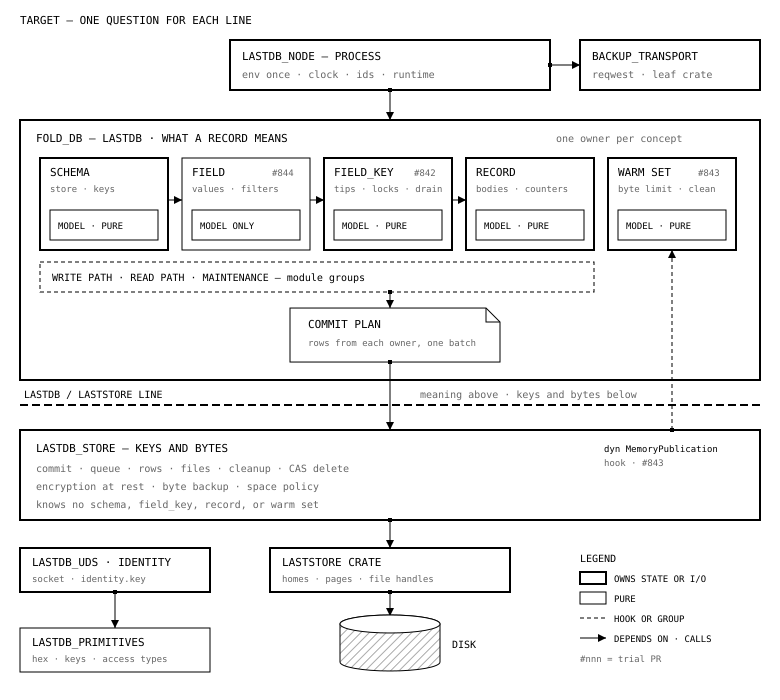

# Spike: the split of `fold_db` with the most clarity

| | |
|---|---|
| Date | 2026-10-30 |
| Base | `main` at `ae0b7936d` |
| Status | proposed |
| Follows | [fold-db-separation-of-concerns.md](fold-db-separation-of-concerns.md) |
| Tool | [scripts/split-lab/split_measure.py](../../scripts/split-lab/split_measure.py) |

## Question

Which split of `fold_db` makes its responsibilities easiest to understand?
Tom asked for the split with the most conceptual clarity, not the easiest split.
This spike measured five candidate splits and one combination.
Three code trials then tested the seams that the measurements found.

## Short answer

1. **The outer cut is the LastDB and LastStore line.**
   This line is in the 2026-10-16 boundary design (workspace `docs/design-lastdb-laststore-boundary.html`).
   LastDB decides what a record means. LastStore stores keys and bytes.
   Of the five candidates, this cut has the fewest violations: 84 references in 24 files.
2. **The outer cut is not sufficient.**
   Above the line, the database holds 84% of the code, and it is still one cycle.
   The cause is not the file layout. Four objects hold the state, and their methods are in 255 files.
3. **The second step gives each concept one owner.**
   An owner is a struct with its own state and a narrow interface.
   After that step, the canonical levels (schema, field, molecule, atom) can organize the database.
4. **Purity is a rule inside each owner, not a crate line.**
   Two leaf crates are correct on every axis: `lastdb_primitives` and the backup transport.

Three code trials tested the three seams on `main`. CI compiled all three, and every check passed.
Each trial keeps the same behavior, locks, batches, and stored formats.



FIG. 1 — The target. The LastDB and LastStore line separates meaning from bytes.
Above it, one owner holds each concept, and each owner has a pure model module.
The owners give rows to one commit plan. `#nnn` marks a trial PR.

## Method

The tool reads `fold_db/crates/core/src` without cargo.
It parses `use` trees and `crate::`, `super::`, and `self::` paths, and it follows `pub use`.
A candidate is a JSON file that puts each of the 815 files in one unit.
The tool counts each reference between units that the candidate does not allow.

The tool also counts these signals:

- **Foreign inherent impls:** an `impl T` block in one unit for a type from another unit.
  Rust permits an inherent impl only in the crate of the type.
  So each one is a hard block for a crate split.
- **Effect sites in pure units:** clock reads, random ids, env reads, process globals, task spawns, network, and file I/O.
- **Concepts with more than one home:** 16 concepts from [concepts.json](../../scripts/split-lab/concepts.json).
  A unit is a home of a concept when it holds 300 lines or more of that concept.

CAUTION: The counts are a lower bound. The tool does not see macro expansion or method calls.
A split with fewer units also has fewer places for a violation. Read each count with the unit count.

Commands:

```bash
python3 scripts/split-lab/split_measure.py \
  --src fold_db/crates/core/src \
  --config scripts/split-lab/candidates/40-store-substrate.json \
  --concepts scripts/split-lab/concepts.json \
  --dependent lastdb_host=lastdb_host/src
```

Candidate 60 combines two candidates. `compose_candidates.py` makes it:

```bash
python3 scripts/split-lab/compose_candidates.py \
  --src fold_db/crates/core/src \
  --outer scripts/split-lab/candidates/40-store-substrate.json --split database \
  --inner scripts/split-lab/candidates/20-canonical-levels.json --out "$TMPDIR/60.json"
```

## Scorecard

| Candidate | Units | Largest unit | Violation refs | Files with violations | Foreign impls | Pure-unit effects | Concepts with >1 home |
|---|---|---|---|---|---|---|---|
| now: one unit per top-level module | 18 | `db_operations` 33% | 2,189 | 486 | 8 | — | 12 of 16 |
| 10 purity: decide or act | 4 | engine 77% | 170 | 77 | 15 | 34 | 12 of 16 |
| 20 canonical levels | 9 | database 29% | 378 | 129 | 138 | — | 13 of 16 |
| 30 place: memory, disk, cloud | 6 | disk 40% | 136 | 49 | 41 | 24 | 14 of 16 |
| **40 store substrate** | 4 | database 84% | **84** | **24** | 16 | 0 | 3 of 16 |
| 50 operation: write, read, maintain | 6 | store 40% | 222 | 47 | 109 | 25 | 14 of 16 |
| 60 = 40 outside, 20 inside | 12 | database 29% | 418 | 143 | 133 | 0 | 12 of 16 |

Today all 18 units form one cycle. Every candidate also leaves one cycle.

## The candidates: what worked and what did not

### 10 purity: decide or act

Units: `primitives`, a pure `model`, `engine`, and `transport`.

- **Worked:** determinism, and two clean leaf crates.
  `lastdb_identity` needs only `primitives`.
  `lastdb_uds` needs only `primitives` after one clock call moves.
- **Did not work:** the model is a mix of every concept's types.
  The engine keeps 77% of the code and every concept. 12 of 16 concepts get two homes.
- **Failure points:**
  - The warm set charges shared budgets, so it stays in the engine.
  - Read rules are async methods on a model type (`FieldVariant`).
  - Key order reads a tokio task-local (`KeyComparisonContext`).
  - `StorageError` covers both decode failures and I/O failures.
- **Verdict:** use purity as a rule in each owner, not as the crate axis.

### 20 canonical levels: schema, field, molecule, atom, file

- **Worked:** the model types follow the levels.
  The model files (10.1k lines) give only 22 of the violations.
- **Did not work:** the store files (99.4k lines) give the rest.
  `AtomStore` has 130 inherent impl blocks. Most of them are molecule code.
  One function, `commit_tip_changes`, writes tips, atom counters, blob counters, and the maintenance rows in one batch.
  The warm set crosses every level. No position for it works.
- **Field:** in the code, field is a type level only. It has no codec and no store of its own.
- **Verdict:** use the levels as the module order for owners and model types, not as crates now.

### 30 place: memory, disk, cloud

- **Worked:** two clean leaves.
  The cloud transport (`sync/auth`) is the only `reqwest` user.
  The warm set (`resident` and `memory_budget`) is clean when memory sits below disk.
- **Did not work:** the order in the code is the reverse of the design order.
  The design puts memory first and disk after the flush.
  In the code, the disk runtime owns the warm set, and the write path waits for the disk.
  The logical store has no place, so disk mixes meaning with bytes.
- **Verdict:** use place only for leaf boundaries. See [A design and code mismatch](#a-design-and-code-mismatch).

### 40 store substrate: meaning above, keys and bytes below

- **Worked:** the bottom line holds for homes, commit, rows, cleanup, CAS delete, the backup planner, and encryption.
  `storage/disk_pack` divides into 62% store and 38% meaning.
  `db_operations` is about 99% meaning.
- **Did not work:** six points cross the line.
  1. `PackRuntime` owns the warm set, the schema keys, and the logical capture.
     `install_committed` publishes the disk root and invalidates the warm set under one lock.
  2. The store applies the database's key families.
  3. Byte backup and restore check the logical inclusion map.
  4. The home format marker is a database record that the store writes and checks.
  5. One process memory budget covers the warm set and the accepted batch bytes.
  6. The database calls `laststore` directly in 12 files.
- **Verdict:** the best outer cut. It says where bytes stop. It does not organize the meaning.

### 50 operation: write, read, maintain

- **Worked:** a request flow is easy to find.
- **Did not work:**
  - The write path needs reads, so the read code sinks into the shared store.
  - The commit writes the maintenance queues in its own batch.
  - Delete and purge are both a user command and a cleanup task.
  - 14 of 16 concepts get two or more homes. Molecule code is in four units.
- **Verdict:** do not use. Write, read, and maintain can be module groups inside one owner.

## What all five found

Each agent found the same structure without the others.

1. **Four objects hold the state.**

   | Object | Inherent impl blocks | Files |
   |---|---|---|
   | `AtomStore` | 130 | 125 |
   | `MutationManager` | 68 | 67 |
   | `PackRuntime` | 40 | 40 |
   | `FoldDB` | 25 | 23 |

   Any file can change any field through `self`.
   So the module tree shows a structure that the state does not have.
   A split by files cannot cross these objects.
2. **The commit knot.** `AtomStore::commit_tip_changes` writes one batch for many concepts.
   The batch must stay one batch, because the atom counter is the only authority that lets an atom body go.
3. **The runtime knot.** `PackRuntime::install_committed` publishes the disk root, the schema keys, and the warm set under one view lock.
4. **Values that fetch their own data.** `FieldVariant` has async read methods that call `DbOperations` and `disk_pack::logical_paths`.
5. **Errors with two meanings.** `SchemaError` is the error type of most of the store (148 references from `db_operations`).
   `StorageError` covers both decode failures and I/O failures.
6. **Clean leaves.** `primitives` (hex, key types, access types, `peer_cred`) and the backup transport are clean on every axis.

## Code trials

Each trial is a draft PR. Auto-merge is off. Each trial took one PR, and CI passed on the first full round.

| Trial | Question | PR | Diff | Result |
|---|---|---|---|---|
| Store line | Can the warm set leave the store? | [#843](https://github.com/EdgeVector/lastdb/pull/843) | 27 files, +621 −322 | Yes |
| Owner per concept | Can a concept leave `AtomStore` and the commit stay one batch? | [#842](https://github.com/EdgeVector/lastdb/pull/842) | 16 files, +423 −364 | Yes, for the molecule drain |
| Plain values | Can the fetch code leave the field types? | [#844](https://github.com/EdgeVector/lastdb/pull/844) | 51 files, +1,739 −1,688 | Yes |

### Trial 1: the warm set leaves the store (#843)

- **Change:** the database owns `NativeWarmSet`, which holds `CoreWarmSet` and `SchemaKeys`.
  The store holds only `Arc<dyn MemoryPublication>`.
  A second trait, `BatchMemory`, holds the memory effects that `PendingBatch` held before.
- **Behavior:** the lock order stays view, then call receipt, then core.
  Under the view write lock, the publication order is the same.
- **Measure (candidate 40):** violation refs 84 → 63. Files with violations 24 → 21.
- **Remains:** `logical_capture`, the key-format links, the `file_dependencies` names, and 15 database `impl PackRuntime` blocks.
  The estimate is 4 to 6 more PRs.
- **Review point:** the database finds its own state through an `as_any` downcast.
  A wrong implementation causes a panic at run time, not a compile error.
  Only one type implements the traits today.

### Trial 2: the molecule drain gets its own owner (#842)

- **Change:** the new `MoleculeDrain` owns the drain state. `AtomStore` holds the owner and never reads its state.
  The drain rows reach the one-batch commit as `TipChangeSet` values.
  The wake signal goes through a new hook, `AtomStore::notify_after_commit`.
- **Measure:** `impl AtomStore` blocks 130 → 124. Foreign impls (candidate 60) 133 → 127.
- **Result:** most drain methods used no drain state. They were on `AtomStore` only to reach the store.
  Free functions over `&AtomStore` work for them.
- **Result:** the reference counts did not fall, because `AtomStore` still holds the owner.
  They fall only when the owners leave `AtomStore`.
- **Remains:** the commit planner (`commit_tip_changes`, `build_mutations`) reaches into retention, history, the verify watch, blob counters, and keep-small through `self`.
  Each of them must give the planner a value.
  The estimate is 12 to 15 PRs for molecule, atom-body, and maintenance owners.

### Trial 3: the field types become plain values (#844)

- **Change:** the fetch code moved from `schema/types/field/` to `db_operations/field_read/`.
  The new free functions take the field as the first argument.
  Four slot values moved to `atom/molecule_slot.rs`.
- **Measure:** engine `impl FieldVariant` blocks 9 → 0.
  `schema → storage` refs 39 → 21, and `schema → db_operations` refs 26 → 7.
  None of the other edges come from `schema/types/field/`.
- **Remains:** `KeyValue::cmp_page_order` reads the task-local key comparison.
  The context also holds a failure latch, so the change touches about 30 call sites in 18 files. It needs its own PR.

### What the trials show

- The three seams are real, and each one cuts with code motion and signatures. No trial needed a behavior change.
- The reference count is not sufficient to see progress. Trial 2 removed six foreign impls and no reference.
  Track three numbers: violation refs, foreign impls, and `impl` blocks on the four large objects.
- The largest cost is the commit planner, not the file layout.
- `#842` and `#844` both change `atom_store/mod.rs`. `#843` and `#844` both change `search_rebuild.rs`.
  Merge them one at a time.

## Recommendation

The split with the most clarity has two levels. Each level answers one question.

| Level | Question | Line |
|---|---|---|
| Crate | Does this code know what a record means? | LastDB above, LastStore below |
| Owner | Which concept owns this state? | one owner for each concept, in canonical level order |
| Rule | Does this function decide or act? | pure model modules in each owner, behind a clippy deny list |

The two other axes have a smaller role:

- **Place (memory, disk, cloud):** only for leaf boundaries: the transport and the warm set.
- **Operation (write, read, maintain):** only as module groups inside the owners.

### Move order

Each row is one PR or a small group of PRs. No PR changes a stored format.

| Phase | Work | PRs |
|---|---|---|
| A. First seams | Review and merge #844, #843, and #842, one at a time | 3 |
| A. Leaves | `lastdb_primitives`; the backup transport crate; delete the unused `fold_db` dependency of `generate_schema_org_classifications` | 3 |
| B. Store line | `logical_capture` out of the store runtime; key formats; `file_dependencies` names; a database handle for the `impl PackRuntime` blocks | 4–6 |
| B. Store crate | Extract `lastdb_store`; a CI job builds it alone | 2 |
| C. Owners | The commit planner takes plan values | 2–3 |
| C. Owners | Retention, blob counter, counter verify, keep-small, history | about 5 |
| C. Owners | Molecule owner; atom-body owner; the owners leave `AtomStore` | 6–8 |
| C. Owners | `MutationManager` and `FoldDB` | not measured |
| D. Rules | `EngineConfig`, `Clock`, and `IdGen` (steps 2 and 3 of the [first spike](fold-db-separation-of-concerns.md)) | 8 |
| D. Rules | Key comparison as an argument; split `SchemaError` and `StorageError` | 3 |
| D. Rules | Clippy deny list on the model modules; the layer check in CI | 2 |

The total is about 40 PRs, plus the `MutationManager` and `FoldDB` owners.
Phase A can start now. Phases B and C can run in parallel, because they change different files.

### The layer check

Phase D adds `split_measure.py` to CI with the chosen candidate.
The current counts become a ceiling, and a PR can only lower them.
The check counts violation refs, foreign impls, and the `impl` blocks on the four large objects.

## A design and code mismatch

The design vocabulary says that a write changes memory, LastDB then sends the ack, and a flush writes to disk every 500 ms.
The code does not do this:

- `transaction::request_scope` waits for `runtime.wait_for_queue(sequence)` before it returns ([request.rs](../../fold_db/crates/core/src/storage/disk_pack/transaction/request.rs)).
  The mutation write path calls it (`fold_db_core/mutation_manager/write/native.rs:66`).
  So the ack comes after the durable disk commit.
- The write queue has no timer. The comment in `queue.rs` says "There is no collection timer."

This spike does not change the behavior. Tom decides whether the design or the code is correct.
If the design is correct, the place split (candidate 30) becomes a product change, not a refactor.

## Decisions for Tom

| # | Decision | Recommendation |
|---|---|---|
| D1 | Approve the two-level split: the LastDB and LastStore line for crates, and one owner per concept inside. | Yes |
| D2 | Merge the three trials as the first steps after review. | Yes, one at a time: #844, then #843, then #842 |
| D3 | Accept the `as_any` downcast in #843, or require a typed generic. | Accept now. Replace it when `lastdb_store` becomes a crate. |
| D4 | The write ack: does the design (memory ack, 500 ms flush) or the code (ack after the disk commit) describe the product? | Tom decides. This spike changes neither. |
| D5 | Add the layer check to CI as a ceiling that can only fall. | Yes, after D1 |
